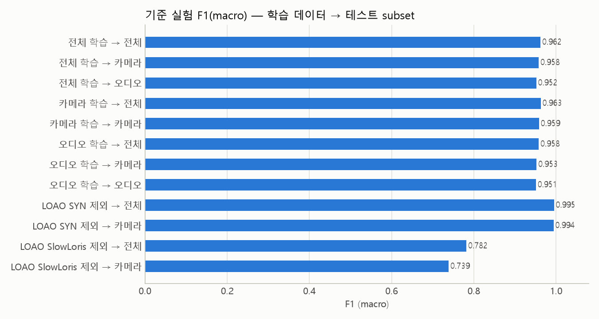
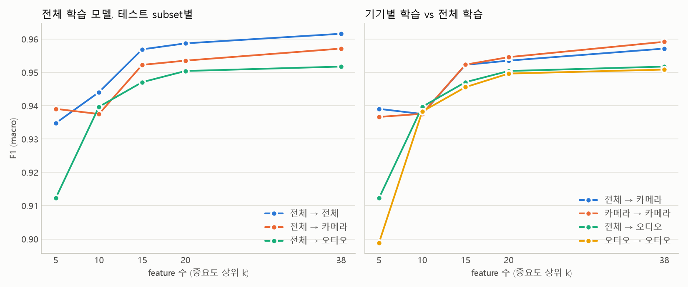
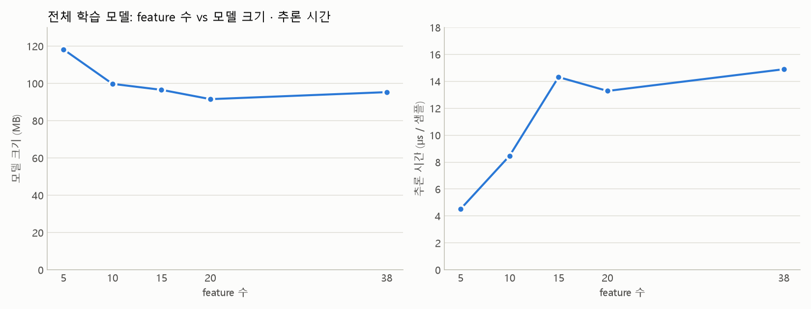
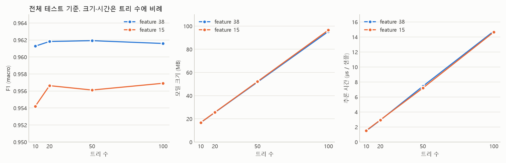
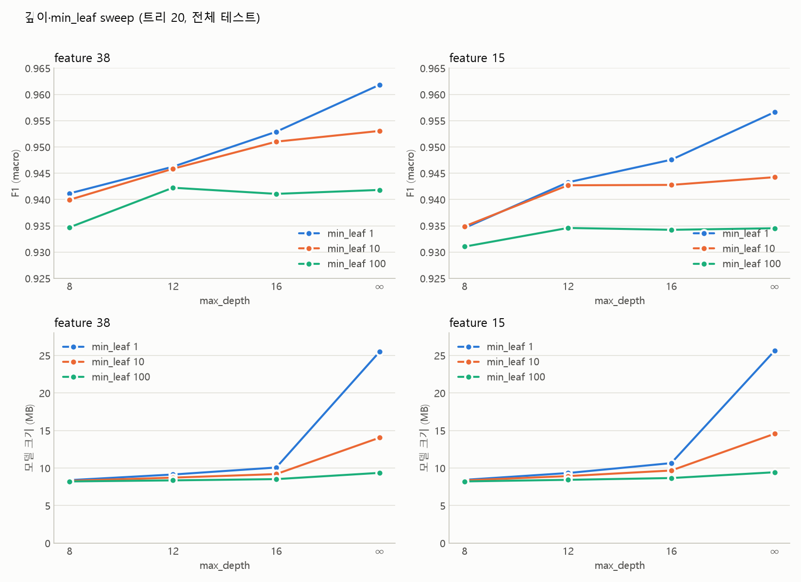
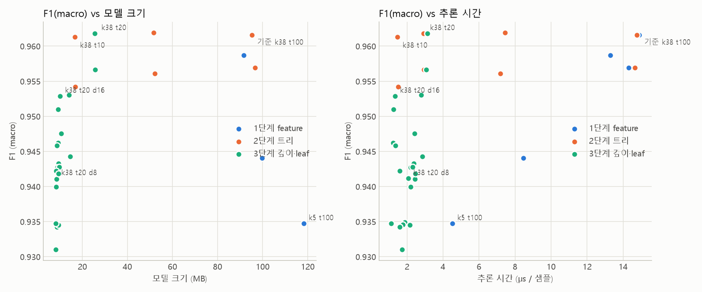
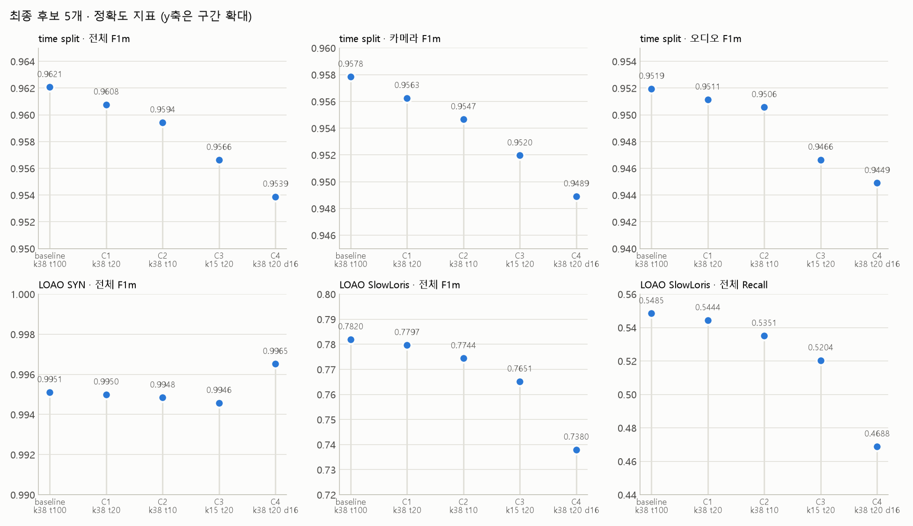
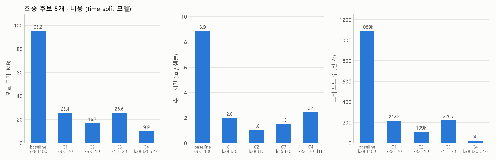

# RF 실험 결과 전체 정리

모든 결과는 각 PCAP 캡처의 **첫 2 GB 청크**(HTTP_Flood, SlowLoris, BenignTraffic3는 원본 전체)에서 추출한 20,990,150개 윈도우 기준. 학습은 무작위 100만 행, 평가는 테스트 전체. 표의 값은 `results/tables/*.csv`를 그대로 옮긴 것이며 생략한 실험은 없다. 이 문서와 그림은 `python src/report_all_results.py`로 다시 만들 수 있다.

## 0. 실험 설계 요약

**조합 수.** feature 5종 × 트리 4종 × 깊이 4종 × min_leaf 3종 = 240개 전체 격자는 돌리지 않았다. 한 번에 한 변수씩 바꾸는 방식으로 아래 **47개 설정**을 학습했고, 마지막에 후보 5개를 평가 3종으로 재학습(15회)했다.

| 단계 | 바꾼 변수 | 고정 | 학습 모델 수 |
|---|---|---|---:|
| 1단계 feature | feature 5/10/15/20/38 × 학습 데이터(전체/카메라/오디오) | 트리 100, 깊이 ∞, leaf 1 | 15 |
| 2단계 트리 | 트리 10/20/50/100 × feature 15/38 | 깊이 ∞, leaf 1, 전체 학습 | 8 |
| 3단계 깊이 | 깊이 8/12/16/∞ × min_leaf 1/10/100 × feature 15/38 | 트리 20, 전체 학습 | 24 |
| 4단계 최종 | 후보 5개 × (time split, LOAO-SYN, LOAO-SlowLoris) |  | 15 |

**변수 값을 정한 기준.** 설계 당시 기준이며 `docs/LOG.md`에는 값만 기록돼 있다.

| 변수 | 값 | 기준 |
|---|---|---|
| feature 수 | 5 / 10 / 15 / 20 / 38 | `rf_v1` 중요도 순위 상위 k개. 38 = 전체. |
| 트리 수 | 10 / 20 / 50 / 100 | 100 = scikit-learn 기본값이자 기준 모델. 추론시간·모델 크기가 트리 수에 정비례하므로 100에서 절반씩 줄여 10배 범위를 4점으로 봄. 10 미만은 앙상블이라 보기 어려워 제외. |
| 깊이 | ∞ / 16 / 12 / 8 | ∞ = 기본값(실제 트리 깊이 77~85). 트리당 리프 수 상한이 2^깊이(8→256, 12→4k, 16→65k)라 노드 수가 수십 배 줄어드는 구간을 4 간격으로 잡음. 20 이상은 ∞와 노드 수 차이가 작을 것으로 보고 제외(추정). |
| min_leaf | 1 / 10 / 100 | 1 = 기본값. 10배 간격 2점. 깊이와 같은 "트리 크기 제한" 변수라 3단계에서 깊이와 함께 격자로 봄. |
| 2·3단계의 feature | 15, 38 | 1단계에서 F1 손실 0.5%p 이내인 최소값(15)과 전체(38). |
| 3단계의 트리 | 20 | 2단계에서 F1 손실 없이 가장 적은 트리 수. |
| 학습 행 수 | 100만 (무작위) | 학습 가능 행 1,469만 중 메모리·시간 제약으로 상한. 1단계 카메라 학습 모델이 650 MB까지 커진 원인이기도 함. |
| class_weight | balanced | DDoS : Benign = 18 : 1 불균형 보정. |
| split | 파일별 시간순 70/30 | 같은 파일의 앞뒤를 섞어 평가하는 시간 누수 방지. |
| LOAO 공격 | SYN_Flood, SlowLoris | 대량 flood 대표 1종 + 저속 공격 대표 1종을 학습에서 빼고 평가. |
| 평가 subset | all / camera / audio (+ echo_dot1, amcrest) | 카메라 = 정상 트래픽 최다 기기 종류, 오디오 = DDoS 피해 최다. sweep은 앞 3개, 단일 학습(`train_rf.py`)은 5개 모두 평가. |
| seed | 42, 설정당 1회 | 반복 없음. 같은 설정(k38 t20)이 2단계 0.9618, 4단계 0.9608로 실행 간 약 0.001 차이. |
| 지표 | F1(macro) 우선 | Accuracy는 DDoS 95%인 데이터에서 아무것도 안 해도 0.95라 의미가 약함. |

## 1. 기준 실험 (9/25~26): 전체 vs 기기별 학습, LOAO

트리 100, feature 38, 깊이 ∞. `rf_v1.csv`, `rf_v1_cam.csv`, `rf_v1_audio.csv`, `rf_loao_syn.csv`, `rf_loao_slowloris.csv`.

| 실험 | 테스트 subset | 테스트 행 | Acc | Prec | Recall | F1 | F1m | 다수결 Acc | 추론 µs | 모델 MB | 노드 |
|---|---|---:|---:|---:|---:|---:|---:|---:|---:|---:|---:|
| 전체 학습 | 전체 | 6,297,039 | 0.9920 | 0.9996 | 0.9919 | 0.9958 | 0.9621 | 0.9477 | 5.9 | 95.2 | 1,089,338 |
| 전체 학습 | 카메라 | 1,568,271 | 0.9713 | 0.9991 | 0.9648 | 0.9817 | 0.9578 | 0.7963 | 8.8 | 95.2 | 1,089,338 |
| 전체 학습 | 오디오 | 4,037,863 | 0.9935 | 0.9997 | 0.9935 | 0.9966 | 0.9519 | 0.9679 | 5.4 | 95.2 | 1,089,338 |
| 전체 학습 | Echo Dot 1 | 51,043 | 0.8402 | 0.9890 | 0.7505 | 0.8534 | 0.8389 | 0.6197 | 15.8 | 95.2 | 1,089,338 |
| 전체 학습 | AMCREST | 1,143,162 | 0.9986 | 0.9999 | 0.9986 | 0.9993 | 0.9567 | 0.9925 | 5.1 | 95.2 | 1,089,338 |
| 카메라 학습 | 전체 | 6,297,039 | 0.9922 | 0.9994 | 0.9923 | 0.9958 | 0.9627 | 0.9477 | 12.7 | 649.3 | 8,016,030 |
| 카메라 학습 | 카메라 | 1,568,271 | 0.9718 | 0.9984 | 0.9662 | 0.9820 | 0.9585 | 0.7963 | 19.6 | 649.3 | 8,016,030 |
| 카메라 학습 | Echo Dot 1 | 51,043 | 0.8464 | 0.9840 | 0.7646 | 0.8605 | 0.8448 | 0.6197 | 26.0 | 649.3 | 8,016,030 |
| 카메라 학습 | AMCREST | 1,143,162 | 0.9988 | 0.9999 | 0.9988 | 0.9994 | 0.9612 | 0.9925 | 5.7 | 649.3 | 8,016,030 |
| 오디오 학습 | 전체 | 6,297,039 | 0.9911 | 0.9994 | 0.9912 | 0.9953 | 0.9579 | 0.9477 | 4.5 | 51.1 | 538,112 |
| 오디오 학습 | 카메라 | 1,568,271 | 0.9676 | 0.9980 | 0.9612 | 0.9793 | 0.9526 | 0.7963 | 6.7 | 51.1 | 538,112 |
| 오디오 학습 | 오디오 | 4,037,863 | 0.9934 | 0.9997 | 0.9934 | 0.9966 | 0.9511 | 0.9679 | 4.2 | 51.1 | 538,112 |
| 오디오 학습 | Echo Dot 1 | 51,043 | 0.8388 | 0.9878 | 0.7491 | 0.8520 | 0.8375 | 0.6197 | 12.0 | 51.1 | 538,112 |
| 오디오 학습 | AMCREST | 1,143,162 | 0.9986 | 0.9999 | 0.9986 | 0.9993 | 0.9561 | 0.9925 | 3.2 | 51.1 | 538,112 |
| LOAO SYN 제외 | 전체 | 2,988,514 | 0.9981 | 0.9988 | 0.9991 | 0.9989 | 0.9951 | 0.8898 | 6.4 | 104.2 | 1,202,044 |
| LOAO SYN 제외 | 카메라 | 644,597 | 0.9940 | 0.9945 | 0.9936 | 0.9940 | 0.9940 | 0.5044 | 16.9 | 104.2 | 1,202,044 |
| LOAO SYN 제외 | Echo Dot 1 | 816,586 | 0.9992 | 0.9994 | 0.9997 | 0.9996 | 0.9908 | 0.9762 | 4.7 | 104.2 | 1,202,044 |
| LOAO SYN 제외 | AMCREST | 302,649 | 0.9994 | 0.9996 | 0.9998 | 0.9997 | 0.9942 | 0.9716 | 5.6 | 104.2 | 1,202,044 |
| LOAO SlowLoris 제외 | 전체 | 563,264 | 0.8092 | 0.9859 | 0.5485 | 0.7048 | 0.7820 | 0.5847 | 14.7 | 43.8 | 446,484 |
| LOAO SlowLoris 제외 | 카메라 | 498,620 | 0.7988 | 0.9907 | 0.4443 | 0.6135 | 0.7387 | 0.6407 | 16.2 | 43.8 | 446,484 |
| LOAO SlowLoris 제외 | Echo Dot 1 | 22,487 | 0.8809 | 0.6985 | 0.2281 | 0.3439 | 0.6392 | 0.8632 | 18.6 | 43.8 | 446,484 |
| LOAO SlowLoris 제외 | AMCREST | 19,123 | 0.8519 | 0.9912 | 0.7375 | 0.8457 | 0.8516 | 0.5506 | 14.4 | 43.8 | 446,484 |

## 2. 1단계 feature 수 (sweep_features.csv, 45행)

트리 100, 깊이 ∞, leaf 1. 학습 데이터 3종 × feature 5종 = 15개 모델, 각각 전체/카메라/오디오 테스트.

| feature | 트리 | 깊이 | leaf | 학습 | 테스트 | 테스트 행 | Acc | Prec | Recall | F1 | F1m | 추론 µs | samples/s | 모델 MB | 노드 | 학습 s |
|---:|---:|---:|---:|---|---|---:|---:|---:|---:|---:|---:|---:|---:|---:|---:|---:|
| 5 | 100 | ∞ | 1 | 전체 | 전체 | 6,297,039 | 0.9857 | 0.9987 | 0.9861 | 0.9924 | 0.9347 | 4.5 | 221k | 118.2 | 1,377,528 | 49.9 |
| 5 | 100 | ∞ | 1 | 전체 | 카메라 | 1,568,271 | 0.9580 | 0.9957 | 0.9513 | 0.9730 | 0.9391 | 9.6 | 104k | 118.2 | 1,377,528 | 49.9 |
| 5 | 100 | ∞ | 1 | 전체 | 오디오 | 4,037,863 | 0.9875 | 0.9985 | 0.9886 | 0.9935 | 0.9123 | 4.4 | 229k | 118.2 | 1,377,528 | 49.9 |
| 5 | 100 | ∞ | 1 | 카메라 | 전체 | 6,297,039 | 0.9865 | 0.9978 | 0.9880 | 0.9929 | 0.9373 | 10.9 | 92k | 699.5 | 8,643,196 | 128.3 |
| 5 | 100 | ∞ | 1 | 카메라 | 카메라 | 1,568,271 | 0.9566 | 0.9920 | 0.9532 | 0.9722 | 0.9366 | 19.3 | 52k | 699.5 | 8,643,196 | 128.3 |
| 5 | 100 | ∞ | 1 | 카메라 | 오디오 | 4,037,863 | 0.9893 | 0.9977 | 0.9912 | 0.9945 | 0.9214 | 5.2 | 193k | 699.5 | 8,643,196 | 128.3 |
| 5 | 100 | ∞ | 1 | 오디오 | 전체 | 6,297,039 | 0.9818 | 0.9983 | 0.9824 | 0.9903 | 0.9190 | 3.8 | 261k | 72.3 | 803,644 | 50.3 |
| 5 | 100 | ∞ | 1 | 오디오 | 카메라 | 1,568,271 | 0.9477 | 0.9935 | 0.9405 | 0.9663 | 0.9250 | 6.0 | 168k | 72.3 | 803,644 | 50.3 |
| 5 | 100 | ∞ | 1 | 오디오 | 오디오 | 4,037,863 | 0.9850 | 0.9988 | 0.9857 | 0.9922 | 0.8989 | 3.3 | 300k | 72.3 | 803,644 | 50.3 |
| 10 | 100 | ∞ | 1 | 전체 | 전체 | 6,297,039 | 0.9878 | 0.9993 | 0.9878 | 0.9935 | 0.9441 | 8.5 | 118k | 99.8 | 1,146,492 | 96.0 |
| 10 | 100 | ∞ | 1 | 전체 | 카메라 | 1,568,271 | 0.9566 | 0.9980 | 0.9473 | 0.9720 | 0.9375 | 8.4 | 119k | 99.8 | 1,146,492 | 96.0 |
| 10 | 100 | ∞ | 1 | 전체 | 오디오 | 4,037,863 | 0.9917 | 0.9994 | 0.9920 | 0.9957 | 0.9397 | 5.1 | 194k | 99.8 | 1,146,492 | 96.0 |
| 10 | 100 | ∞ | 1 | 카메라 | 전체 | 6,297,039 | 0.9880 | 0.9984 | 0.9889 | 0.9936 | 0.9440 | 9.0 | 111k | 678.3 | 8,377,838 | 360.1 |
| 10 | 100 | ∞ | 1 | 카메라 | 카메라 | 1,568,271 | 0.9570 | 0.9944 | 0.9514 | 0.9724 | 0.9376 | 19.2 | 52k | 678.3 | 8,377,838 | 360.1 |
| 10 | 100 | ∞ | 1 | 카메라 | 오디오 | 4,037,863 | 0.9920 | 0.9989 | 0.9928 | 0.9958 | 0.9407 | 8.8 | 114k | 678.3 | 8,377,838 | 360.1 |
| 10 | 100 | ∞ | 1 | 오디오 | 전체 | 6,297,039 | 0.9874 | 0.9991 | 0.9876 | 0.9933 | 0.9419 | 4.3 | 230k | 54.7 | 582,856 | 63.0 |
| 10 | 100 | ∞ | 1 | 오디오 | 카메라 | 1,568,271 | 0.9553 | 0.9969 | 0.9468 | 0.9712 | 0.9356 | 6.4 | 157k | 54.7 | 582,856 | 63.0 |
| 10 | 100 | ∞ | 1 | 오디오 | 오디오 | 4,037,863 | 0.9914 | 0.9995 | 0.9917 | 0.9956 | 0.9382 | 5.6 | 180k | 54.7 | 582,856 | 63.0 |
| 15 | 100 | ∞ | 1 | 전체 | 전체 | 6,297,039 | 0.9908 | 0.9995 | 0.9908 | 0.9951 | 0.9569 | 14.3 | 70k | 96.6 | 1,106,430 | 90.7 |
| 15 | 100 | ∞ | 1 | 전체 | 카메라 | 1,568,271 | 0.9673 | 0.9988 | 0.9601 | 0.9791 | 0.9523 | 22.4 | 45k | 96.6 | 1,106,430 | 90.7 |
| 15 | 100 | ∞ | 1 | 전체 | 오디오 | 4,037,863 | 0.9928 | 0.9996 | 0.9930 | 0.9963 | 0.9471 | 13.7 | 73k | 96.6 | 1,106,430 | 90.7 |
| 15 | 100 | ∞ | 1 | 카메라 | 전체 | 6,297,039 | 0.9909 | 0.9993 | 0.9912 | 0.9952 | 0.9572 | 17.8 | 56k | 658.1 | 8,125,658 | 195.0 |
| 15 | 100 | ∞ | 1 | 카메라 | 카메라 | 1,568,271 | 0.9674 | 0.9981 | 0.9610 | 0.9792 | 0.9523 | 33.3 | 30k | 658.1 | 8,125,658 | 195.0 |
| 15 | 100 | ∞ | 1 | 카메라 | 오디오 | 4,037,863 | 0.9933 | 0.9995 | 0.9936 | 0.9965 | 0.9504 | 16.0 | 63k | 658.1 | 8,125,658 | 195.0 |
| 15 | 100 | ∞ | 1 | 오디오 | 전체 | 6,297,039 | 0.9898 | 0.9992 | 0.9901 | 0.9946 | 0.9523 | 10.2 | 98k | 52.0 | 550,044 | 71.8 |
| 15 | 100 | ∞ | 1 | 오디오 | 카메라 | 1,568,271 | 0.9637 | 0.9973 | 0.9570 | 0.9767 | 0.9471 | 15.7 | 64k | 52.0 | 550,044 | 71.8 |
| 15 | 100 | ∞ | 1 | 오디오 | 오디오 | 4,037,863 | 0.9925 | 0.9996 | 0.9926 | 0.9961 | 0.9456 | 9.3 | 107k | 52.0 | 550,044 | 71.8 |
| 20 | 100 | ∞ | 1 | 전체 | 전체 | 6,297,039 | 0.9912 | 0.9996 | 0.9911 | 0.9953 | 0.9587 | 13.3 | 75k | 91.6 | 1,043,972 | 99.4 |
| 20 | 100 | ∞ | 1 | 전체 | 카메라 | 1,568,271 | 0.9682 | 0.9991 | 0.9610 | 0.9797 | 0.9535 | 21.1 | 47k | 91.6 | 1,043,972 | 99.4 |
| 20 | 100 | ∞ | 1 | 전체 | 오디오 | 4,037,863 | 0.9933 | 0.9997 | 0.9933 | 0.9965 | 0.9504 | 12.2 | 82k | 91.6 | 1,043,972 | 99.4 |
| 20 | 100 | ∞ | 1 | 카메라 | 전체 | 6,297,039 | 0.9914 | 0.9994 | 0.9916 | 0.9955 | 0.9594 | 17.9 | 56k | 624.2 | 7,702,530 | 221.2 |
| 20 | 100 | ∞ | 1 | 카메라 | 카메라 | 1,568,271 | 0.9690 | 0.9983 | 0.9627 | 0.9802 | 0.9546 | 30.0 | 33k | 624.2 | 7,702,530 | 221.2 |
| 20 | 100 | ∞ | 1 | 카메라 | 오디오 | 4,037,863 | 0.9937 | 0.9996 | 0.9939 | 0.9967 | 0.9533 | 16.0 | 62k | 624.2 | 7,702,530 | 221.2 |
| 20 | 100 | ∞ | 1 | 오디오 | 전체 | 6,297,039 | 0.9901 | 0.9993 | 0.9902 | 0.9947 | 0.9536 | 10.7 | 94k | 49.3 | 515,304 | 76.7 |
| 20 | 100 | ∞ | 1 | 오디오 | 카메라 | 1,568,271 | 0.9638 | 0.9977 | 0.9567 | 0.9768 | 0.9473 | 16.4 | 61k | 49.3 | 515,304 | 76.7 |
| 20 | 100 | ∞ | 1 | 오디오 | 오디오 | 4,037,863 | 0.9931 | 0.9997 | 0.9932 | 0.9964 | 0.9496 | 9.5 | 106k | 49.3 | 515,304 | 76.7 |
| 38 | 100 | ∞ | 1 | 전체 | 전체 | 6,297,039 | 0.9919 | 0.9996 | 0.9918 | 0.9957 | 0.9616 | 14.9 | 67k | 95.3 | 1,090,988 | 107.7 |
| 38 | 100 | ∞ | 1 | 전체 | 카메라 | 1,568,271 | 0.9708 | 0.9991 | 0.9642 | 0.9813 | 0.9571 | 22.6 | 44k | 95.3 | 1,090,988 | 107.7 |
| 38 | 100 | ∞ | 1 | 전체 | 오디오 | 4,037,863 | 0.9935 | 0.9997 | 0.9935 | 0.9966 | 0.9517 | 13.3 | 75k | 95.3 | 1,090,988 | 107.7 |
| 38 | 100 | ∞ | 1 | 카메라 | 전체 | 6,297,039 | 0.9923 | 0.9994 | 0.9925 | 0.9959 | 0.9632 | 18.6 | 54k | 649.6 | 8,019,888 | 227.6 |
| 38 | 100 | ∞ | 1 | 카메라 | 카메라 | 1,568,271 | 0.9723 | 0.9983 | 0.9669 | 0.9823 | 0.9592 | 31.3 | 32k | 649.6 | 8,019,888 | 227.6 |
| 38 | 100 | ∞ | 1 | 카메라 | 오디오 | 4,037,863 | 0.9939 | 0.9996 | 0.9941 | 0.9969 | 0.9548 | 16.3 | 61k | 649.6 | 8,019,888 | 227.6 |
| 38 | 100 | ∞ | 1 | 오디오 | 전체 | 6,297,039 | 0.9910 | 0.9994 | 0.9910 | 0.9952 | 0.9574 | 11.2 | 89k | 51.3 | 540,890 | 79.8 |
| 38 | 100 | ∞ | 1 | 오디오 | 카메라 | 1,568,271 | 0.9672 | 0.9981 | 0.9606 | 0.9790 | 0.9520 | 17.9 | 56k | 51.3 | 540,890 | 79.8 |
| 38 | 100 | ∞ | 1 | 오디오 | 오디오 | 4,037,863 | 0.9933 | 0.9998 | 0.9933 | 0.9965 | 0.9508 | 10.1 | 99k | 51.3 | 540,890 | 79.8 |

추론 µs 절대값은 실행 시점 PC 부하에 따라 같은 설정이 5~15 µs로 흔들린다(LOG 9/27). 같은 표 안의 상대 비교만 의미가 있다.

## 3. 2단계 트리 수 (sweep_trees.csv, 24행)

깊이 ∞, leaf 1, 전체 학습. feature 15/38 × 트리 4종 = 8개 모델.

| feature | 트리 | 깊이 | leaf | 학습 | 테스트 | 테스트 행 | Acc | Prec | Recall | F1 | F1m | 추론 µs | samples/s | 모델 MB | 노드 | 학습 s |
|---:|---:|---:|---:|---|---|---:|---:|---:|---:|---:|---:|---:|---:|---:|---:|---:|
| 15 | 10 | ∞ | 1 | 전체 | 전체 | 6,297,039 | 0.9902 | 0.9995 | 0.9901 | 0.9948 | 0.9542 | 1.5 | 659k | 16.8 | 110,106 | 14.1 |
| 15 | 10 | ∞ | 1 | 전체 | 카메라 | 1,568,271 | 0.9650 | 0.9986 | 0.9573 | 0.9775 | 0.9490 | 2.2 | 450k | 16.8 | 110,106 | 14.1 |
| 15 | 10 | ∞ | 1 | 전체 | 오디오 | 4,037,863 | 0.9926 | 0.9996 | 0.9928 | 0.9961 | 0.9456 | 1.4 | 706k | 16.8 | 110,106 | 14.1 |
| 15 | 20 | ∞ | 1 | 전체 | 전체 | 6,297,039 | 0.9908 | 0.9995 | 0.9907 | 0.9951 | 0.9566 | 2.9 | 340k | 25.6 | 220,180 | 23.9 |
| 15 | 20 | ∞ | 1 | 전체 | 카메라 | 1,568,271 | 0.9671 | 0.9987 | 0.9599 | 0.9789 | 0.9520 | 4.3 | 233k | 25.6 | 220,180 | 23.9 |
| 15 | 20 | ∞ | 1 | 전체 | 오디오 | 4,037,863 | 0.9927 | 0.9996 | 0.9929 | 0.9962 | 0.9466 | 2.7 | 369k | 25.6 | 220,180 | 23.9 |
| 15 | 50 | ∞ | 1 | 전체 | 전체 | 6,297,039 | 0.9906 | 0.9995 | 0.9906 | 0.9950 | 0.9561 | 7.2 | 139k | 52.1 | 551,238 | 48.3 |
| 15 | 50 | ∞ | 1 | 전체 | 카메라 | 1,568,271 | 0.9666 | 0.9988 | 0.9592 | 0.9786 | 0.9512 | 10.4 | 96k | 52.1 | 551,238 | 48.3 |
| 15 | 50 | ∞ | 1 | 전체 | 오디오 | 4,037,863 | 0.9928 | 0.9996 | 0.9929 | 0.9962 | 0.9469 | 6.5 | 154k | 52.1 | 551,238 | 48.3 |
| 15 | 100 | ∞ | 1 | 전체 | 전체 | 6,297,039 | 0.9908 | 0.9995 | 0.9908 | 0.9951 | 0.9569 | 14.7 | 68k | 96.6 | 1,106,430 | 88.0 |
| 15 | 100 | ∞ | 1 | 전체 | 카메라 | 1,568,271 | 0.9673 | 0.9988 | 0.9601 | 0.9791 | 0.9523 | 20.9 | 48k | 96.6 | 1,106,430 | 88.0 |
| 15 | 100 | ∞ | 1 | 전체 | 오디오 | 4,037,863 | 0.9928 | 0.9996 | 0.9930 | 0.9963 | 0.9471 | 14.4 | 69k | 96.6 | 1,106,430 | 88.0 |
| 38 | 10 | ∞ | 1 | 전체 | 전체 | 6,297,039 | 0.9918 | 0.9996 | 0.9917 | 0.9957 | 0.9613 | 1.5 | 679k | 16.7 | 108,712 | 15.5 |
| 38 | 10 | ∞ | 1 | 전체 | 카메라 | 1,568,271 | 0.9707 | 0.9990 | 0.9642 | 0.9813 | 0.9570 | 2.2 | 447k | 16.7 | 108,712 | 15.5 |
| 38 | 10 | ∞ | 1 | 전체 | 오디오 | 4,037,863 | 0.9933 | 0.9997 | 0.9934 | 0.9965 | 0.9509 | 1.3 | 756k | 16.7 | 108,712 | 15.5 |
| 38 | 20 | ∞ | 1 | 전체 | 전체 | 6,297,039 | 0.9919 | 0.9996 | 0.9918 | 0.9957 | 0.9618 | 2.9 | 344k | 25.5 | 218,494 | 26.5 |
| 38 | 20 | ∞ | 1 | 전체 | 카메라 | 1,568,271 | 0.9711 | 0.9991 | 0.9646 | 0.9815 | 0.9575 | 4.5 | 224k | 25.5 | 218,494 | 26.5 |
| 38 | 20 | ∞ | 1 | 전체 | 오디오 | 4,037,863 | 0.9934 | 0.9997 | 0.9935 | 0.9966 | 0.9513 | 2.6 | 385k | 25.5 | 218,494 | 26.5 |
| 38 | 50 | ∞ | 1 | 전체 | 전체 | 6,297,039 | 0.9919 | 0.9996 | 0.9919 | 0.9957 | 0.9619 | 7.4 | 135k | 51.7 | 545,542 | 55.3 |
| 38 | 50 | ∞ | 1 | 전체 | 카메라 | 1,568,271 | 0.9711 | 0.9991 | 0.9646 | 0.9815 | 0.9575 | 11.1 | 90k | 51.7 | 545,542 | 55.3 |
| 38 | 50 | ∞ | 1 | 전체 | 오디오 | 4,037,863 | 0.9935 | 0.9997 | 0.9935 | 0.9966 | 0.9518 | 6.5 | 153k | 51.7 | 545,542 | 55.3 |
| 38 | 100 | ∞ | 1 | 전체 | 전체 | 6,297,039 | 0.9919 | 0.9996 | 0.9918 | 0.9957 | 0.9616 | 14.8 | 68k | 95.3 | 1,090,988 | 102.5 |
| 38 | 100 | ∞ | 1 | 전체 | 카메라 | 1,568,271 | 0.9708 | 0.9991 | 0.9642 | 0.9813 | 0.9571 | 22.2 | 45k | 95.3 | 1,090,988 | 102.5 |
| 38 | 100 | ∞ | 1 | 전체 | 오디오 | 4,037,863 | 0.9935 | 0.9997 | 0.9935 | 0.9966 | 0.9517 | 13.2 | 76k | 95.3 | 1,090,988 | 102.5 |

## 4. 3단계 깊이 · min_samples_leaf (sweep_depth.csv, 72행)

트리 20, 전체 학습. feature 15/38 × 깊이 4종 × leaf 3종 = 24개 모델.

| feature | 트리 | 깊이 | leaf | 학습 | 테스트 | 테스트 행 | Acc | Prec | Recall | F1 | F1m | 추론 µs | samples/s | 모델 MB | 노드 | 학습 s |
|---:|---:|---:|---:|---|---|---:|---:|---:|---:|---:|---:|---:|---:|---:|---:|---:|
| 15 | 20 | 8 | 1 | 전체 | 전체 | 6,297,039 | 0.9854 | 0.9999 | 0.9847 | 0.9922 | 0.9346 | 2.1 | 471k | 8.4 | 5,290 | 18.9 |
| 15 | 20 | 8 | 1 | 전체 | 카메라 | 1,568,271 | 0.9519 | 0.9998 | 0.9397 | 0.9689 | 0.9316 | 2.2 | 451k | 8.4 | 5,290 | 18.9 |
| 15 | 20 | 8 | 1 | 전체 | 오디오 | 4,037,863 | 0.9893 | 0.9999 | 0.9891 | 0.9945 | 0.9258 | 2.0 | 498k | 8.4 | 5,290 | 18.9 |
| 15 | 20 | 8 | 10 | 전체 | 전체 | 6,297,039 | 0.9854 | 0.9999 | 0.9848 | 0.9923 | 0.9349 | 1.9 | 533k | 8.4 | 4,340 | 19.9 |
| 15 | 20 | 8 | 10 | 전체 | 카메라 | 1,568,271 | 0.9516 | 0.9999 | 0.9393 | 0.9687 | 0.9312 | 1.9 | 527k | 8.4 | 4,340 | 19.9 |
| 15 | 20 | 8 | 10 | 전체 | 오디오 | 4,037,863 | 0.9895 | 0.9999 | 0.9892 | 0.9945 | 0.9268 | 1.8 | 560k | 8.4 | 4,340 | 19.9 |
| 15 | 20 | 8 | 100 | 전체 | 전체 | 6,297,039 | 0.9845 | 0.9999 | 0.9837 | 0.9917 | 0.9310 | 1.7 | 579k | 8.2 | 2,676 | 17.9 |
| 15 | 20 | 8 | 100 | 전체 | 카메라 | 1,568,271 | 0.9511 | 0.9999 | 0.9388 | 0.9684 | 0.9306 | 1.7 | 599k | 8.2 | 2,676 | 17.9 |
| 15 | 20 | 8 | 100 | 전체 | 오디오 | 4,037,863 | 0.9882 | 0.9999 | 0.9879 | 0.9939 | 0.9192 | 1.6 | 623k | 8.2 | 2,676 | 17.9 |
| 15 | 20 | 12 | 1 | 전체 | 전체 | 6,297,039 | 0.9875 | 0.9998 | 0.9871 | 0.9934 | 0.9433 | 2.4 | 422k | 9.3 | 16,602 | 20.2 |
| 15 | 20 | 12 | 1 | 전체 | 카메라 | 1,568,271 | 0.9562 | 0.9997 | 0.9453 | 0.9717 | 0.9372 | 2.3 | 435k | 9.3 | 16,602 | 20.2 |
| 15 | 20 | 12 | 1 | 전체 | 오디오 | 4,037,863 | 0.9912 | 0.9998 | 0.9911 | 0.9955 | 0.9376 | 2.2 | 445k | 9.3 | 16,602 | 20.2 |
| 15 | 20 | 12 | 10 | 전체 | 전체 | 6,297,039 | 0.9874 | 0.9998 | 0.9868 | 0.9933 | 0.9427 | 2.2 | 453k | 8.9 | 11,550 | 19.4 |
| 15 | 20 | 12 | 10 | 전체 | 카메라 | 1,568,271 | 0.9566 | 0.9998 | 0.9457 | 0.9720 | 0.9378 | 2.3 | 441k | 8.9 | 11,550 | 19.4 |
| 15 | 20 | 12 | 10 | 전체 | 오디오 | 4,037,863 | 0.9907 | 0.9999 | 0.9905 | 0.9952 | 0.9343 | 2.1 | 468k | 8.9 | 11,550 | 19.4 |
| 15 | 20 | 12 | 100 | 전체 | 전체 | 6,297,039 | 0.9854 | 0.9999 | 0.9846 | 0.9922 | 0.9346 | 1.8 | 565k | 8.4 | 5,320 | 18.0 |
| 15 | 20 | 12 | 100 | 전체 | 카메라 | 1,568,271 | 0.9530 | 0.9998 | 0.9411 | 0.9696 | 0.9330 | 1.9 | 515k | 8.4 | 5,320 | 18.0 |
| 15 | 20 | 12 | 100 | 전체 | 오디오 | 4,037,863 | 0.9888 | 0.9999 | 0.9886 | 0.9942 | 0.9230 | 1.7 | 596k | 8.4 | 5,320 | 18.0 |
| 15 | 20 | 16 | 1 | 전체 | 전체 | 6,297,039 | 0.9886 | 0.9997 | 0.9882 | 0.9939 | 0.9476 | 2.4 | 415k | 10.7 | 33,162 | 20.0 |
| 15 | 20 | 16 | 1 | 전체 | 카메라 | 1,568,271 | 0.9594 | 0.9995 | 0.9495 | 0.9738 | 0.9415 | 2.5 | 407k | 10.7 | 33,162 | 20.0 |
| 15 | 20 | 16 | 1 | 전체 | 오디오 | 4,037,863 | 0.9919 | 0.9998 | 0.9919 | 0.9958 | 0.9417 | 2.3 | 427k | 10.7 | 33,162 | 20.0 |
| 15 | 20 | 16 | 10 | 전체 | 전체 | 6,297,039 | 0.9874 | 0.9998 | 0.9869 | 0.9933 | 0.9428 | 2.3 | 433k | 9.7 | 20,822 | 19.6 |
| 15 | 20 | 16 | 10 | 전체 | 카메라 | 1,568,271 | 0.9562 | 0.9997 | 0.9452 | 0.9717 | 0.9373 | 2.6 | 387k | 9.7 | 20,822 | 19.6 |
| 15 | 20 | 16 | 10 | 전체 | 오디오 | 4,037,863 | 0.9910 | 0.9999 | 0.9908 | 0.9953 | 0.9363 | 2.2 | 452k | 9.7 | 20,822 | 19.6 |
| 15 | 20 | 16 | 100 | 전체 | 전체 | 6,297,039 | 0.9853 | 0.9999 | 0.9845 | 0.9922 | 0.9342 | 1.6 | 625k | 8.7 | 8,278 | 18.0 |
| 15 | 20 | 16 | 100 | 전체 | 카메라 | 1,568,271 | 0.9528 | 0.9998 | 0.9409 | 0.9695 | 0.9328 | 2.2 | 461k | 8.7 | 8,278 | 18.0 |
| 15 | 20 | 16 | 100 | 전체 | 오디오 | 4,037,863 | 0.9888 | 0.9999 | 0.9886 | 0.9942 | 0.9230 | 1.8 | 561k | 8.7 | 8,278 | 18.0 |
| 15 | 20 | ∞ | 1 | 전체 | 전체 | 6,297,039 | 0.9908 | 0.9995 | 0.9907 | 0.9951 | 0.9566 | 3.1 | 326k | 25.6 | 220,180 | 22.1 |
| 15 | 20 | ∞ | 1 | 전체 | 카메라 | 1,568,271 | 0.9671 | 0.9987 | 0.9599 | 0.9789 | 0.9520 | 4.7 | 211k | 25.6 | 220,180 | 22.1 |
| 15 | 20 | ∞ | 1 | 전체 | 오디오 | 4,037,863 | 0.9927 | 0.9996 | 0.9929 | 0.9962 | 0.9466 | 3.0 | 336k | 25.6 | 220,180 | 22.1 |
| 15 | 20 | ∞ | 10 | 전체 | 전체 | 6,297,039 | 0.9878 | 0.9998 | 0.9873 | 0.9935 | 0.9442 | 2.9 | 351k | 14.6 | 81,986 | 19.4 |
| 15 | 20 | ∞ | 10 | 전체 | 카메라 | 1,568,271 | 0.9572 | 0.9997 | 0.9466 | 0.9724 | 0.9386 | 4.3 | 231k | 14.6 | 81,986 | 19.4 |
| 15 | 20 | ∞ | 10 | 전체 | 오디오 | 4,037,863 | 0.9912 | 0.9999 | 0.9911 | 0.9955 | 0.9376 | 2.5 | 396k | 14.6 | 81,986 | 19.4 |
| 15 | 20 | ∞ | 100 | 전체 | 전체 | 6,297,039 | 0.9853 | 0.9999 | 0.9846 | 0.9922 | 0.9345 | 2.2 | 462k | 9.4 | 17,918 | 18.3 |
| 15 | 20 | ∞ | 100 | 전체 | 카메라 | 1,568,271 | 0.9533 | 0.9998 | 0.9416 | 0.9698 | 0.9335 | 3.0 | 335k | 9.4 | 17,918 | 18.3 |
| 15 | 20 | ∞ | 100 | 전체 | 오디오 | 4,037,863 | 0.9888 | 0.9999 | 0.9885 | 0.9942 | 0.9226 | 1.9 | 537k | 9.4 | 17,918 | 18.3 |
| 38 | 20 | 8 | 1 | 전체 | 전체 | 6,297,039 | 0.9870 | 0.9999 | 0.9864 | 0.9931 | 0.9412 | 2.1 | 483k | 8.4 | 4,794 | 19.7 |
| 38 | 20 | 8 | 1 | 전체 | 카메라 | 1,568,271 | 0.9557 | 0.9999 | 0.9445 | 0.9714 | 0.9367 | 1.4 | 720k | 8.4 | 4,794 | 19.7 |
| 38 | 20 | 8 | 1 | 전체 | 오디오 | 4,037,863 | 0.9904 | 1.0000 | 0.9901 | 0.9950 | 0.9325 | 1.9 | 538k | 8.4 | 4,794 | 19.7 |
| 38 | 20 | 8 | 10 | 전체 | 전체 | 6,297,039 | 0.9867 | 0.9999 | 0.9861 | 0.9929 | 0.9400 | 2.2 | 455k | 8.3 | 3,712 | 20.1 |
| 38 | 20 | 8 | 10 | 전체 | 카메라 | 1,568,271 | 0.9557 | 0.9999 | 0.9445 | 0.9714 | 0.9367 | 2.1 | 486k | 8.3 | 3,712 | 20.1 |
| 38 | 20 | 8 | 10 | 전체 | 오디오 | 4,037,863 | 0.9900 | 1.0000 | 0.9898 | 0.9948 | 0.9303 | 1.3 | 784k | 8.3 | 3,712 | 20.1 |
| 38 | 20 | 8 | 100 | 전체 | 전체 | 6,297,039 | 0.9854 | 0.9999 | 0.9846 | 0.9922 | 0.9347 | 1.1 | 886k | 8.2 | 2,648 | 17.6 |
| 38 | 20 | 8 | 100 | 전체 | 카메라 | 1,568,271 | 0.9540 | 0.9999 | 0.9423 | 0.9703 | 0.9344 | 1.1 | 896k | 8.2 | 2,648 | 17.6 |
| 38 | 20 | 8 | 100 | 전체 | 오디오 | 4,037,863 | 0.9885 | 0.9999 | 0.9881 | 0.9940 | 0.9208 | 1.2 | 822k | 8.2 | 2,648 | 17.6 |
| 38 | 20 | 12 | 1 | 전체 | 전체 | 6,297,039 | 0.9882 | 0.9999 | 0.9877 | 0.9938 | 0.9462 | 1.2 | 822k | 9.1 | 14,168 | 18.9 |
| 38 | 20 | 12 | 1 | 전체 | 카메라 | 1,568,271 | 0.9582 | 0.9998 | 0.9477 | 0.9730 | 0.9399 | 1.7 | 604k | 9.1 | 14,168 | 18.9 |
| 38 | 20 | 12 | 1 | 전체 | 오디오 | 4,037,863 | 0.9917 | 0.9999 | 0.9915 | 0.9957 | 0.9408 | 1.5 | 689k | 9.1 | 14,168 | 18.9 |
| 38 | 20 | 12 | 10 | 전체 | 전체 | 6,297,039 | 0.9881 | 0.9999 | 0.9876 | 0.9937 | 0.9459 | 1.4 | 738k | 8.7 | 8,960 | 18.9 |
| 38 | 20 | 12 | 10 | 전체 | 카메라 | 1,568,271 | 0.9583 | 0.9998 | 0.9478 | 0.9731 | 0.9401 | 1.2 | 808k | 8.7 | 8,960 | 18.9 |
| 38 | 20 | 12 | 10 | 전체 | 오디오 | 4,037,863 | 0.9915 | 0.9999 | 0.9912 | 0.9956 | 0.9391 | 1.6 | 636k | 8.7 | 8,960 | 18.9 |
| 38 | 20 | 12 | 100 | 전체 | 전체 | 6,297,039 | 0.9873 | 0.9999 | 0.9867 | 0.9932 | 0.9422 | 1.6 | 627k | 8.4 | 4,414 | 19.7 |
| 38 | 20 | 12 | 100 | 전체 | 카메라 | 1,568,271 | 0.9567 | 0.9999 | 0.9457 | 0.9721 | 0.9380 | 1.2 | 846k | 8.4 | 4,414 | 19.7 |
| 38 | 20 | 12 | 100 | 전체 | 오디오 | 4,037,863 | 0.9904 | 1.0000 | 0.9901 | 0.9950 | 0.9325 | 1.2 | 837k | 8.4 | 4,414 | 19.7 |
| 38 | 20 | 16 | 1 | 전체 | 전체 | 6,297,039 | 0.9898 | 0.9998 | 0.9895 | 0.9946 | 0.9529 | 1.3 | 752k | 10.1 | 25,810 | 20.9 |
| 38 | 20 | 16 | 1 | 전체 | 카메라 | 1,568,271 | 0.9636 | 0.9997 | 0.9546 | 0.9766 | 0.9473 | 1.3 | 790k | 10.1 | 25,810 | 20.9 |
| 38 | 20 | 16 | 1 | 전체 | 오디오 | 4,037,863 | 0.9925 | 0.9999 | 0.9924 | 0.9961 | 0.9459 | 1.6 | 631k | 10.1 | 25,810 | 20.9 |
| 38 | 20 | 16 | 10 | 전체 | 전체 | 6,297,039 | 0.9894 | 0.9999 | 0.9889 | 0.9944 | 0.9510 | 1.2 | 803k | 9.2 | 14,870 | 20.8 |
| 38 | 20 | 16 | 10 | 전체 | 카메라 | 1,568,271 | 0.9624 | 0.9998 | 0.9529 | 0.9758 | 0.9456 | 1.3 | 764k | 9.2 | 14,870 | 20.8 |
| 38 | 20 | 16 | 10 | 전체 | 오디오 | 4,037,863 | 0.9920 | 0.9999 | 0.9918 | 0.9959 | 0.9427 | 1.7 | 590k | 9.2 | 14,870 | 20.8 |
| 38 | 20 | 16 | 100 | 전체 | 전체 | 6,297,039 | 0.9870 | 0.9999 | 0.9864 | 0.9931 | 0.9411 | 2.4 | 409k | 8.5 | 6,482 | 21.5 |
| 38 | 20 | 16 | 100 | 전체 | 카메라 | 1,568,271 | 0.9554 | 0.9999 | 0.9442 | 0.9712 | 0.9363 | 2.8 | 353k | 8.5 | 6,482 | 21.5 |
| 38 | 20 | 16 | 100 | 전체 | 오디오 | 4,037,863 | 0.9905 | 0.9999 | 0.9903 | 0.9951 | 0.9333 | 2.3 | 432k | 8.5 | 6,482 | 21.5 |
| 38 | 20 | ∞ | 1 | 전체 | 전체 | 6,297,039 | 0.9919 | 0.9996 | 0.9918 | 0.9957 | 0.9618 | 3.1 | 318k | 25.5 | 218,494 | 24.2 |
| 38 | 20 | ∞ | 1 | 전체 | 카메라 | 1,568,271 | 0.9711 | 0.9991 | 0.9646 | 0.9815 | 0.9575 | 5.1 | 196k | 25.5 | 218,494 | 24.2 |
| 38 | 20 | ∞ | 1 | 전체 | 오디오 | 4,037,863 | 0.9934 | 0.9997 | 0.9935 | 0.9966 | 0.9513 | 2.9 | 344k | 25.5 | 218,494 | 24.2 |
| 38 | 20 | ∞ | 10 | 전체 | 전체 | 6,297,039 | 0.9899 | 0.9999 | 0.9894 | 0.9946 | 0.9531 | 2.8 | 359k | 14.0 | 75,464 | 22.8 |
| 38 | 20 | ∞ | 10 | 전체 | 카메라 | 1,568,271 | 0.9641 | 0.9998 | 0.9551 | 0.9769 | 0.9479 | 3.9 | 255k | 14.0 | 75,464 | 22.8 |
| 38 | 20 | ∞ | 10 | 전체 | 오디오 | 4,037,863 | 0.9922 | 0.9999 | 0.9920 | 0.9960 | 0.9439 | 2.5 | 398k | 14.0 | 75,464 | 22.8 |
| 38 | 20 | ∞ | 100 | 전체 | 전체 | 6,297,039 | 0.9872 | 0.9999 | 0.9866 | 0.9932 | 0.9418 | 2.5 | 407k | 9.4 | 16,912 | 21.9 |
| 38 | 20 | ∞ | 100 | 전체 | 카메라 | 1,568,271 | 0.9564 | 0.9999 | 0.9454 | 0.9719 | 0.9376 | 3.1 | 322k | 9.4 | 16,912 | 21.9 |
| 38 | 20 | ∞ | 100 | 전체 | 오디오 | 4,037,863 | 0.9905 | 0.9999 | 0.9903 | 0.9951 | 0.9332 | 2.3 | 426k | 9.4 | 16,912 | 21.9 |

## 5. sweep 전체 trade-off (47개 설정, 전체 학습·전체 테스트)

1~3단계의 전체-학습 모델을 한 그림에 모은 것. 같은 설정(k38 t20 d∞ l1, k15 t20 d∞ l1, k38 t100, k15 t100)이 두 단계에 중복으로 들어 있어 점은 47개보다 적어 보일 수 있다.

## 6. 4단계 최종 후보 재검증 (final_candidates.csv, 75행)

후보 5개를 time split(5 subset) + LOAO-SYN(5 subset) + LOAO-SlowLoris(5 subset)로 재학습·평가. 같은 실행 묶음에서 측정했으므로 추론 µs는 이 표 안에서만 비교.

| 후보 | 평가 | 테스트 | feature | 트리 | 깊이 | 테스트 행 | Acc | Prec | Recall | F1 | F1m | 추론 µs | samples/s | 모델 MB | 노드 | 학습 s |
|---|---|---|---:|---:|---:|---:|---:|---:|---:|---:|---:|---:|---:|---:|---:|---:|
| baseline | time split | 전체 | 38 | 100 | ∞ | 6,297,039 | 0.9920 | 0.9996 | 0.9919 | 0.9958 | 0.9621 | 8.9 | 113k | 95.2 | 1,089,338 | 109.4 |
| baseline | time split | 카메라 | 38 | 100 | ∞ | 1,568,271 | 0.9713 | 0.9991 | 0.9648 | 0.9817 | 0.9578 | 12.8 | 78k | 95.2 | 1,089,338 | 109.4 |
| baseline | time split | 오디오 | 38 | 100 | ∞ | 4,037,863 | 0.9935 | 0.9997 | 0.9935 | 0.9966 | 0.9519 | 8.1 | 124k | 95.2 | 1,089,338 | 109.4 |
| baseline | time split | Echo Dot 1 | 38 | 100 | ∞ | 51,043 | 0.8402 | 0.9890 | 0.7505 | 0.8534 | 0.8389 | 18.3 | 55k | 95.2 | 1,089,338 | 109.4 |
| baseline | time split | AMCREST | 38 | 100 | ∞ | 1,143,162 | 0.9986 | 0.9999 | 0.9986 | 0.9993 | 0.9567 | 6.5 | 154k | 95.2 | 1,089,338 | 109.4 |
| baseline | LOAO SYN | 전체 | 38 | 100 | ∞ | 2,988,514 | 0.9981 | 0.9988 | 0.9991 | 0.9989 | 0.9951 | 18.7 | 54k | 104.2 | 1,202,044 | 106.0 |
| baseline | LOAO SYN | 카메라 | 38 | 100 | ∞ | 644,597 | 0.9940 | 0.9945 | 0.9936 | 0.9940 | 0.9940 | 35.9 | 28k | 104.2 | 1,202,044 | 106.0 |
| baseline | LOAO SYN | 오디오 | 38 | 100 | ∞ | 2,501,817 | 0.9986 | 0.9993 | 0.9992 | 0.9993 | 0.9928 | 11.3 | 88k | 104.2 | 1,202,044 | 106.0 |
| baseline | LOAO SYN | Echo Dot 1 | 38 | 100 | ∞ | 816,586 | 0.9992 | 0.9994 | 0.9997 | 0.9996 | 0.9908 | 10.2 | 98k | 104.2 | 1,202,044 | 106.0 |
| baseline | LOAO SYN | AMCREST | 38 | 100 | ∞ | 302,649 | 0.9994 | 0.9996 | 0.9998 | 0.9997 | 0.9942 | 9.9 | 101k | 104.2 | 1,202,044 | 106.0 |
| baseline | LOAO SlowLoris | 전체 | 38 | 100 | ∞ | 563,264 | 0.8092 | 0.9859 | 0.5485 | 0.7048 | 0.7820 | 35.6 | 28k | 43.8 | 446,484 | 109.2 |
| baseline | LOAO SlowLoris | 카메라 | 38 | 100 | ∞ | 498,620 | 0.7988 | 0.9907 | 0.4443 | 0.6135 | 0.7387 | 36.6 | 27k | 43.8 | 446,484 | 109.2 |
| baseline | LOAO SlowLoris | 오디오 | 38 | 100 | ∞ | 191,565 | 0.8107 | 0.9666 | 0.4275 | 0.5928 | 0.7347 | 38.1 | 26k | 43.8 | 446,484 | 109.2 |
| baseline | LOAO SlowLoris | Echo Dot 1 | 38 | 100 | ∞ | 22,487 | 0.8809 | 0.6985 | 0.2281 | 0.3439 | 0.6392 | 39.1 | 26k | 43.8 | 446,484 | 109.2 |
| baseline | LOAO SlowLoris | AMCREST | 38 | 100 | ∞ | 19,123 | 0.8519 | 0.9912 | 0.7375 | 0.8457 | 0.8516 | 32.9 | 30k | 43.8 | 446,484 | 109.2 |
| C1 | time split | 전체 | 38 | 20 | ∞ | 6,297,039 | 0.9917 | 0.9996 | 0.9916 | 0.9956 | 0.9608 | 2.0 | 504k | 25.4 | 217,946 | 30.5 |
| C1 | time split | 카메라 | 38 | 20 | ∞ | 1,568,271 | 0.9702 | 0.9991 | 0.9635 | 0.9809 | 0.9563 | 3.2 | 312k | 25.4 | 217,946 | 30.5 |
| C1 | time split | 오디오 | 38 | 20 | ∞ | 4,037,863 | 0.9934 | 0.9997 | 0.9934 | 0.9966 | 0.9511 | 1.5 | 651k | 25.4 | 217,946 | 30.5 |
| C1 | time split | Echo Dot 1 | 38 | 20 | ∞ | 51,043 | 0.8394 | 0.9884 | 0.7497 | 0.8526 | 0.8381 | 5.2 | 193k | 25.4 | 217,946 | 30.5 |
| C1 | time split | AMCREST | 38 | 20 | ∞ | 1,143,162 | 0.9986 | 0.9999 | 0.9986 | 0.9993 | 0.9559 | 2.3 | 441k | 25.4 | 217,946 | 30.5 |
| C1 | LOAO SYN | 전체 | 38 | 20 | ∞ | 2,988,514 | 0.9980 | 0.9987 | 0.9991 | 0.9989 | 0.9950 | 3.4 | 291k | 27.2 | 239,832 | 30.2 |
| C1 | LOAO SYN | 카메라 | 38 | 20 | ∞ | 644,597 | 0.9938 | 0.9941 | 0.9935 | 0.9938 | 0.9938 | 5.2 | 191k | 27.2 | 239,832 | 30.2 |
| C1 | LOAO SYN | 오디오 | 38 | 20 | ∞ | 2,501,817 | 0.9986 | 0.9993 | 0.9992 | 0.9993 | 0.9928 | 1.4 | 694k | 27.2 | 239,832 | 30.2 |
| C1 | LOAO SYN | Echo Dot 1 | 38 | 20 | ∞ | 816,586 | 0.9992 | 0.9995 | 0.9997 | 0.9996 | 0.9910 | 1.3 | 773k | 27.2 | 239,832 | 30.2 |
| C1 | LOAO SYN | AMCREST | 38 | 20 | ∞ | 302,649 | 0.9994 | 0.9996 | 0.9997 | 0.9997 | 0.9943 | 1.6 | 622k | 27.2 | 239,832 | 30.2 |
| C1 | LOAO SlowLoris | 전체 | 38 | 20 | ∞ | 563,264 | 0.8075 | 0.9857 | 0.5444 | 0.7014 | 0.7797 | 4.6 | 216k | 15.1 | 89,150 | 27.8 |
| C1 | LOAO SlowLoris | 카메라 | 38 | 20 | ∞ | 498,620 | 0.7972 | 0.9896 | 0.4402 | 0.6094 | 0.7362 | 3.8 | 264k | 15.1 | 89,150 | 27.8 |
| C1 | LOAO SlowLoris | 오디오 | 38 | 20 | ∞ | 191,565 | 0.8094 | 0.9641 | 0.4245 | 0.5895 | 0.7327 | 4.3 | 233k | 15.1 | 89,150 | 27.8 |
| C1 | LOAO SlowLoris | Echo Dot 1 | 38 | 20 | ∞ | 22,487 | 0.8783 | 0.6638 | 0.2246 | 0.3356 | 0.6343 | 4.2 | 239k | 15.1 | 89,150 | 27.8 |
| C1 | LOAO SlowLoris | AMCREST | 38 | 20 | ∞ | 19,123 | 0.8502 | 0.9910 | 0.7346 | 0.8438 | 0.8500 | 3.2 | 309k | 15.1 | 89,150 | 27.8 |
| C2 | time split | 전체 | 38 | 10 | ∞ | 6,297,039 | 0.9914 | 0.9996 | 0.9913 | 0.9954 | 0.9594 | 1.0 | 984k | 16.7 | 109,082 | 18.5 |
| C2 | time split | 카메라 | 38 | 10 | ∞ | 1,568,271 | 0.9690 | 0.9990 | 0.9621 | 0.9802 | 0.9547 | 1.2 | 817k | 16.7 | 109,082 | 18.5 |
| C2 | time split | 오디오 | 38 | 10 | ∞ | 4,037,863 | 0.9933 | 0.9997 | 0.9934 | 0.9965 | 0.9506 | 0.9 | 1104k | 16.7 | 109,082 | 18.5 |
| C2 | time split | Echo Dot 1 | 38 | 10 | ∞ | 51,043 | 0.8384 | 0.9879 | 0.7484 | 0.8516 | 0.8371 | 2.3 | 434k | 16.7 | 109,082 | 18.5 |
| C2 | time split | AMCREST | 38 | 10 | ∞ | 1,143,162 | 0.9985 | 0.9999 | 0.9986 | 0.9993 | 0.9548 | 0.7 | 1405k | 16.7 | 109,082 | 18.5 |
| C2 | LOAO SYN | 전체 | 38 | 10 | ∞ | 2,988,514 | 0.9980 | 0.9987 | 0.9991 | 0.9989 | 0.9948 | 0.9 | 1092k | 17.6 | 120,002 | 16.6 |
| C2 | LOAO SYN | 카메라 | 38 | 10 | ∞ | 644,597 | 0.9934 | 0.9935 | 0.9935 | 0.9935 | 0.9934 | 2.2 | 460k | 17.6 | 120,002 | 16.6 |
| C2 | LOAO SYN | 오디오 | 38 | 10 | ∞ | 2,501,817 | 0.9986 | 0.9993 | 0.9992 | 0.9992 | 0.9927 | 0.7 | 1370k | 17.6 | 120,002 | 16.6 |
| C2 | LOAO SYN | Echo Dot 1 | 38 | 10 | ∞ | 816,586 | 0.9991 | 0.9994 | 0.9997 | 0.9996 | 0.9905 | 0.7 | 1509k | 17.6 | 120,002 | 16.6 |
| C2 | LOAO SYN | AMCREST | 38 | 10 | ∞ | 302,649 | 0.9994 | 0.9996 | 0.9997 | 0.9997 | 0.9942 | 0.9 | 1163k | 17.6 | 120,002 | 16.6 |
| C2 | LOAO SlowLoris | 전체 | 38 | 10 | ∞ | 563,264 | 0.8035 | 0.9848 | 0.5351 | 0.6934 | 0.7744 | 1.9 | 528k | 11.6 | 44,390 | 16.5 |
| C2 | LOAO SlowLoris | 카메라 | 38 | 10 | ∞ | 498,620 | 0.7929 | 0.9891 | 0.4284 | 0.5979 | 0.7292 | 2.2 | 455k | 11.6 | 44,390 | 16.5 |
| C2 | LOAO SlowLoris | 오디오 | 38 | 10 | ∞ | 191,565 | 0.8068 | 0.9640 | 0.4162 | 0.5814 | 0.7279 | 2.1 | 471k | 11.6 | 44,390 | 16.5 |
| C2 | LOAO SlowLoris | Echo Dot 1 | 38 | 10 | ∞ | 22,487 | 0.8780 | 0.6729 | 0.2112 | 0.3215 | 0.6273 | 2.0 | 507k | 11.6 | 44,390 | 16.5 |
| C2 | LOAO SlowLoris | AMCREST | 38 | 10 | ∞ | 19,123 | 0.8459 | 0.9918 | 0.7261 | 0.8384 | 0.8456 | 3.2 | 311k | 11.6 | 44,390 | 16.5 |
| C3 | time split | 전체 | 15 | 20 | ∞ | 6,297,039 | 0.9908 | 0.9995 | 0.9907 | 0.9951 | 0.9566 | 1.5 | 670k | 25.6 | 220,180 | 19.2 |
| C3 | time split | 카메라 | 15 | 20 | ∞ | 1,568,271 | 0.9671 | 0.9987 | 0.9599 | 0.9789 | 0.9520 | 2.5 | 401k | 25.6 | 220,180 | 19.2 |
| C3 | time split | 오디오 | 15 | 20 | ∞ | 4,037,863 | 0.9927 | 0.9996 | 0.9929 | 0.9962 | 0.9466 | 1.5 | 689k | 25.6 | 220,180 | 19.2 |
| C3 | time split | Echo Dot 1 | 15 | 20 | ∞ | 51,043 | 0.8311 | 0.9776 | 0.7444 | 0.8452 | 0.8296 | 3.5 | 284k | 25.6 | 220,180 | 19.2 |
| C3 | time split | AMCREST | 15 | 20 | ∞ | 1,143,162 | 0.9984 | 0.9999 | 0.9985 | 0.9992 | 0.9522 | 1.4 | 738k | 25.6 | 220,180 | 19.2 |
| C3 | LOAO SYN | 전체 | 15 | 20 | ∞ | 2,988,514 | 0.9979 | 0.9985 | 0.9991 | 0.9988 | 0.9946 | 1.4 | 729k | 27.5 | 243,870 | 18.4 |
| C3 | LOAO SYN | 카메라 | 15 | 20 | ∞ | 644,597 | 0.9932 | 0.9927 | 0.9937 | 0.9932 | 0.9932 | 3.4 | 297k | 27.5 | 243,870 | 18.4 |
| C3 | LOAO SYN | 오디오 | 15 | 20 | ∞ | 2,501,817 | 0.9983 | 0.9990 | 0.9993 | 0.9991 | 0.9913 | 1.2 | 831k | 27.5 | 243,870 | 18.4 |
| C3 | LOAO SYN | Echo Dot 1 | 15 | 20 | ∞ | 816,586 | 0.9987 | 0.9990 | 0.9997 | 0.9993 | 0.9861 | 1.0 | 971k | 27.5 | 243,870 | 18.4 |
| C3 | LOAO SYN | AMCREST | 15 | 20 | ∞ | 302,649 | 0.9993 | 0.9995 | 0.9998 | 0.9996 | 0.9934 | 1.5 | 666k | 27.5 | 243,870 | 18.4 |
| C3 | LOAO SlowLoris | 전체 | 15 | 20 | ∞ | 563,264 | 0.7963 | 0.9793 | 0.5204 | 0.6796 | 0.7651 | 6.5 | 154k | 15.4 | 92,200 | 18.7 |
| C3 | LOAO SlowLoris | 카메라 | 15 | 20 | ∞ | 498,620 | 0.7855 | 0.9833 | 0.4101 | 0.5788 | 0.7175 | 6.5 | 153k | 15.4 | 92,200 | 18.7 |
| C3 | LOAO SlowLoris | 오디오 | 15 | 20 | ∞ | 191,565 | 0.7998 | 0.9372 | 0.4062 | 0.5667 | 0.7183 | 6.8 | 147k | 15.4 | 92,200 | 18.7 |
| C3 | LOAO SlowLoris | Echo Dot 1 | 15 | 20 | ∞ | 22,487 | 0.8602 | 0.4732 | 0.1921 | 0.2732 | 0.5979 | 7.0 | 144k | 15.4 | 92,200 | 18.7 |
| C3 | LOAO SlowLoris | AMCREST | 15 | 20 | ∞ | 19,123 | 0.8304 | 0.9859 | 0.7021 | 0.8201 | 0.8299 | 6.1 | 164k | 15.4 | 92,200 | 18.7 |
| C4 | time split | 전체 | 38 | 20 | 16 | 6,297,039 | 0.9901 | 0.9998 | 0.9897 | 0.9947 | 0.9539 | 2.4 | 412k | 9.9 | 23,726 | 27.1 |
| C4 | time split | 카메라 | 38 | 20 | 16 | 1,568,271 | 0.9648 | 0.9997 | 0.9561 | 0.9774 | 0.9489 | 2.5 | 406k | 9.9 | 23,726 | 27.1 |
| C4 | time split | 오디오 | 38 | 20 | 16 | 4,037,863 | 0.9924 | 0.9999 | 0.9922 | 0.9961 | 0.9449 | 2.4 | 421k | 9.9 | 23,726 | 27.1 |
| C4 | time split | Echo Dot 1 | 38 | 20 | 16 | 51,043 | 0.8290 | 0.9943 | 0.7283 | 0.8407 | 0.8281 | 3.1 | 321k | 9.9 | 23,726 | 27.1 |
| C4 | time split | AMCREST | 38 | 20 | 16 | 1,143,162 | 0.9983 | 1.0000 | 0.9983 | 0.9991 | 0.9478 | 2.0 | 501k | 9.9 | 23,726 | 27.1 |
| C4 | LOAO SYN | 전체 | 38 | 20 | 16 | 2,988,514 | 0.9986 | 0.9995 | 0.9990 | 0.9992 | 0.9965 | 1.9 | 533k | 10.0 | 24,274 | 24.7 |
| C4 | LOAO SYN | 카메라 | 38 | 20 | 16 | 644,597 | 0.9956 | 0.9984 | 0.9929 | 0.9957 | 0.9956 | 2.8 | 363k | 10.0 | 24,274 | 24.7 |
| C4 | LOAO SYN | 오디오 | 38 | 20 | 16 | 2,501,817 | 0.9989 | 0.9997 | 0.9991 | 0.9994 | 0.9947 | 1.7 | 585k | 10.0 | 24,274 | 24.7 |
| C4 | LOAO SYN | Echo Dot 1 | 38 | 20 | 16 | 816,586 | 0.9994 | 0.9998 | 0.9996 | 0.9997 | 0.9936 | 1.7 | 597k | 10.0 | 24,274 | 24.7 |
| C4 | LOAO SYN | AMCREST | 38 | 20 | 16 | 302,649 | 0.9995 | 0.9998 | 0.9997 | 0.9998 | 0.9959 | 1.7 | 598k | 10.0 | 24,274 | 24.7 |
| C4 | LOAO SlowLoris | 전체 | 38 | 20 | 16 | 563,264 | 0.7774 | 0.9899 | 0.4688 | 0.6363 | 0.7380 | 3.3 | 303k | 9.4 | 17,750 | 25.3 |
| C4 | LOAO SlowLoris | 카메라 | 38 | 20 | 16 | 498,620 | 0.7666 | 0.9951 | 0.3521 | 0.5202 | 0.6830 | 3.2 | 313k | 9.4 | 17,750 | 25.3 |
| C4 | LOAO SlowLoris | 오디오 | 38 | 20 | 16 | 191,565 | 0.7897 | 0.9793 | 0.3552 | 0.5213 | 0.6933 | 3.3 | 304k | 9.4 | 17,750 | 25.3 |
| C4 | LOAO SlowLoris | Echo Dot 1 | 38 | 20 | 16 | 22,487 | 0.8761 | 0.7162 | 0.1566 | 0.2571 | 0.5947 | 3.3 | 300k | 9.4 | 17,750 | 25.3 |
| C4 | LOAO SlowLoris | AMCREST | 38 | 20 | 16 | 19,123 | 0.8212 | 0.9954 | 0.6784 | 0.8069 | 0.8202 | 3.6 | 281k | 9.4 | 17,750 | 25.3 |

## 7. 사전 점검 및 Colab 1차 (참고용)

**`rf_test3.csv`** — 파이프라인 점검용. 소규모 데이터셋(`dataset_test3.parquet`, 파일 3개)으로 학습 50만 행. 본 실험과 데이터가 달라 비교 대상이 아님.

| 테스트 | 테스트 행 | Acc | Recall | F1 | F1m | 추론 µs | 모델 MB |
|---|---:|---:|---:|---:|---:|---:|---:|
| 전체 | 992,696 | 0.9966 | 0.9966 | 0.9981 | 0.9915 | 15.2 | 42.1 |
| 카메라 | 408,203 | 0.9939 | 0.9924 | 0.9959 | 0.9920 | 17.8 | 42.1 |
| Echo Dot 1 | 24,080 | 0.9844 | 0.9761 | 0.9866 | 0.9839 | 24.7 | 42.1 |
| AMCREST | 293,995 | 0.9994 | 0.9994 | 0.9997 | 0.9846 | 10.0 | 42.1 |

**Colab 1차 (`data/legacy/rf_full_vs_camera_result.csv`)** — 자체 numpy feature, Benign 파일 1개, 파일당 앞 200만 패킷만 사용. 공식 feature로 바꾸기 전 결과라 본 실험과 직접 비교 불가.

| 실험 | 학습 window 수 | 테스트 window 수 | Accuracy | F1(macro) | 학습시간(초) | 추론시간(ms/1000 window) | 모델크기(MB) |
|---|---:|---:|---:|---:|---:|---:|---:|
| 전체 학습 → 전체 테스트 | 300,000 | 200,000 | 0.9726 | 0.9155 | 23.8000 | 5.1000 | 15.2000 |
| 전체 학습 → Camera 테스트 | 300,000 | 101,686 | 0.8700 | 0.8700 | 23.8000 | 7.5000 | 15.2000 |
| Camera 학습 → Camera 테스트 | 300,000 | 101,686 | 0.8837 | 0.8836 | 40.6000 | 7.4000 | 37.7000 |
