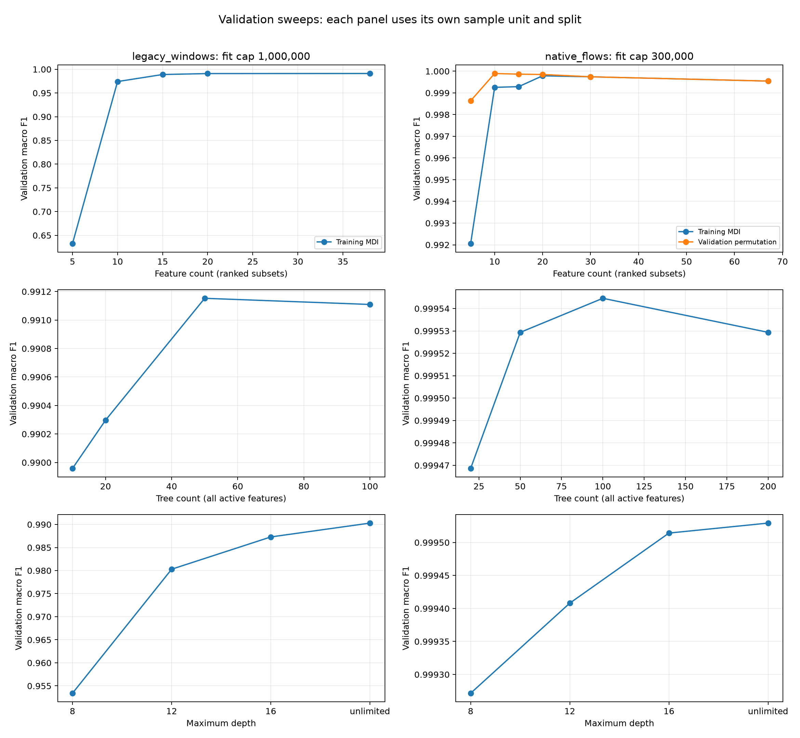
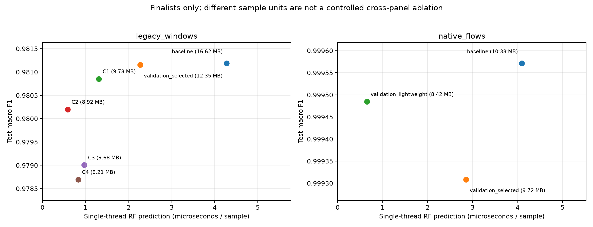

# CICIDS2017 RF 비교

BENIGN/DDoS 이진 분류. DoS·PortScan·Bot 등은 공격 양성에 합치지 않았다.

**모든 표의 학습·평가 데이터는 CICIDS2017이다.** `legacy_windows`는 CICIoT2023에서 쓰던 38특징·10패킷 방식을 CICIDS2017에 적용한 결과이고, `native_flows`는 CICIDS2017 공식 flow 특징으로 새로 실험한 결과다. 이전 CICIoT2023 데이터의 성능 수치가 이 표에 섞여 있지는 않다.

GitHub에는 코드·문서·지표·그림·설정 및 검증 기록을 포함한다. 원본/가공 데이터·모델 joblib·실행 로그는 기존 제외 규칙에 따라 로컬에만 보관한다. `artifact_validation.json`은 로컬에서 저장 모델을 재로딩해 검증한 기록이다.

## 두 표본 단위

- legacy_windows: 기존 38특징·10패킷 방식. 파일·라벨별 앞 70% 중 80%로 fit, 나머지로 validation, 뒤 30%로 test. 기존에 관찰한 테스트를 고정해서 재사용했다.
- native_flows: 공식 CICFlowMeter 수치 특징. IP·port·Flow ID·Timestamp는 입력에서 제외하고 동일 특징 중복 및 라벨 충돌을 제거했다. 같은 날짜의 양방향 5-tuple 전체를 한 분할에 묶고 시간순으로 나눴다.
- flow와 10패킷 윈도우는 표본·라벨 품질·정제·분할이 다르다. 서로의 F1 차이를 특징만 바꾼 순수 효과로 해석하지 않는다. legacy_windows 안의 baseline/C1–C4/선택 모델은 동일 테스트 표본에서 비교한다.

## 선택 방법

특징 순위·상수 제거·결측치 중앙값·설정 선택은 fit/validation에 한정했다. native 탐색은 30만 fit 표본으로 선별하고 상위 3개와 baseline을 최대 100만 fit 표본으로 재검증했다. 최종 후보를 selection.json에 동결한 다음 앞 70%에서 최대 100만 행으로 재학습하고 test를 평가했다. 선택 모델은 seed 42/43/44로 반복했다.
이번 후보 범위의 검증 최고 설정이며, 모든 가능한 특징·설정의 전역 최적해를 보장하지 않는다.

## LOAO

Leave One Attack Out: 공격 한 종류를 학습에서 빼고, 다른 공격으로 학습한 모델이 빠진 공격을 탐지하는지 평가한다. 현재 BENIGN/DDoS 범위에는 DDoS 라벨이 한 종류뿐이다. 이를 빼면 학습 양성이 없어 이진 RF LOAO는 성립하지 않는다. DoS를 DDoS로 바꾸거나 임의 시간 구간을 공격 종류라고 부르지 않았다.

## 결과 (테스트)

`baseline`은 각 방식의 기준선, `validation_selected`는 검증 점수로 선택한 설정(seed 3회 평균), `validation_lightweight`는 검증 성능 손실 한도 안에서 선택한 경량 설정이다. C1=38특징/20트리, C2=38/10, C3=15/20, C4=38/20/깊이16이며 모두 기존 10패킷 방식이다. 전체 후보는 탐색표에, 최종 테스트한 후보는 아래에 표시했다.

| 방식 | 후보 | 특징 | 트리 | macro F1 평균 | DDoS precision | DDoS recall | MB | µs/표본 |
|---|---|---:|---:|---:|---:|---:|---:|---:|
| native_flows | baseline | 67 | 100 | 0.999571 | 0.999575 | 0.998826 | 10.33 | 4.091 |
| native_flows | validation_selected | 10 | 100 | 0.999308 | 0.998518 | 0.998901 | 9.72 | 2.852 |
| native_flows | validation_lightweight | 20 | 20 | 0.999484 | 0.999200 | 0.998876 | 8.42 | 0.650 |
| legacy_windows | baseline | 38 | 100 | 0.981187 | 0.941338 | 0.984904 | 16.62 | 4.275 |
| legacy_windows | validation_selected | 38 | 50 | 0.981154 | 0.941669 | 0.984408 | 12.35 | 2.265 |
| legacy_windows | C1 | 38 | 20 | 0.980853 | 0.941434 | 0.983414 | 9.78 | 1.309 |
| legacy_windows | C2 | 38 | 10 | 0.980199 | 0.941036 | 0.981130 | 8.92 | 0.586 |
| legacy_windows | C3 | 15 | 20 | 0.979006 | 0.936321 | 0.981329 | 9.68 | 0.969 |
| legacy_windows | C4 | 38 | 20 | 0.978695 | 0.929359 | 0.987784 | 9.21 | 0.830 |

공식 특징/시나리오 출처: https://www.unb.ca/cic/datasets/ids-2017.html

설정별 검증 결과는 각 arm의 validation_search.csv, 최종 평가 상세는 final_test.csv, 분할 수와 특징 목록은 protocol.json/partition_audit.csv, 검증 선택은 selection.json에 기록했다.

## 비교 그림

추론 시간은 RF.predict만 측정했다. 패킷 수집, 특징 추출, flow 종료 대기 비용은 포함하지 않는다. 따라서 flow 모델의 RF 추론이 빠르다고 전체 온라인 탐지 지연도 짧다는 뜻은 아니다.

## 추가 해석

- native의 경량 후보는 검증 macro F1 손실 0.001 이내에서 트리 수·특징 수가 적은 설정을 우선하고, 최대 100만 fit 표본으로 검증한 뒤 테스트했다.
- native 그룹 분할은 같은 날짜의 5-tuple 그룹 첫 시각을 정렬 기준으로 삼는다. 그룹 전체를 보존하므로 개별 flow의 시각 경계가 완전히 분리되는 것은 아니며, 두 방식 모두 엄격한 공통 시각 경계의 미래 예측 평가가 아니다.
- seed 42/43/44 반복은 동일 테스트 분할에서 학습 표본 선택·RF 난수의 변동을 본다. 새 데이터셋이나 새 공격에 대한 반복 검증은 아니다.
- 모델 joblib은 RF 객체 단독이 아니라 model, medians, features, selected_columns를 가진 전처리 포함 묶음이다. 원본 후보 열을 features 순서로 배열하고 medians로 결측을 채운 뒤 selected_columns를 선택해 예측한다.
