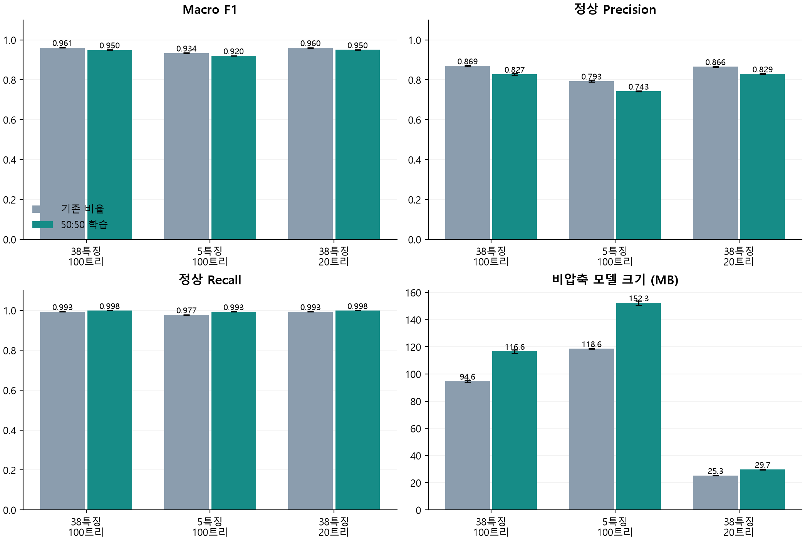
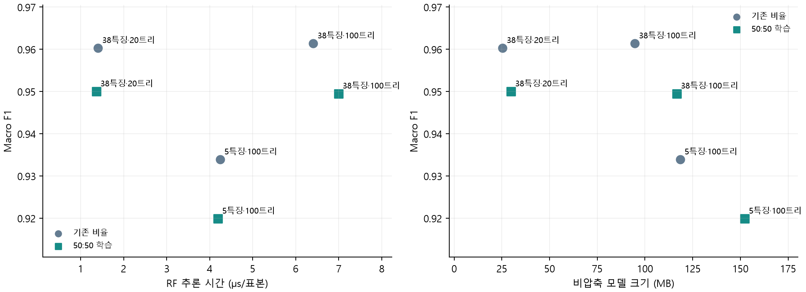

# CICIoT2023 RF 경량화: 동일 학습량에서 클래스 균형의 영향

기존 PCAP 기반 38특징·비중첩 10패킷 데이터를 재사용했다. CICIDS2017이 아닌 CICIoT2023 실험이다. 원본 데이터·특징 계산·파일별 시간순 70/30 분할·테스트는 유지하고, 학습 표본 구성만 비교했다. 기존 결과 파일은 덮어쓰지 않았다.

## 연구 질문과 설계

학습 100만 행을 유지하면서 정상 표본을 약 5만 행에서 50만 행으로 늘리면, 특징 축소 및 트리 축소에 따른 정상/DDoS 성능과 모델 비용이 어떻게 달라지는지 확인했다. 특징 5개·트리 100개와 특징 38개·트리 20개는 서로 다른 경량화 축이다. RF에서는 특징 수 감소가 노드 수나 모델 크기 감소를 보장하지 않는다.

- 대조군: 기존 학습 풀에서 무작위 100만 행. seed 42에서 과거 baseline/top5/C1의 테스트 혼동행렬을 모두 정확히 재현했다.
- 균형군: 같은 학습 풀에서 정상 50만 + DDoS 50만, 중복 추출 없이 선택했다. 총학습량은 100만 행으로 같다.
- 설정: 38특징·100트리 기준선, 고정된 기존 상위 5특징·100트리, 기존 C1인 38특징·20트리. 깊이 무제한·최소 리프 표본 1. 각 구성에 seed 42/43/44를 적용해 총 18개 모델을 학습했다.
- 두 군 모두 class_weight=balanced를 유지했다. 균형군은 클래스 표본 수가 같아 가중치가 1이다. 가중치 보정과 정상 표본의 다양성 증가는 구분한다.
- top5는 기존 RF 중요도 상위 `Tot size`, `Tot sum`, `AVG`, `HTTPS`, `Max`다. 재순위화하지 않아 특징 선택 변경 효과를 섞지 않았다.
- 새로운 설정 선택 없이 사전에 정한 세 후보를 비교했다. 별도 검증 분할을 추가하지 않고 기존 70% 학습 풀을 사용했다. 이미 관찰한 테스트를 재사용한 고정 설정 대조 실험이며 새 holdout이나 검증 선택 실험이 아니다.

## 데이터와 표본 수

전체 20,990,150개 윈도우에서 학습 풀 14,693,111개(정상 768,515 / DDoS 13,924,596)를 사용했다. 테스트는 정상 329,362 / DDoS 5,967,677, 총 6,297,039개로 모든 모델에 동일하다. 테스트를 50:50으로 바꾸지 않았다.

| 학습 구성 | seed | 정상 | DDoS | 합계 |
|---|---|---|---|---|
| 기존 비율 | 42 | 52,219 | 947,781 | 1,000,000 |
| 50:50 학습 | 42 | 500,000 | 500,000 | 1,000,000 |
| 기존 비율 | 43 | 51,945 | 948,055 | 1,000,000 |
| 50:50 학습 | 43 | 500,000 | 500,000 | 1,000,000 |
| 기존 비율 | 44 | 52,163 | 947,837 | 1,000,000 |
| 50:50 학습 | 44 | 500,000 | 500,000 | 1,000,000 |

seed별 학습 인덱스와 고정 테스트 인덱스는 로컬에 보관하고 해시를 protocol/results에 기록했다. 파일·공격별 표본 수는 sampling_audit.csv, 원래 분할은 partition_audit.csv에 기록했다.

## 최종 테스트 결과

지표·비용은 seed 3회 평균이다. macro F1에 표준편차를 병기했다. Precision/Recall은 정상과 DDoS를 구분한다. MB는 RF 객체 비압축 joblib 크기이며 압축 저장 파일 크기는 results.csv의 model_file_mb다.

| 학습 구성 | 후보 | Accuracy | Macro F1 ± SD | 정상 Precision | 정상 Recall | DDoS Recall | MB | µs/표본 |
|---|---|---|---|---|---|---|---|---|
| 기존 비율 | 38특징·100트리 | 0.991832 | 0.961402 ± 0.000657 | 0.869088 | 0.993482 | 0.991740 | 94.63 | 6.408 |
| 기존 비율 | 5특징·100트리 | 0.985472 | 0.933924 ± 0.001521 | 0.793148 | 0.977108 | 0.985934 | 118.57 | 4.244 |
| 기존 비율 | 38특징·20트리 | 0.991585 | 0.960317 ± 0.000835 | 0.865593 | 0.993377 | 0.991486 | 25.32 | 1.405 |
| 50:50 학습 | 38특징·100트리 | 0.989019 | 0.949522 ± 0.001088 | 0.827342 | 0.998436 | 0.988499 | 116.62 | 6.992 |
| 50:50 학습 | 5특징·100트리 | 0.981617 | 0.919911 ± 0.000404 | 0.742534 | 0.992776 | 0.981001 | 152.28 | 4.195 |
| 50:50 학습 | 38특징·20트리 | 0.989143 | 0.950038 ± 0.000718 | 0.828957 | 0.998436 | 0.988630 | 29.74 | 1.364 |

오차 막대는 seed 3회의 표준편차다. 통계적 유의성을 검정한 결과는 아니다. 각 축의 막대는 0부터 표시했다.

## 같은 모델에서 학습 구성 변경 효과

50:50 학습 평균에서 기존 비율 학습 평균을 뺀 값이며 단위는 %p다. 테스트 클래스 구성은 동일하다.

| 후보 | Accuracy 차이 | Macro F1 차이 | 정상 Precision 차이 | 정상 Recall 차이 | DDoS Recall 차이 |
|---|---|---|---|---|---|
| 38특징·100트리 | -0.281 | -1.188 | -4.175 | +0.495 | -0.324 |
| 5특징·100트리 | -0.386 | -1.401 | -5.061 | +1.567 | -0.493 |
| 38특징·20트리 | -0.244 | -1.028 | -3.664 | +0.506 | -0.286 |

정상 Recall 증가는 실제 정상을 DDoS로 오탐하는 비율의 감소를 뜻한다. 정상 Precision 증가는 정상으로 예측한 결과에 DDoS가 섞이는 비율의 감소를 뜻한다. 둘은 서로 다른 지표이므로 정상 Precision을 정상 클래스 정확도라고 부르지 않는다. 혼동행렬은 results.csv의 TN/FP/FN/TP에 기록했다.

## 경량화 해석

각 점은 seed 3회 평균이다. RF 추론 시간은 작을수록, macro F1은 클수록 좋다. 크기와 속도는 서로 다른 비용이므로 각각 표시했다.

균형 학습 안에서 38특징·20트리는 38특징·100트리 대비 macro F1 차이 +0.0516%p, 비압축 모델 크기 116.62 → 29.74 MB, RF 추론 속도 약 5.13배다. 같은 데이터 구성에서 트리 축소의 비용·성능 관계를 보여준다.

균형 학습의 5특징·100트리는 38특징·100트리 대비 macro F1 차이 -2.9611%p, 모델 크기 116.62 → 152.28 MB다. 특징 수뿐 아니라 노드 수·모델 크기를 함께 보고 경량화 여부를 판단해야 한다. 이 결과를 보고 새로운 특징 집합이나 설정을 추가 선택하지 않았다.

## 기존 RF 결과를 수정해야 하는가?

세 후보·세 seed의 9개 대응 비교에서 모두 균형 학습의 macro F1이 낮았다. 정상 Recall은 모든 대응 비교에서 높았다. 따라서 이 테스트에서는 균형 학습이 정상 오탐을 줄이는 대신 DDoS 탐지와 종합 F1을 희생하는 방향으로 나타났다. 기존 결과를 폐기하거나 50:50 학습으로 전면 교체할 근거는 없다. 기존 비율의 38특징·20트리 결과는 유지하고, 균형군은 학습 구성에 따른 오탐·미탐의 교환관계를 보여주는 추가 결과로 보관한다.

이는 세 번의 반복에서 관찰한 결과이며 통계검정에 따른 유의성 주장이나 다른 배포 환경에 대한 보장은 아니다. 정상 오탐 감소가 최우선인 운영 조건에서는 균형군도 검토할 수 있지만, 그 선택 기준은 실제 운영 비용으로 정해야 한다.

## 범위와 한계

- 기존 테스트를 재사용했으므로 새 공격·새 환경에 대한 독립 검증이 아니다. 파일별 시간순 분할은 같은 캡처의 앞뒤 구간 비교이며 모든 연결 단위의 분리나 원본 패킷 전체의 대표성을 보장하지 않는다.
- 학습량을 맞췄지만 클래스 비율·정상 고유 표본 증가·DDoS 표본 감소가 함께 발생한다. 각 요인의 효과를 따로 분리한 실험은 아니다.
- 학습 풀에서만 재표집했다. 전처리 재수행, 테스트 재표집, 기기별 실험, LOAO, 정상 전체+동수 DDoS의 약 154만 행 확장 실험은 포함하지 않았다.
- 속도는 같은 테스트 10만 표본에 대한 단일 스레드 RF.predict, 워밍업 후 5회 중앙값이다. 데이터 수집·특징 추출·edge 장치 비용을 포함하지 않는다. 서로 다른 컴퓨터의 MLP 속도와 직접 비교하지 않는다.
- 이 결과는 RF 특징/트리 축소 결과다. MLP FP32→INT8 양자화 손실의 원인이 불균형이라는 증거는 아니며, 해당 원인은 MLP의 양자화 전후 클래스별 결과로 확인해야 한다.

## 재현과 검증

### 실행별 지표와 혼동행렬

TN=정상을 정상으로 예측, FP=정상을 DDoS로 오탐, FN=DDoS를 정상으로 미탐, TP=DDoS를 탐지한 수다. 아래는 평균이 아닌 각 실행의 실제 정수 개수다.

| 학습 구성 | 후보 | seed | Accuracy | Macro F1 | TN | FP | FN | TP |
|---|---|---|---|---|---|---|---|---|
| 기존 비율 | 38특징·100트리 | 42 | 0.991985 | 0.962073 | 327155 | 2207 | 48262 | 5919415 |
| 기존 비율 | 5특징·100트리 | 42 | 0.985670 | 0.934739 | 321948 | 7414 | 82821 | 5884856 |
| 기존 비율 | 38특징·20트리 | 42 | 0.991690 | 0.960770 | 327124 | 2238 | 50090 | 5917587 |
| 50:50 학습 | 38특징·100트리 | 42 | 0.989147 | 0.950060 | 328874 | 488 | 67853 | 5899824 |
| 50:50 학습 | 5특징·100트리 | 42 | 0.981613 | 0.919897 | 326996 | 2366 | 113419 | 5854258 |
| 50:50 학습 | 38특징·20트리 | 42 | 0.989318 | 0.950779 | 328893 | 469 | 66798 | 5900879 |
| 기존 비율 | 38특징·100트리 | 43 | 0.991822 | 0.961373 | 327344 | 2018 | 49479 | 5918198 |
| 기존 비율 | 5특징·100트리 | 43 | 0.985024 | 0.932169 | 322069 | 7293 | 87011 | 5880666 |
| 기존 비율 | 38특징·20트리 | 43 | 0.991700 | 0.960829 | 327253 | 2109 | 50154 | 5917523 |
| 50:50 학습 | 38특징·100트리 | 43 | 0.988720 | 0.948269 | 328833 | 529 | 70501 | 5897176 |
| 50:50 학습 | 5특징·100트리 | 43 | 0.981509 | 0.919514 | 327027 | 2335 | 114105 | 5853572 |
| 50:50 학습 | 38특징·20트리 | 43 | 0.988977 | 0.949344 | 328857 | 505 | 68908 | 5898769 |
| 기존 비율 | 38특징·100트리 | 44 | 0.991687 | 0.960760 | 327147 | 2215 | 50130 | 5917547 |
| 기존 비율 | 5특징·100트리 | 44 | 0.985722 | 0.934864 | 321450 | 7912 | 81998 | 5885679 |
| 기존 비율 | 38특징·20트리 | 44 | 0.991366 | 0.959353 | 327165 | 2197 | 52174 | 5915503 |
| 50:50 학습 | 38특징·100트리 | 44 | 0.989190 | 0.950236 | 328834 | 528 | 67541 | 5900136 |
| 50:50 학습 | 5특징·100트리 | 44 | 0.981730 | 0.920321 | 326925 | 2437 | 112613 | 5855064 |
| 50:50 학습 | 38특징·20트리 | 44 | 0.989133 | 0.949991 | 328791 | 571 | 67857 | 5899820 |

실행: `.venv/Scripts/python.exe -u src/run_ciciot2023_balanced_rf.py`, 정리: `.venv/Scripts/python.exe src/report_ciciot2023_balanced_rf.py`.

results.csv는 모델별 전체 지표·혼동행렬·비용·학습 표본 해시, summary.csv는 평균·표준편차, paired_deltas.csv는 같은 seed의 구성 간 차이, protocol.json은 입력/코드 해시와 프로토콜, archive_reproduction_*.json은 기존 세 모델 대조군 재현 확인이다. 18개 저장 모델 모두 다시 로드해 예측 일치를 확인했다.

완료 체크포인트 기준 누적 실행 시간: 22.83분(중단 직전 미저장 작업 및 서버 대기시간 제외). 서버 재시작 후 저장된 15개 모델의 결과를 재사용하고 나머지를 실행했다. 원본/가공 데이터·모델 바이너리·인덱스·실행 로그는 로컬에 보관한다.
