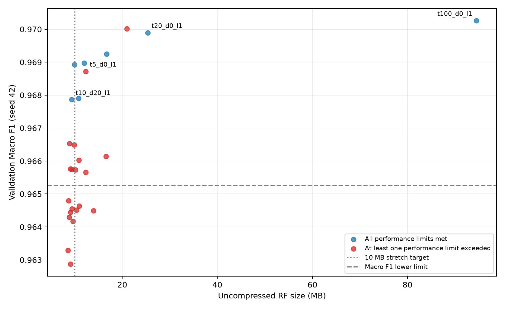
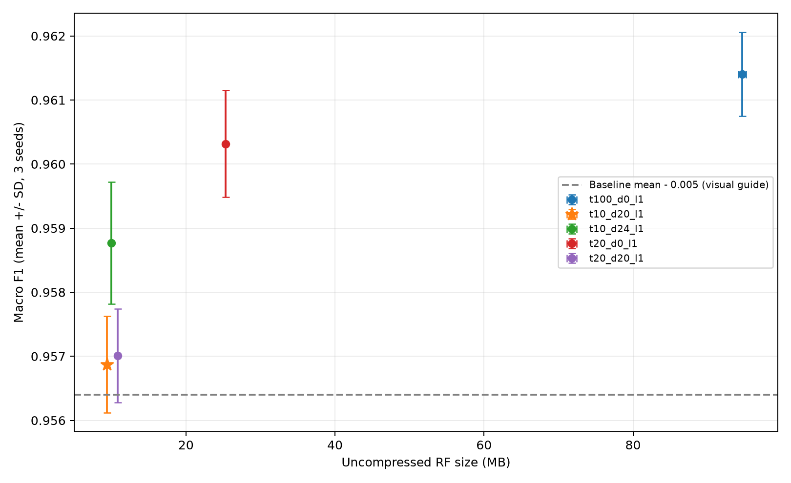
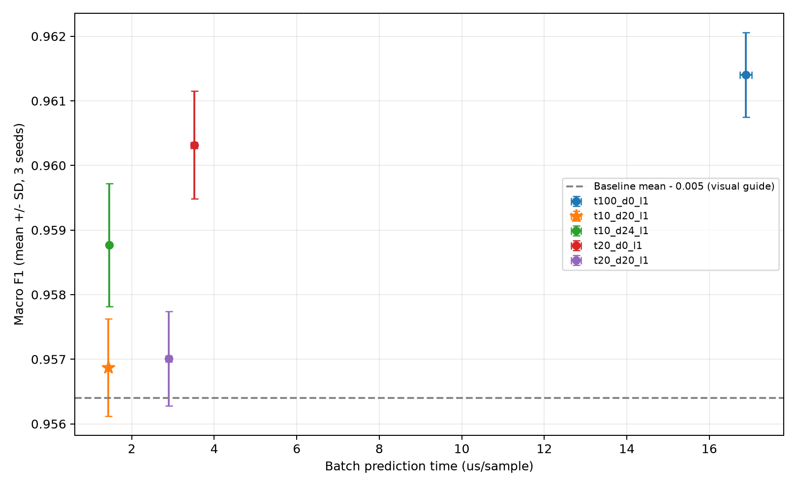

# CICIoT2023 RF 추가 경량화 실험

작성 기준: 2026-11-13 완료된 실험. 추가 학습 없이 저장 결과로 재생성한 보고서다.

## 연구 배경과 이번 진행 범위

초기에는 모델 크기나 추론 시간의 배포 목표를 확정하지 않고, CICIoT2023에서 탐지 성능을 유지하면서 RF를 얼마나 작고 빠르게 만들 수 있는지 탐색했다. 이후 교수님께 성능·모델 비용의 교환관계를 정리하고 정상 오탐과 DDoS 미탐을 함께 고려해 목표를 구체화하겠다고 보고했다. 이번 실험은 그 약속에 따라 기존 결과로 잠정 기준을 정하고 추가 경량화 수준을 확인하는 단계다.

팀원의 MLP 양자화와 RF 경량화는 모델 구조와 방법이 다르므로 같은 압축률이나 파일 크기를 맞추는 것이 목적은 아니다. 공통으로 비교할 것은 동일한 평가 조건에서의 탐지 성능, 원본 대비 개선율, 최종 모델의 실제 비용이다. 서로 다른 PC나 표본에서 측정한 절대 추론 시간을 그대로 비교하지 않는다.

## 목적과 평가 원칙

기존 38특징·100트리 RF의 탐지 성능을 크게 낮추지 않으면서, 기존 C1(20트리)보다 작은 모델을 탐색했다. 특징 선택과 클래스 재표집 효과를 섞지 않고 트리 수·최대 깊이·최소 리프 표본 수만 조절했다. RF 구조 경량화 실험이며 MLP INT8 양자화와는 다른 방법이다.

## 목표 기준 및 근거

| 구분 | 잠정 기준 | 설정 근거 |
|---|---|---|
| 1차 크기 | 15 MB 이하 | 기존 10트리 16.73 MB보다 추가 축소, C1 대비 약 41% 축소 |
| 도전 크기 | 10 MB 이하 | 기존 깊이 16 모델의 9.91 MB를 더 적은 성능 손실로 달성하는지 확인 |
| 속도 | 같은 seed C1 시간의 70% 이하 | 기존 10트리의 약 51% 시간 감소를 참고해 30% 이상 감소 목표 |
| Macro F1 | 같은 seed 100트리보다 감소 0.005 이하 | 기존 C2 손실 약 0.27%p와 C4 손실 약 0.82%p 사이의 탐색적 허용치 |
| 정상 오탐률 FPR | 같은 seed 기준보다 증가 0.001 이하 | 정상 1만 건당 추가 오탐 10건 이하라는 잠정 허용량 |
| DDoS 미탐률 FNR | 같은 seed 기준보다 증가 0.001 이하 | 공격 1만 건당 추가 미탐 10건 이하라는 잠정 허용량 |

이 수치는 산업 표준·배포 장치의 필수 요구사항이 아니다. 이전 탐색 결과를 바탕으로 이번 실험 전에 정한 연구 목표다. 성능 3개 조건은 모두 만족해야 하며 크기·속도는 달성 여부를 따로 보고한다. 0.005는 F1의 절대 차이로 0.5%p, 오류율 0.001은 0.1%p다. 현재 구현의 통과 판정은 관측 점추정치에 대한 것으로 통계적 비열등성 검정이 아니다.

### 왜 이 수치인가?

- 15 MB: 기존 10트리 C2의 16.73 MB에서 트리 구조를 제어해 한 단계 더 축소하는 목표다. 기존 C1 25.44 MB 대비 약 41%, 100트리 95.19 MB 대비 약 84% 감소에 해당한다. 장치의 메모리 한계에서 도출된 값은 아니다.
- 10 MB: 기존 20트리·깊이 16 모델이 이미 9.91 MB였지만 Macro F1 손실이 약 0.82%p였다. 따라서 같은 크기를 더 적은 성능 손실로 달성하는지를 확인하는 도전 목표다.
- 시간 70%: 기존 C2가 C1 대비 약 51%의 시간 감소를 보였으므로 최소 30% 감소를 후속 목표로 두었다. 정확히 70%가 최적이라는 이론적 근거는 없으며, 실시간 처리 마감시간에서 도출된 값도 아니다.
- F1 감소 0.005: 과거 C1 손실 약 0.13%p, C2 약 0.27%p, 깊이 16 후보 약 0.82%p 사이에서 허용 가능한 탐색 범위를 정했다. 과거 결과를 본 뒤 정한 잠정 기준이며, 과거 결과의 독립적인 성공을 입증하는 사전 기준으로 소급하지 않는다.
- 오류율 증가 0.1%p: 각 클래스 1만 건당 추가 오류 10건이라는 해석 가능한 한도다. 정상 피해와 공격 누락이 종합 점수에 가려지는 것을 막는다. 운영 오류 비용이 아직 없어 양쪽에 동일한 허용량을 두었으며, 안전성이 입증된 보편적 기준은 아니다.

이전 seed 42 기준 FPR은 약 0.670%, FNR은 약 0.809%다. 0.1%p 증가는 해당 오류율의 약 12~15% 상대 증가에 해당하므로 무조건 작은 손실이라고 해석하지 않는다. Accuracy는 함께 기록하지만 DDoS 비중이 큰 데이터에서 단독 선택 기준으로 사용하지 않았다.

## 데이터·분할·선택 절차

CICIoT2023에서 기존에 추출한 비중첩 10패킷·38특징 데이터를 재사용했다. 보유 PCAP은 각 캡처의 첫 2 GB 청크 중심이며 HTTP_Flood·SlowLoris·BenignTraffic3는 예외다. CICIoT2023 전체 원본을 대표하는 실험으로 해석하지 않는다.

| 구간 | 행 수 | 정상 | DDoS |
|---|---:|---:|---:|
| 탐색 학습: 파일별 앞 56% | 11,754,494 | 614,814 | 11,139,680 |
| 검증: 다음 14% | 2,938,617 | 153,701 | 2,784,916 |
| 기존 테스트: 뒤 30% | 6,297,039 | 329,362 | 5,967,677 |
| 최종 재학습 풀: 앞 70% | 14,693,111 | 768,515 | 13,924,596 |

1. 탐색 학습 풀에서 seed 42로 중복 없이 무작위 100만 행을 선택하고 모든 설정에 같은 표본을 사용했다. 클래스 비율을 50:50으로 바꾸지 않았으며 class_weight=balanced를 유지했다.
2. 100트리 기준과 5·10·15·20트리를 검증했다. 성능 조건을 통과하는 가장 작은 트리 수 두 개를 선택했다. 두 개 미만이면 나머지는 Macro F1 순으로 보충하도록 사전 정의했다.
3. 두 트리 수에 대해 깊이 제한 없음·16·20·24, 최소 리프 표본 1·5·10을 비교했다. seed 42의 성능 조건을 통과한 후보 중 모델 크기, 추론 시간 순으로 상위 3개를 정했다.
4. 후보와 기준 모델·C1을 seed 42·43·44로 검증했다. 각 seed에서 대응 기준 모델 대비 성능 조건 3개를 모두 통과한 후보 중 seed 42 크기 순으로 최종 후보를 고정했다. 모든 후보가 탈락하면 C1으로 돌아가는 규칙이다.
5. 선택을 selection.json에 저장한 후, 기존 앞 70% 학습 풀의 seed별 100만 행으로 기준·C1·후보를 재학습하고 동일한 기존 테스트 전체에 평가했다. 테스트 결과를 보고 후보를 바꾸지 않았다.

검증 구간을 새로 나누었으나 이 데이터는 과거 실험에서 학습에 사용된 구간이다. 기존 테스트도 과거 여러 번 관찰했으므로 이번 결과를 완전히 새로운 독립 holdout 성능으로 주장하지 않는다. 파일별 시간 구분이며 연결 단위 purge나 공격·기기 전체의 독립 분리가 아니다.

## 최종 테스트 결과

seed 3회 평균이며 Macro F1에는 표준편차를 병기했다. 크기는 RF 객체의 비압축 joblib 직렬화 MB(10^6 bytes)이며 RAM 사용량과 다르다. 최종 속도는 학습이 끝난 별도 프로세스에서 저장 모델을 불러와 같은 테스트 10만 표본의 단일 스레드 predict로 측정했다. 전체 배치 워밍업 후 모델 순서를 무작위로 섞은 7회 측정의 중앙값을 seed별로 구한 평균이다. 검증 탐색 중에는 5회 중앙값을 사용했다. 표본당 시간은 배치 처리 시간을 나눈 값이며 단일 요청 지연이나 특징 추출·패킷 대기·실제 엣지 장치 시간은 아니다.

| 후보 | Accuracy(%) | Macro F1 ± SD | 정상 오탐률(%) | DDoS 미탐률(%) | MB | µs/표본 |
|---|---:|---:|---:|---:|---:|---:|
| t100_d0_l1 | 99.1832 | 0.961402 ± 0.000657 | 0.6518 | 0.8260 | 94.626 | 16.883 |
| t10_d20_l1 **[검증 선택]** | 99.0778 | 0.956874 ± 0.000753 | 0.4648 | 0.9475 | 9.382 | 1.433 |
| t10_d24_l1 | 99.1221 | 0.958770 ± 0.000952 | 0.5437 | 0.8963 | 10.002 | 1.458 |
| t20_d0_l1 | 99.1585 | 0.960317 ± 0.000835 | 0.6623 | 0.8514 | 25.320 | 3.513 |
| t20_d20_l1 | 99.0807 | 0.957012 ± 0.000730 | 0.4353 | 0.9460 | 10.829 | 2.903 |

후보 이름의 t는 트리 수, d는 최대 깊이(0은 무제한), l은 최소 리프 표본 수다.

## 선택 결과와 목표 달성

검증으로 고정한 최종 후보: **t10_d20_l1**.

| 후보 | 테스트 성능 통과 seed | 15 MB 달성 seed | 10 MB 달성 seed | C1 대비 시간 70% 이하 seed |
|---|---:|---:|---:|---:|
| t100_d0_l1 | 3/3 | 0/3 | 0/3 | 0/3 |
| t10_d20_l1 | 0/3 | 3/3 | 3/3 | 3/3 |
| t10_d24_l1 | 3/3 | 3/3 | 2/3 | 3/3 |
| t20_d0_l1 | 3/3 | 0/3 | 0/3 | 0/3 |
| t20_d20_l1 | 0/3 | 3/3 | 0/3 | 0/3 |

### 10트리·깊이 24 후보의 상세 판정

평균 크기 10.002185 MB로 C1 대비 60.50%, 100트리 대비 89.43% 감소했다. 평균 추론 시간은 1.458 µs/표본으로 C1 대비 58.49% 감소했다. 100트리 대비 평균 Macro F1 감소는 0.2632%p, 정상 오탐률 변화는 -0.1081%p, DDoS 미탐률 변화는 +0.0703%p다.

| seed | F1 감소(%p) | FPR 증가(%p) | FNR 증가(%p) | C1 대비 시간(%) | 성능 통과 |
|---|---:|---:|---:|---:|---|
| 42 | 0.3643 | -0.1044 | +0.0944 | 41.13 | 통과 |
| 43 | 0.1527 | -0.0877 | +0.0423 | 43.21 | 통과 |
| 44 | 0.2726 | -0.1321 | +0.0743 | 40.24 | 통과 |

선택 후보의 평균 크기는 9.382 MB로 100트리 대비 90.08%, C1 대비 62.95% 감소했다. 평균 추론 시간은 C1의 40.80%이며, Macro F1 차이는 100트리 대비 -0.4527%p다.

**판정:** 선택 후보는 검증 구간에서는 세 seed 모두 통과했지만, 기존 테스트에서는 잠정 성능 조건을 모두 충족하지 못했다. 따라서 크기 목표 달성과 탐지 성능 유지 달성을 구분해야 하며, 이 후보로 기존 C1을 대체했다고 결론 내리지 않는다. 현재 유지 후보는 C1이며, 추가 후보들은 성능·비용 교환관계를 보여주는 실험 결과로 보관한다.

비교 후보 t10_d24_l1는 기존 테스트에서 세 seed 모두 성능 조건을 통과했다. 평균 크기 10.002185 MB, 범위 9.902185~10.140105 MB로 15 MB 목표는 3/3회, 10 MB 목표는 2/3회 달성했다. 유망한 후속 검증 후보이지만, 테스트를 본 뒤 사전 선택을 변경한 최종 모델로 제시하지 않는다.

테스트에서 기준을 벗어나는 seed가 있으면 일반화 한계로 보고하며 해당 결과를 제외하거나 테스트를 근거로 후보를 재선택하지 않는다. seed 반복은 학습 표본·RF 무작위성의 변동을 보여주며, 동일 테스트 데이터에 대한 반복이 독립 데이터셋 3개의 검증을 뜻하지 않는다.

기준 모델과 C1의 세 seed 학습 인덱스 해시 및 테스트 혼동행렬은 과거 실험과 6개 대응 비교에서 모두 정확히 일치했다. 전체 실행의 지표를 혼동행렬에서 재계산해 일치 여부를 확인했고, 최종 저장 모델은 재로딩 후 예측 일치를 확인했다.

## 해석과 후속 검증 계획

이번 결과로 말할 수 있는 것은 “현재 CICIoT2023 실험에서 10트리·깊이 24 후보가 성능 허용 조건과 15 MB·속도 목표를 모두 만족했고 약 10 MB 수준까지 줄었다”이다. 평균 10.002185 MB는 엄밀히 10 MB를 넘으며, seed 44는 10.140105 MB이므로 “모든 목표를 모든 반복에서 달성했다”라고 쓰지 않는다. 작게 줄인 깊이 20 후보는 평균 F1 손실이 0.5%p 이내여도 세 seed 모두 미탐 증가 한도를 넘었다. 이 결과는 F1만으로 후보를 판단해서는 안 되는 근거다.

새 PCAP 다운로드와 미사용 CICIoT2023 캡처 평가는 수행하지 않기로 했다. 따라서 새로운 CICIoT2023 수집 환경에서의 일반화는 이번 연구 범위에 포함하지 않는다. 다른 데이터셋 검증은 필수 승인 절차가 아니라 경량화 설정의 적용 가능성을 보강하는 후속 연구다.

다음 단계는 확보된 CICIDS2017에서 10트리·깊이 24·리프 1 설정을 고정한 채 100트리 기준·C1과 같은 조건으로 새로 학습·비교하는 것이다. 기존 CICIDS2017 결과는 이미 존재하지만 이번에 고정한 깊이 24 설정의 추가 검증을 완료한 것은 아니다. 표본 분할·지표·허용치를 먼저 고정하고 새 결과를 보고 설정을 다시 고르지 않는다. 다른 데이터로 새로 학습하는 실험은 “경량화 설정의 적용 가능성” 검증이며, 지금 학습한 CICIoT2023 모델을 그대로 적용한 데이터셋 간 일반화 검증과 다르다.

RF는 같은 트리 수와 깊이여도 데이터에 따라 실제 노드 수와 파일 크기가 달라진다. 추가 데이터셋에서는 10 MB를 당연한 결과로 가정하지 않고 해당 데이터셋의 기준 RF 대비 크기·속도 개선율도 함께 보고한다. 실제 엣지 배포 모델을 확정하려면 대상 장치에서 메모리와 특징 추출·패킷 대기를 포함한 처리 시간을 별도로 측정해야 한다.

### 발표 질의에 대한 답변

- 왜 15 MB와 10 MB인가? 기존 16.73 MB 후보의 추가 개선을 1차 목표로, 이미 관찰한 약 10 MB의 크기를 더 적은 성능 손실로 달성하는 것을 도전 목표로 삼았다.
- 왜 성능 허용치가 0.5%p와 0.1%p인가? 이전 탐색 손실 범위와 클래스별 추가 오류량을 바탕으로 이번 실험 전에 정한 잠정 연구 기준이다. 산업 표준이나 운영 안전 보장값이 아니다.
- 모두 달성했는가? 깊이 24 비교 후보는 세 seed 모두 성능 조건·15 MB·속도 목표를 통과했다. 10 MB 도전 목표는 2/3회이며 평균도 약간 초과한다.
- 최종 선택과 비교 후보가 왜 다른가? 검증에서 크기 순으로 고정한 깊이 20은 테스트에서 미탐 기준을 넘었다. 깊이 24가 테스트에서 좋았다는 이유로 사전 선택 기록을 바꾸지 않고 유망한 후속 후보로 구분했다.
- MLP와 같은 수준까지 줄여야 하는가? 방법과 구조가 달라 같은 압축률을 강제하지 않는다. 동일 조건에서 성능과 비용을 공정하게 비교한다.

## 전체 실행별 혼동행렬

TN=정상→정상, FP=정상→DDoS, FN=DDoS→정상, TP=DDoS→DDoS. FPR=FP/(TN+FP), FNR=FN/(TP+FN).

| 후보 | seed | TN | FP | FN | TP |
|---|---:|---:|---:|---:|---:|
| t100_d0_l1 | 42 | 327155 | 2207 | 48262 | 5919415 |
| t20_d0_l1 | 42 | 327124 | 2238 | 50090 | 5917587 |
| t10_d20_l1 | 42 | 327839 | 1523 | 57762 | 5909915 |
| t10_d24_l1 | 42 | 327499 | 1863 | 53895 | 5913782 |
| t20_d20_l1 | 42 | 327897 | 1465 | 57597 | 5910080 |
| t100_d0_l1 | 43 | 327344 | 2018 | 49479 | 5918198 |
| t20_d0_l1 | 43 | 327253 | 2109 | 50154 | 5917523 |
| t10_d20_l1 | 43 | 327871 | 1491 | 55654 | 5912023 |
| t10_d24_l1 | 43 | 327633 | 1729 | 52005 | 5915672 |
| t20_d20_l1 | 43 | 327934 | 1428 | 55570 | 5912107 |
| t100_d0_l1 | 44 | 327147 | 2215 | 50130 | 5917547 |
| t20_d0_l1 | 44 | 327165 | 2197 | 52174 | 5915503 |
| t10_d20_l1 | 44 | 327783 | 1579 | 56209 | 5911468 |
| t10_d24_l1 | 44 | 327582 | 1780 | 54564 | 5913113 |
| t20_d20_l1 | 44 | 327954 | 1408 | 56198 | 5911479 |

## 그림과 재현

실행: `.venv/Scripts/python.exe -u src/run_ciciot2023_rf_further.py`

보고서 재생성: `.venv/Scripts/python.exe src/report_ciciot2023_rf_further.py`

최종 검증·별도 속도 측정: `.venv/Scripts/python.exe -u src/verify_ciciot2023_rf_further.py`

`runs.csv`: 검증·테스트 전체 실행과 지표, `summary.csv`: 평균·표준편차, `comparisons.csv`: seed별 기준 대비 차이와 목표 판정, `protocol.json`: 사전 절차·환경·분할 해시, `selection.json`: 테스트 전에 고정한 선택, `partition_audit.csv`: 파일별 분할, `validation.json`: 캐시·분할·저장 모델 검증 결과.

학습 표본 인덱스와 압축 저장 모델은 `data/processed/ciciot2023_rf_further/`에 보관한다. 기존 데이터·결과·모델 파일은 변경하지 않았다.
