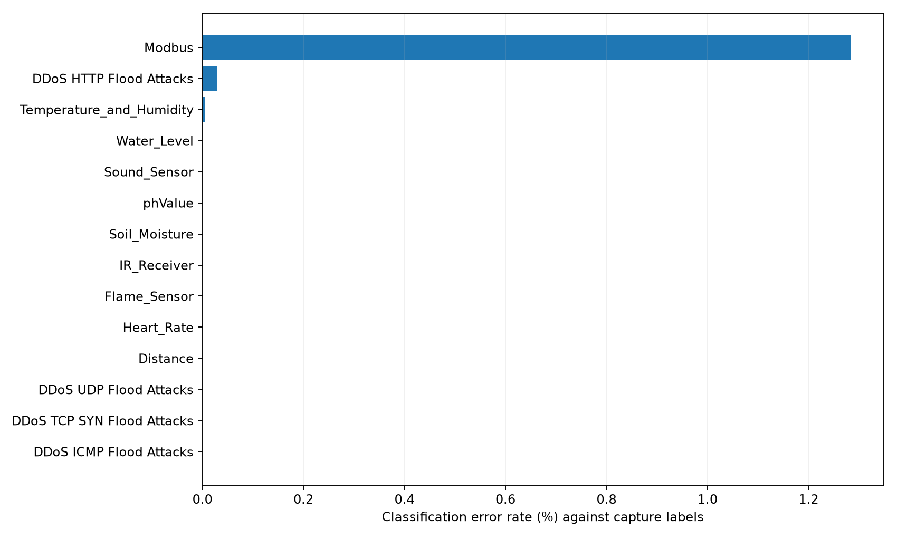
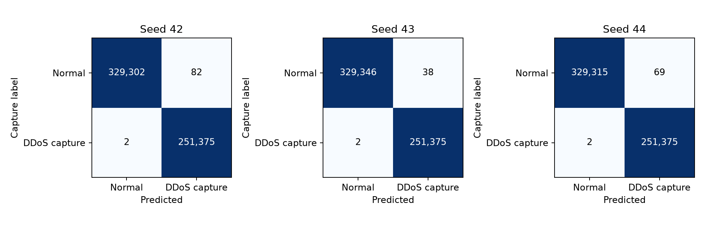
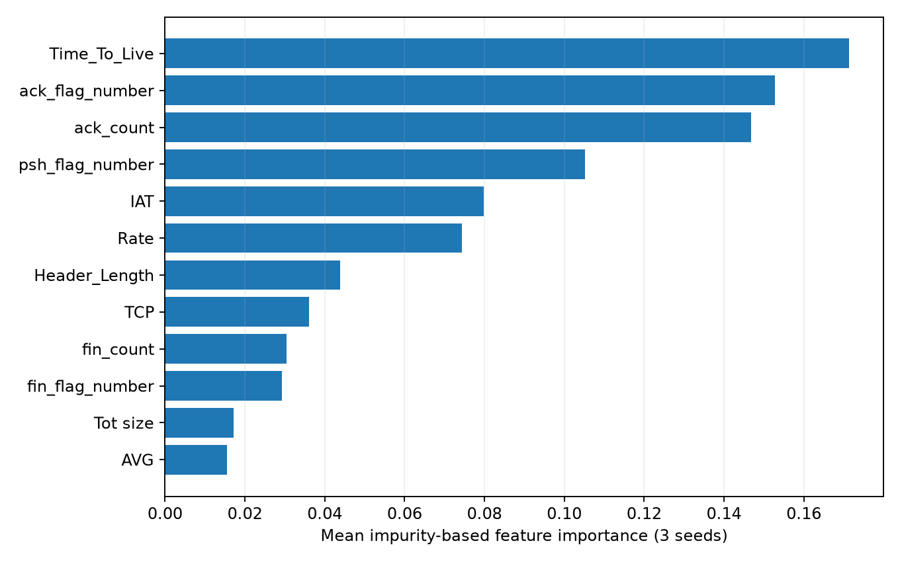

# Edge-IIoTset PCAP 기반 RF 기준선 실험

## 실험 목적과 범위

새 데이터셋 Edge-IIoTset의 정상 10개·DDoS 4개 PCAP에서 기존 38개 특징·비중첩 10패킷 방식으로 RF 기준 성능을 확인했다. 이번에는 100트리 기준선만 학습했으며 경량화 탐색·양자화·MLP 학습은 수행하지 않았다. 기존 CICIoT2023에서 학습한 모델을 그대로 적용한 실험이 아니라 Edge-IIoTset에서 새로 학습한 결과다.

정상 파일: Distance, Flame_Sensor, Heart_Rate, IR_Receiver, Modbus, phValue, Soil_Moisture, Sound_Sensor, Temperature_and_Humidity, Water_Level. 공격 파일: HTTP Flood, ICMP Flood, TCP SYN Flood, UDP Flood. 제공된 14개 PCAP 전체를 순회했으며 다른 공격 유형은 포함하지 않았다.

입력 합계: 1,843,678,832 bytes. 읽은 패킷 19,638,007개, 추출기 채택 IPv4/ARP 패킷 19,359,008개, 최종 윈도우 1,935,894개.

### 정답 라벨의 근거와 한계

현재 입력은 PCAP만이며 별도의 패킷별 정답 매칭 자료는 제공받지 않았다. 원 논문이 정상 및 공격별 파일로 구분해 제공하는 구조를 근거로 Normal traffic 파일은 0, 선택한 DDoS 수집 파일은 1이라는 파일/시나리오 라벨을 부여했다. **공격 파일 안의 모든 패킷이 악성이라고 독립적으로 확인한 것은 아니다.** 따라서 이 보고서의 FPR/FNR은 정상·DDoS 수집 시나리오 윈도우의 분류 오류율이며, 순수 악성 패킷 단위 탐지율로 단정하지 않는다. 공격 수집 중 배경 정상 패킷이 포함되면 그 라벨 잡음이 평가에 반영된다.

[Edge-IIoTset 원 논문](https://doi.org/10.1109/ACCESS.2022.3165809) · [저자 제공 데이터셋](https://www.kaggle.com/datasets/mohamedamineferrag/edgeiiotset-cyber-security-dataset-of-iot-iiot)

## 특징 추출과 전처리

- 기존 CICIoT2023 pcap2csv 기반 추출기를 사용했다. 파일별 샘플 2,000패킷에서 불필요한 flow 계산을 생략한 방식과 기존 방식의 CSV 전체를 정확히 대조했다.
- IPv4/ARP 채택 패킷을 20,000개씩 나누되 10패킷 경계를 보존했다. 청크 끝의 10패킷 미만 윈도우와 IAT > 100,000초 아티팩트를 제외했다.
- Rate 상한 10^7, Std/Variance 결측 0, LLC 제외 38개 float32 특징을 사용했다. 최종 입력의 유한성을 확인했다.
- 파일명, 정상/공격 폴더, 라벨, IP, MAC, 원시 시간, 기기명은 모델 입력에 넣지 않았다. CICIoT2023의 기기·공격자 MAC 목록을 이 데이터에 적용하지 않았다.
- 원 논문의 61개 특징 CSV를 재현하는 실험이 아니다. 같은 38개 추출 방식으로 데이터셋을 바꾼 기준선이다.

| 파일 | 시나리오 | 읽은 패킷 | 추출 윈도우 | 제외: 짧음 | 제외: IAT | 시간 역전 윈도우 |
|---|---|---:|---:|---:|---:|---:|
| Distance.pcap | Normal | 1,143,948 | 114,381 | 1 | 0 | 0 |
| Flame_Sensor.pcap | Normal | 1,070,510 | 107,042 | 0 | 0 | 0 |
| Heart_Rate.pcap | Normal | 170,435 | 17,033 | 1 | 0 | 0 |
| IR_Receiver.pcap | Normal | 1,308,238 | 130,813 | 1 | 0 | 0 |
| Modbus.pcap | Normal | 159,514 | 15,921 | 0 | 1 | 0 |
| Soil_Moisture.pcap | Normal | 1,200,751 | 120,026 | 1 | 0 | 0 |
| Sound_Sensor.pcap | Normal | 1,513,318 | 151,320 | 1 | 0 | 0 |
| Temperature_and_Humidity.pcap | Normal | 1,629,749 | 135,258 | 1 | 1 | 0 |
| Water_Level.pcap | Normal | 2,302,497 | 230,230 | 1 | 0 | 0 |
| phValue.pcap | Normal | 759,665 | 75,940 | 1 | 0 | 0 |
| DDoS HTTP Flood Attacks.pcap | DDoS_HTTP | 229,142 | 22,912 | 1 | 0 | 1 |
| DDoS ICMP Flood Attacks.pcap | DDoS_ICMP | 2,914,356 | 291,434 | 1 | 0 | 0 |
| DDoS TCP SYN Flood Attacks.pcap | DDoS_TCP_SYN | 2,020,152 | 202,013 | 1 | 0 | 1 |
| DDoS UDP Flood Attacks.pcap | DDoS_UDP | 3,215,732 | 321,571 | 1 | 0 | 0 |

## 분할과 학습 조건

파일별 추출 순서의 앞 70%를 학습 풀, 뒤 30%를 고정 테스트로 사용했다. 행 순서로 나눈 분할이며 엄격한 연결별 독립 분할·새 캡처 holdout은 아니다. 각 파일의 시간 역전 여부는 위 표에 별도 기록했다. 고정 100트리 설정으로 별도 하이퍼파라미터 선택을 하지 않았다.

| 구간 | 전체 | 정상 | DDoS 시나리오 |
|---|---:|---:|---:|
| 최종 학습 풀: 앞 70% | 1,355,133 | 768,580 | 586,553 |
| 테스트: 뒤 30% | 580,761 | 329,384 | 251,377 |
| MLP 참고 fit: 앞 56% | 1,084,109 | 614,866 | 469,243 |
| MLP 참고 validation: 다음 14% | 271,024 | 153,714 | 117,310 |

RF: 트리 100개, 깊이 무제한, 최소 리프 표본 1, class_weight=balanced, seed 42/43/44. 각 seed에서 학습 풀의 최대 100만 행을 중복 없이 선택했다. class_weight는 학습 가중치 보정이며 정상과 공격 표본 수를 50:50으로 재표집한 것은 아니다. 모든 seed의 테스트 인덱스는 동일하다.

### 중복 및 누수 점검

38개 float32 특징의 64-bit 해시로 확인한 전체 학습 풀과 동일 특징을 갖는 테스트 행은 174,924/580,761개 (30.1198%)다. 같은 특징에 정상·공격 라벨이 함께 존재하는 해시 그룹은 0개다. 64-bit 해시 충돌 가능성은 이론적으로 있으며, 여기서의 중복 점검은 연결·공격 캠페인 독립성을 입증하지 않는다.

시간순 기준선의 표본 구성은 유지하고 중복을 몰래 제거하지 않았다. 학습에 실제로 사용한 표본과 동일 특징인 테스트 행을 제외한 보조 결과를 sensitivity_seed*.csv에 함께 저장했다. 보조 결과는 서로 다른 표본 구성의 민감도 분석이며 독립적인 새 환경 검증이 아니다.

## RF 결과

테스트의 다수 클래스만 예측했을 때의 기준 Accuracy는 56.7159%다. Accuracy뿐 아니라 Macro F1과 클래스별 오류율을 함께 확인한다.

아래 값은 정상/DDoS 수집 시나리오 라벨을 기준으로 한다. DDoS를 양성으로 계산한다. FPR=FP/(TN+FP), FNR=FN/(TP+FN). 단일 클래스 파일의 Macro F1을 전체 이진 Macro F1과 혼동하지 않도록 파일별 표에는 오류율만 표시했다.

| seed | Accuracy(%) | Macro F1 | 정상 FPR(%) | DDoS FNR(%) | DDoS Recall(%) | MB | µs/표본 |
|---|---:|---:|---:|---:|---:|---:|---:|
| 42 | 99.9855 | 0.999853 | 0.0249 | 0.0008 | 99.9992 | 8.476 | 9.151 |
| 43 | 99.9931 | 0.999930 | 0.0115 | 0.0008 | 99.9992 | 8.456 | 10.043 |
| 44 | 99.9878 | 0.999876 | 0.0209 | 0.0008 | 99.9992 | 8.459 | 9.645 |
| 평균 | 99.9888 | 0.999886 | 0.0191 | 0.0008 | 99.9992 | 8.464 | 9.613 |

Macro F1 표준편차: 0.000040. 반복은 같은 테스트에서 학습 표본·RF 무작위성의 변동을 확인한 것이며 서로 독립적인 데이터셋 3개가 아니다.

크기는 RF 객체 비압축 joblib 직렬화 MB(10^6 bytes)이며 RAM과 다르다. 속도는 동일 테스트 중 최대 10만 행의 단일 스레드 predict, 워밍업 후 5회 중앙값이다. 특징 추출·패킷 수집·10패킷 대기 시간은 제외하며 단일 요청 지연이 아니라 배치 시간을 표본 수로 나눈 값이다. 과거 CICIoT2023/CICIDS2017 실행의 절대 속도와 직접 우열을 비교하지 않는다.

### 혼동행렬

| seed | TN | FP | FN | TP |
|---|---:|---:|---:|---:|
| 42 | 329302 | 82 | 2 | 251375 |
| 43 | 329346 | 38 | 2 | 251375 |
| 44 | 329315 | 69 | 2 | 251375 |

### 특징 중요도

RF impurity 기반 중요도(MDI)의 seed 3회 평균이다. 새 특징 선택에는 사용하지 않았다. 상관된 특징 간 중요도 분산 및 연속값·분할 기회에 따른 편향이 있어 인과적 영향이나 외부 환경에서의 안정성을 뜻하지 않는다.

| 특징 | 평균 중요도 |
|---|---:|
| Time_To_Live | 0.171291 |
| ack_flag_number | 0.152817 |
| ack_count | 0.146784 |
| psh_flag_number | 0.105227 |
| IAT | 0.079747 |
| Rate | 0.074336 |
| Header_Length | 0.043822 |
| TCP | 0.036048 |
| fin_count | 0.030385 |
| fin_flag_number | 0.029231 |
| Tot size | 0.017106 |
| AVG | 0.015554 |

### 파일별 오류율

| 파일 | 정상/DDoS | 테스트 행 | 오류율 평균(%) |
|---|---|---:|---:|
| DDoS HTTP Flood Attacks.pcap | DDoS | 6,873 | 0.0291 |
| DDoS ICMP Flood Attacks.pcap | DDoS | 87,430 | 0.0000 |
| DDoS TCP SYN Flood Attacks.pcap | DDoS | 60,603 | 0.0000 |
| DDoS UDP Flood Attacks.pcap | DDoS | 96,471 | 0.0000 |
| Distance.pcap | 정상 | 34,314 | 0.0000 |
| Flame_Sensor.pcap | 정상 | 32,112 | 0.0000 |
| Heart_Rate.pcap | 정상 | 5,109 | 0.0000 |
| IR_Receiver.pcap | 정상 | 39,243 | 0.0000 |
| Modbus.pcap | 정상 | 4,776 | 1.2842 |
| Soil_Moisture.pcap | 정상 | 36,007 | 0.0000 |
| Sound_Sensor.pcap | 정상 | 45,396 | 0.0000 |
| Temperature_and_Humidity.pcap | 정상 | 40,576 | 0.0041 |
| Water_Level.pcap | 정상 | 69,069 | 0.0000 |
| phValue.pcap | 정상 | 22,782 | 0.0000 |

정상 파일 중 평균 오류율이 가장 큰 것은 Modbus.pcap이며 1.2842%다. 전체 FPR이 작더라도 특정 센서·프로토콜의 오탐이 클 수 있으므로 전체 평균만으로 정상 동작을 보장하지 않는다. 같은 캡처의 학습·테스트는 장치·프로토콜·통신 역할의 차이를 공유할 수 있다. 특징 중요도나 높은 점수만으로 악성 행동 자체를 일반화해 학습했다고 단정할 수 없다. 이번 모델 크기는 이 데이터의 100트리 기준선 크기이며, 기존 CICIoT2023 RF 대비 경량화로 얻은 크기가 아니다.

### 동일 특징 제외 민감도 분석

| seed | 평가 범위 | 행 수 | Macro F1 | 정상 FPR(%) | DDoS FNR(%) |
|---|---|---:|---:|---:|---:|
| 42 | all | 580,761 | 0.999853 | 0.0249 | 0.0008 |
| 42 | feature_unseen_in_sampled_training | 412,180 | 0.999687 | 0.0250 | 0.0024 |
| 43 | all | 580,761 | 0.999930 | 0.0115 | 0.0008 |
| 43 | feature_unseen_in_sampled_training | 412,295 | 0.999851 | 0.0116 | 0.0024 |
| 44 | all | 580,761 | 0.999876 | 0.0209 | 0.0008 |
| 44 | feature_unseen_in_sampled_training | 412,189 | 0.999735 | 0.0210 | 0.0024 |

## 팀원 MLP에 전달할 자료

로컬 `data/processed/edge_iiotset/MLP_HANDOFF.json`에 파일명과 규칙을 기록했다. `X.float32.npy`는 정해진 38특징 순서, `y.int8.npy`는 정상=0/DDoS시나리오=1이다. `sample_manifest.parquet`에는 각 행의 출처·분할 정보가 있다.

- 공통 테스트: `test_indices.npy`. 모델을 보고 테스트를 재분할하지 않는다.
- 동일 학습 예산 비교: `rf_train_seed42.npy`(또는 대응 seed)와 같은 행을 사용한다.
- 같은 RF 학습 표본 안에서 MLP를 조정하려면 `rf_fit_seed42.npy`와 `rf_validation_seed42.npy`를 사용하고, 결정 후 전체 `rf_train_seed42.npy`로 재학습한다. 최종 테스트는 공통 `test_indices.npy`로 한 번 평가한다.
- MLP 내부 검증용 `fit_indices.npy`, `validation_indices.npy`도 제공한다. 이 fit만으로 학습하면 RF 최종 학습 풀과 예산이 다르므로, 공정한 비교 시 학습 범위를 명시하거나 선택 후 공통 학습 행으로 다시 학습한다.
- 스케일러·결측 보정은 학습 데이터로만 맞춘다. 검증·테스트에서 평균·표준편차를 다시 계산하지 않는다. 라벨·파일명·시간·메타데이터는 입력에 넣지 않는다.
- MLP FP32 및 양자화 모델도 같은 테스트에서 평가하고, 추론 시간은 가능한 같은 장치에서 측정한다.

## 실행 및 산출물

특징 추출: `.venv/Scripts/python.exe -u src/prepare_edge_iiotset.py`

RF 학습: `.venv/Scripts/python.exe -u src/run_edge_iiotset_rf.py`

보고서 재생성: `.venv/Scripts/python.exe src/report_edge_iiotset_rf.py`

특징 추출은 청크·파일 단위 체크포인트를 저장하며 입력 해시와 코드 해시가 일치할 때 재개한다. 데이터·모델·임시 청크는 data 아래에 저장해 Git에서 제외한다. 기존 CICIoT2023/CICIDS2017 결과는 변경하지 않았다.

