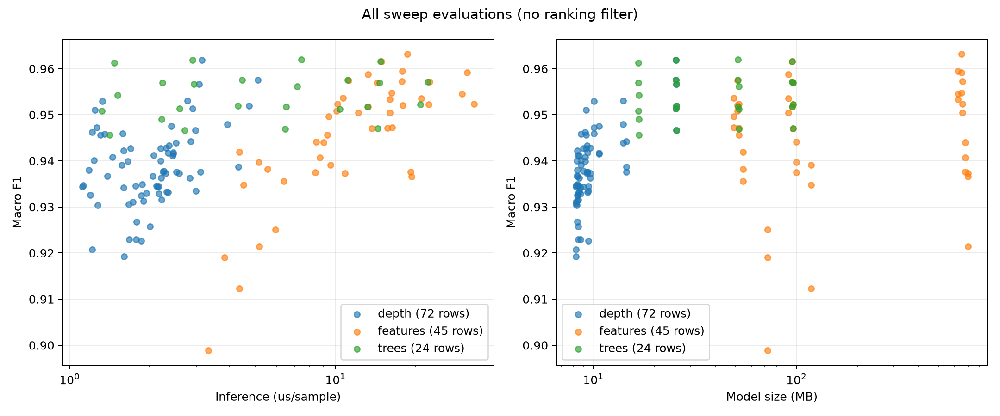
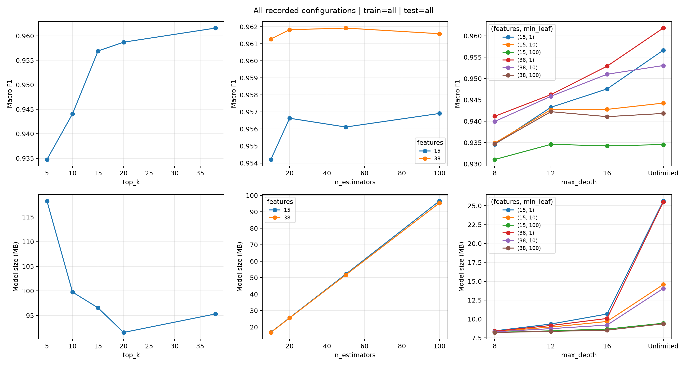
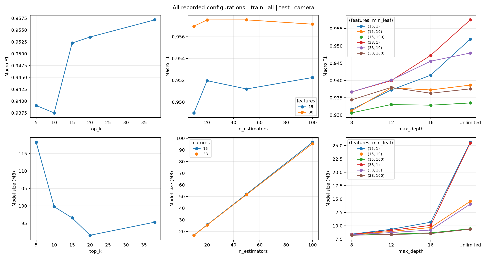
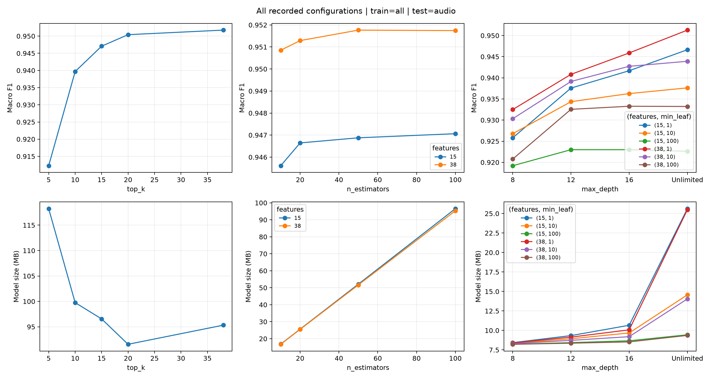

| 항목 | 내용 |
| --- | --- |
| 보고서 | 저장된 전체 실험 결과 · 순위 필터 없음 |
| 범위 | 개별 결과 CSV 24개, 평가 행 242개 + 이전 Colab 결과 |
| 요청 조합 | feature 5·10·15·20·38 × 트리 10·20·50·100 × 깊이 ∞·8·12·16 × min_leaf 1·10·100 = 240개 |
| 전체 학습 sweep 실행 범위 | 33개 조합 결과 있음 / 207개 조합 저장 결과 없음 |
| 실험 방식 | feature sweep 15개 모델; trees sweep 8개 모델; depth sweep 24개 모델. 단계 간 동일 설정의 재측정도 보존 |
| 자료 한계 | 로컬 PCAP은 각 캡처 첫 2 GB 청크 중심(HTTP_Flood·SlowLoris·BenignTraffic3 제외). 전체 원본 548 GB 실험이 아님 |
| 비교 주의 | 추론시간은 PC 부하·실행 시점 영향. 동일 실행 묶음에서 비교; 서로 다른 데이터셋(test3·Colab)은 별도 비교 |
| 표 정밀도 | 소수 6자리 표시; 전체 원시 열·정밀도는 all_experiment_results.csv 및 원본 CSV 보존 |

| 변수 | 설정 | 확인된 목적·사실 | 선정 기준 설명·기록 한계 |
| --- | --- | --- | --- |
| 트리 수 | 10·20·50·100 | 확인: 100개 기준 모델과 경량 모델의 정확도·속도·크기 비교 | 해석: 기준선의 10%·20%·50%·100% 수준을 탐색. 10/20은 큰 절감, 50은 중간, 100은 기준. 정확히 이 숫자를 고른 사전 근거는 기록 없음 |
| 최대 깊이 | ∞·8·12·16 | 확인: 트리 성장 제한에 따른 성능·노드 수·크기 비교 | 해석: ∞는 깊이 제한 없는 대조군; 8/12/16은 강한·중간·완화된 제한을 4단계 간격으로 탐색. 특정 논문이나 최적값에서 유도한 기록 없음 |
| 깊이 값 간격 | 8 → 12 → 16 | 이진 트리의 깊이 d에서 최대 노드 수는 2^(d+1)−1 | 이론상 상한 511 → 8,191 → 131,071개/트리. 실제 노드 수는 데이터·다른 제한에 따라 더 작음; ∞도 유한 데이터에서는 유한 트리 |
| min_samples_leaf | 1·10·100 | 확인: 말단 노드에 필요한 최소 학습 표본 수를 증가시키는 실험 | 해석: 1은 최소 제약 기준선, 10/100은 10배 간격의 중간/강한 제약. 작은 가지를 줄여 크기·과적합을 완화할 수 있으나 세부 공격 탐지를 잃을 수 있음. 정확한 숫자의 선정 근거 기록 없음 |
| 후속 sweep 고정값 | feature 15·38; depth sweep 트리 20 | 확인: 단계별 결과를 보고 탐색 범위를 축소 | 로그: 15개는 성능 손실 약 0.5%p의 후보, 38개는 전체 입력; 20트리는 성능을 유지하며 경량화한 후보 |
| 기타 공통 설정 | seed=42; class_weight=balanced; 학습 최대 100만 | 확인: sweep 코드와 결과의 공통 설정 | 목적 해석: 난수 고정으로 재현, 클래스 불균형 보정, 학습 비용 제한. 시간순 70/30은 후반 트래픽 평가; LOAO는 미학습 공격 평가 |
| 근거 파일 | [sweep_rf.py](../../src/sweep_rf.py) · [train_rf.py](../../src/train_rf.py) · [LOG.md](../../docs/LOG.md) | 실행 값·목적은 저장소에서 확인 | 수치 선정 해석은 당시 의사결정의 확정적 증거가 아님 |

| 표기 | 의미 |
| --- | --- |
| accuracy | 전체 정답 비율 |
| precision / recall / f1 | DDoS를 양성으로 계산 |
| f1_macro | Benign·DDoS F1의 단순 평균 |
| ∞ | sweep 원본 0 또는 RF 원본 빈 max_depth: 깊이 제한 없음 |
| — | 미기록 값; min_leaf 미기록 값은 임의 보충하지 않음 |
| 모델 MB | 비압축 joblib 파일 크기, 1 MB=10⁶ bytes; 실행 메모리와 다름 |
| 추론 µs | 단일 스레드, 최대 10만 표본, 워밍업 후 5회 중앙값; feature 추출 시간 제외 |
| 평가 subset | all·camera·audio·echo_dot1·amcrest는 중첩 가능, 행 수 합산 금지 |

| 원본 | 전체 평가 행 수 | 첫 행 학습 subset | 평가 subset |
| --- | --- | --- | --- |
| rf_final_base.csv | 5 | all | all, camera, audio, echo_dot1, amcrest |
| rf_final_base_loao_slowloris.csv | 5 | all | all, camera, audio, echo_dot1, amcrest |
| rf_final_base_loao_syn.csv | 5 | all | all, camera, audio, echo_dot1, amcrest |
| rf_final_c1.csv | 5 | all | all, camera, audio, echo_dot1, amcrest |
| rf_final_c1_loao_slowloris.csv | 5 | all | all, camera, audio, echo_dot1, amcrest |
| rf_final_c1_loao_syn.csv | 5 | all | all, camera, audio, echo_dot1, amcrest |
| rf_final_c2.csv | 5 | all | all, camera, audio, echo_dot1, amcrest |
| rf_final_c2_loao_slowloris.csv | 5 | all | all, camera, audio, echo_dot1, amcrest |
| rf_final_c2_loao_syn.csv | 5 | all | all, camera, audio, echo_dot1, amcrest |
| rf_final_c3.csv | 5 | all | all, camera, audio, echo_dot1, amcrest |
| rf_final_c3_loao_slowloris.csv | 5 | all | all, camera, audio, echo_dot1, amcrest |
| rf_final_c3_loao_syn.csv | 5 | all | all, camera, audio, echo_dot1, amcrest |
| rf_final_c4.csv | 5 | all | all, camera, audio, echo_dot1, amcrest |
| rf_final_c4_loao_slowloris.csv | 5 | all | all, camera, audio, echo_dot1, amcrest |
| rf_final_c4_loao_syn.csv | 5 | all | all, camera, audio, echo_dot1, amcrest |
| rf_loao_slowloris.csv | 4 | all | all, camera, echo_dot1, amcrest |
| rf_loao_syn.csv | 4 | all | all, camera, echo_dot1, amcrest |
| rf_test3.csv | 4 | all | all, camera, echo_dot1, amcrest |
| rf_v1.csv | 5 | all | all, camera, audio, echo_dot1, amcrest |
| rf_v1_audio.csv | 5 | audio | all, camera, audio, echo_dot1, amcrest |
| rf_v1_cam.csv | 4 | camera | all, camera, echo_dot1, amcrest |
| sweep_depth.csv | 72 | all | all, camera, audio |
| sweep_features.csv | 45 | all | all, camera, audio |
| sweep_trees.csv | 24 | all | all, camera, audio |

| feature | 트리 | 깊이 | min_leaf | 전체 학습 결과 | 출처 |
| --- | --- | --- | --- | --- | --- |
| 5 | 10 | ∞ | 1 | 저장 결과 없음 | — |
| 5 | 10 | ∞ | 10 | 저장 결과 없음 | — |
| 5 | 10 | ∞ | 100 | 저장 결과 없음 | — |
| 5 | 10 | 8 | 1 | 저장 결과 없음 | — |
| 5 | 10 | 8 | 10 | 저장 결과 없음 | — |
| 5 | 10 | 8 | 100 | 저장 결과 없음 | — |
| 5 | 10 | 12 | 1 | 저장 결과 없음 | — |
| 5 | 10 | 12 | 10 | 저장 결과 없음 | — |
| 5 | 10 | 12 | 100 | 저장 결과 없음 | — |
| 5 | 10 | 16 | 1 | 저장 결과 없음 | — |
| 5 | 10 | 16 | 10 | 저장 결과 없음 | — |
| 5 | 10 | 16 | 100 | 저장 결과 없음 | — |
| 5 | 20 | ∞ | 1 | 저장 결과 없음 | — |
| 5 | 20 | ∞ | 10 | 저장 결과 없음 | — |
| 5 | 20 | ∞ | 100 | 저장 결과 없음 | — |
| 5 | 20 | 8 | 1 | 저장 결과 없음 | — |
| 5 | 20 | 8 | 10 | 저장 결과 없음 | — |
| 5 | 20 | 8 | 100 | 저장 결과 없음 | — |
| 5 | 20 | 12 | 1 | 저장 결과 없음 | — |
| 5 | 20 | 12 | 10 | 저장 결과 없음 | — |
| 5 | 20 | 12 | 100 | 저장 결과 없음 | — |
| 5 | 20 | 16 | 1 | 저장 결과 없음 | — |
| 5 | 20 | 16 | 10 | 저장 결과 없음 | — |
| 5 | 20 | 16 | 100 | 저장 결과 없음 | — |
| 5 | 50 | ∞ | 1 | 저장 결과 없음 | — |
| 5 | 50 | ∞ | 10 | 저장 결과 없음 | — |
| 5 | 50 | ∞ | 100 | 저장 결과 없음 | — |
| 5 | 50 | 8 | 1 | 저장 결과 없음 | — |
| 5 | 50 | 8 | 10 | 저장 결과 없음 | — |
| 5 | 50 | 8 | 100 | 저장 결과 없음 | — |
| 5 | 50 | 12 | 1 | 저장 결과 없음 | — |
| 5 | 50 | 12 | 10 | 저장 결과 없음 | — |
| 5 | 50 | 12 | 100 | 저장 결과 없음 | — |
| 5 | 50 | 16 | 1 | 저장 결과 없음 | — |
| 5 | 50 | 16 | 10 | 저장 결과 없음 | — |
| 5 | 50 | 16 | 100 | 저장 결과 없음 | — |
| 5 | 100 | ∞ | 1 | 있음 | sweep_features.csv |
| 5 | 100 | ∞ | 10 | 저장 결과 없음 | — |
| 5 | 100 | ∞ | 100 | 저장 결과 없음 | — |
| 5 | 100 | 8 | 1 | 저장 결과 없음 | — |
| 5 | 100 | 8 | 10 | 저장 결과 없음 | — |
| 5 | 100 | 8 | 100 | 저장 결과 없음 | — |
| 5 | 100 | 12 | 1 | 저장 결과 없음 | — |
| 5 | 100 | 12 | 10 | 저장 결과 없음 | — |
| 5 | 100 | 12 | 100 | 저장 결과 없음 | — |
| 5 | 100 | 16 | 1 | 저장 결과 없음 | — |
| 5 | 100 | 16 | 10 | 저장 결과 없음 | — |
| 5 | 100 | 16 | 100 | 저장 결과 없음 | — |
| 10 | 10 | ∞ | 1 | 저장 결과 없음 | — |
| 10 | 10 | ∞ | 10 | 저장 결과 없음 | — |
| 10 | 10 | ∞ | 100 | 저장 결과 없음 | — |
| 10 | 10 | 8 | 1 | 저장 결과 없음 | — |
| 10 | 10 | 8 | 10 | 저장 결과 없음 | — |
| 10 | 10 | 8 | 100 | 저장 결과 없음 | — |
| 10 | 10 | 12 | 1 | 저장 결과 없음 | — |
| 10 | 10 | 12 | 10 | 저장 결과 없음 | — |
| 10 | 10 | 12 | 100 | 저장 결과 없음 | — |
| 10 | 10 | 16 | 1 | 저장 결과 없음 | — |
| 10 | 10 | 16 | 10 | 저장 결과 없음 | — |
| 10 | 10 | 16 | 100 | 저장 결과 없음 | — |
| 10 | 20 | ∞ | 1 | 저장 결과 없음 | — |
| 10 | 20 | ∞ | 10 | 저장 결과 없음 | — |
| 10 | 20 | ∞ | 100 | 저장 결과 없음 | — |
| 10 | 20 | 8 | 1 | 저장 결과 없음 | — |
| 10 | 20 | 8 | 10 | 저장 결과 없음 | — |
| 10 | 20 | 8 | 100 | 저장 결과 없음 | — |
| 10 | 20 | 12 | 1 | 저장 결과 없음 | — |
| 10 | 20 | 12 | 10 | 저장 결과 없음 | — |
| 10 | 20 | 12 | 100 | 저장 결과 없음 | — |
| 10 | 20 | 16 | 1 | 저장 결과 없음 | — |
| 10 | 20 | 16 | 10 | 저장 결과 없음 | — |
| 10 | 20 | 16 | 100 | 저장 결과 없음 | — |
| 10 | 50 | ∞ | 1 | 저장 결과 없음 | — |
| 10 | 50 | ∞ | 10 | 저장 결과 없음 | — |
| 10 | 50 | ∞ | 100 | 저장 결과 없음 | — |
| 10 | 50 | 8 | 1 | 저장 결과 없음 | — |
| 10 | 50 | 8 | 10 | 저장 결과 없음 | — |
| 10 | 50 | 8 | 100 | 저장 결과 없음 | — |
| 10 | 50 | 12 | 1 | 저장 결과 없음 | — |
| 10 | 50 | 12 | 10 | 저장 결과 없음 | — |
| 10 | 50 | 12 | 100 | 저장 결과 없음 | — |
| 10 | 50 | 16 | 1 | 저장 결과 없음 | — |
| 10 | 50 | 16 | 10 | 저장 결과 없음 | — |
| 10 | 50 | 16 | 100 | 저장 결과 없음 | — |
| 10 | 100 | ∞ | 1 | 있음 | sweep_features.csv |
| 10 | 100 | ∞ | 10 | 저장 결과 없음 | — |
| 10 | 100 | ∞ | 100 | 저장 결과 없음 | — |
| 10 | 100 | 8 | 1 | 저장 결과 없음 | — |
| 10 | 100 | 8 | 10 | 저장 결과 없음 | — |
| 10 | 100 | 8 | 100 | 저장 결과 없음 | — |
| 10 | 100 | 12 | 1 | 저장 결과 없음 | — |
| 10 | 100 | 12 | 10 | 저장 결과 없음 | — |
| 10 | 100 | 12 | 100 | 저장 결과 없음 | — |
| 10 | 100 | 16 | 1 | 저장 결과 없음 | — |
| 10 | 100 | 16 | 10 | 저장 결과 없음 | — |
| 10 | 100 | 16 | 100 | 저장 결과 없음 | — |
| 15 | 10 | ∞ | 1 | 있음 | sweep_trees.csv |
| 15 | 10 | ∞ | 10 | 저장 결과 없음 | — |
| 15 | 10 | ∞ | 100 | 저장 결과 없음 | — |
| 15 | 10 | 8 | 1 | 저장 결과 없음 | — |
| 15 | 10 | 8 | 10 | 저장 결과 없음 | — |
| 15 | 10 | 8 | 100 | 저장 결과 없음 | — |
| 15 | 10 | 12 | 1 | 저장 결과 없음 | — |
| 15 | 10 | 12 | 10 | 저장 결과 없음 | — |
| 15 | 10 | 12 | 100 | 저장 결과 없음 | — |
| 15 | 10 | 16 | 1 | 저장 결과 없음 | — |
| 15 | 10 | 16 | 10 | 저장 결과 없음 | — |
| 15 | 10 | 16 | 100 | 저장 결과 없음 | — |
| 15 | 20 | ∞ | 1 | 있음 | sweep_depth.csv, sweep_trees.csv |
| 15 | 20 | ∞ | 10 | 있음 | sweep_depth.csv |
| 15 | 20 | ∞ | 100 | 있음 | sweep_depth.csv |
| 15 | 20 | 8 | 1 | 있음 | sweep_depth.csv |
| 15 | 20 | 8 | 10 | 있음 | sweep_depth.csv |
| 15 | 20 | 8 | 100 | 있음 | sweep_depth.csv |
| 15 | 20 | 12 | 1 | 있음 | sweep_depth.csv |
| 15 | 20 | 12 | 10 | 있음 | sweep_depth.csv |
| 15 | 20 | 12 | 100 | 있음 | sweep_depth.csv |
| 15 | 20 | 16 | 1 | 있음 | sweep_depth.csv |
| 15 | 20 | 16 | 10 | 있음 | sweep_depth.csv |
| 15 | 20 | 16 | 100 | 있음 | sweep_depth.csv |
| 15 | 50 | ∞ | 1 | 있음 | sweep_trees.csv |
| 15 | 50 | ∞ | 10 | 저장 결과 없음 | — |
| 15 | 50 | ∞ | 100 | 저장 결과 없음 | — |
| 15 | 50 | 8 | 1 | 저장 결과 없음 | — |
| 15 | 50 | 8 | 10 | 저장 결과 없음 | — |
| 15 | 50 | 8 | 100 | 저장 결과 없음 | — |
| 15 | 50 | 12 | 1 | 저장 결과 없음 | — |
| 15 | 50 | 12 | 10 | 저장 결과 없음 | — |
| 15 | 50 | 12 | 100 | 저장 결과 없음 | — |
| 15 | 50 | 16 | 1 | 저장 결과 없음 | — |
| 15 | 50 | 16 | 10 | 저장 결과 없음 | — |
| 15 | 50 | 16 | 100 | 저장 결과 없음 | — |
| 15 | 100 | ∞ | 1 | 있음 | sweep_features.csv, sweep_trees.csv |
| 15 | 100 | ∞ | 10 | 저장 결과 없음 | — |
| 15 | 100 | ∞ | 100 | 저장 결과 없음 | — |
| 15 | 100 | 8 | 1 | 저장 결과 없음 | — |
| 15 | 100 | 8 | 10 | 저장 결과 없음 | — |
| 15 | 100 | 8 | 100 | 저장 결과 없음 | — |
| 15 | 100 | 12 | 1 | 저장 결과 없음 | — |
| 15 | 100 | 12 | 10 | 저장 결과 없음 | — |
| 15 | 100 | 12 | 100 | 저장 결과 없음 | — |
| 15 | 100 | 16 | 1 | 저장 결과 없음 | — |
| 15 | 100 | 16 | 10 | 저장 결과 없음 | — |
| 15 | 100 | 16 | 100 | 저장 결과 없음 | — |
| 20 | 10 | ∞ | 1 | 저장 결과 없음 | — |
| 20 | 10 | ∞ | 10 | 저장 결과 없음 | — |
| 20 | 10 | ∞ | 100 | 저장 결과 없음 | — |
| 20 | 10 | 8 | 1 | 저장 결과 없음 | — |
| 20 | 10 | 8 | 10 | 저장 결과 없음 | — |
| 20 | 10 | 8 | 100 | 저장 결과 없음 | — |
| 20 | 10 | 12 | 1 | 저장 결과 없음 | — |
| 20 | 10 | 12 | 10 | 저장 결과 없음 | — |
| 20 | 10 | 12 | 100 | 저장 결과 없음 | — |
| 20 | 10 | 16 | 1 | 저장 결과 없음 | — |
| 20 | 10 | 16 | 10 | 저장 결과 없음 | — |
| 20 | 10 | 16 | 100 | 저장 결과 없음 | — |
| 20 | 20 | ∞ | 1 | 저장 결과 없음 | — |
| 20 | 20 | ∞ | 10 | 저장 결과 없음 | — |
| 20 | 20 | ∞ | 100 | 저장 결과 없음 | — |
| 20 | 20 | 8 | 1 | 저장 결과 없음 | — |
| 20 | 20 | 8 | 10 | 저장 결과 없음 | — |
| 20 | 20 | 8 | 100 | 저장 결과 없음 | — |
| 20 | 20 | 12 | 1 | 저장 결과 없음 | — |
| 20 | 20 | 12 | 10 | 저장 결과 없음 | — |
| 20 | 20 | 12 | 100 | 저장 결과 없음 | — |
| 20 | 20 | 16 | 1 | 저장 결과 없음 | — |
| 20 | 20 | 16 | 10 | 저장 결과 없음 | — |
| 20 | 20 | 16 | 100 | 저장 결과 없음 | — |
| 20 | 50 | ∞ | 1 | 저장 결과 없음 | — |
| 20 | 50 | ∞ | 10 | 저장 결과 없음 | — |
| 20 | 50 | ∞ | 100 | 저장 결과 없음 | — |
| 20 | 50 | 8 | 1 | 저장 결과 없음 | — |
| 20 | 50 | 8 | 10 | 저장 결과 없음 | — |
| 20 | 50 | 8 | 100 | 저장 결과 없음 | — |
| 20 | 50 | 12 | 1 | 저장 결과 없음 | — |
| 20 | 50 | 12 | 10 | 저장 결과 없음 | — |
| 20 | 50 | 12 | 100 | 저장 결과 없음 | — |
| 20 | 50 | 16 | 1 | 저장 결과 없음 | — |
| 20 | 50 | 16 | 10 | 저장 결과 없음 | — |
| 20 | 50 | 16 | 100 | 저장 결과 없음 | — |
| 20 | 100 | ∞ | 1 | 있음 | sweep_features.csv |
| 20 | 100 | ∞ | 10 | 저장 결과 없음 | — |
| 20 | 100 | ∞ | 100 | 저장 결과 없음 | — |
| 20 | 100 | 8 | 1 | 저장 결과 없음 | — |
| 20 | 100 | 8 | 10 | 저장 결과 없음 | — |
| 20 | 100 | 8 | 100 | 저장 결과 없음 | — |
| 20 | 100 | 12 | 1 | 저장 결과 없음 | — |
| 20 | 100 | 12 | 10 | 저장 결과 없음 | — |
| 20 | 100 | 12 | 100 | 저장 결과 없음 | — |
| 20 | 100 | 16 | 1 | 저장 결과 없음 | — |
| 20 | 100 | 16 | 10 | 저장 결과 없음 | — |
| 20 | 100 | 16 | 100 | 저장 결과 없음 | — |
| 38 | 10 | ∞ | 1 | 있음 | sweep_trees.csv |
| 38 | 10 | ∞ | 10 | 저장 결과 없음 | — |
| 38 | 10 | ∞ | 100 | 저장 결과 없음 | — |
| 38 | 10 | 8 | 1 | 저장 결과 없음 | — |
| 38 | 10 | 8 | 10 | 저장 결과 없음 | — |
| 38 | 10 | 8 | 100 | 저장 결과 없음 | — |
| 38 | 10 | 12 | 1 | 저장 결과 없음 | — |
| 38 | 10 | 12 | 10 | 저장 결과 없음 | — |
| 38 | 10 | 12 | 100 | 저장 결과 없음 | — |
| 38 | 10 | 16 | 1 | 저장 결과 없음 | — |
| 38 | 10 | 16 | 10 | 저장 결과 없음 | — |
| 38 | 10 | 16 | 100 | 저장 결과 없음 | — |
| 38 | 20 | ∞ | 1 | 있음 | sweep_depth.csv, sweep_trees.csv |
| 38 | 20 | ∞ | 10 | 있음 | sweep_depth.csv |
| 38 | 20 | ∞ | 100 | 있음 | sweep_depth.csv |
| 38 | 20 | 8 | 1 | 있음 | sweep_depth.csv |
| 38 | 20 | 8 | 10 | 있음 | sweep_depth.csv |
| 38 | 20 | 8 | 100 | 있음 | sweep_depth.csv |
| 38 | 20 | 12 | 1 | 있음 | sweep_depth.csv |
| 38 | 20 | 12 | 10 | 있음 | sweep_depth.csv |
| 38 | 20 | 12 | 100 | 있음 | sweep_depth.csv |
| 38 | 20 | 16 | 1 | 있음 | sweep_depth.csv |
| 38 | 20 | 16 | 10 | 있음 | sweep_depth.csv |
| 38 | 20 | 16 | 100 | 있음 | sweep_depth.csv |
| 38 | 50 | ∞ | 1 | 있음 | sweep_trees.csv |
| 38 | 50 | ∞ | 10 | 저장 결과 없음 | — |
| 38 | 50 | ∞ | 100 | 저장 결과 없음 | — |
| 38 | 50 | 8 | 1 | 저장 결과 없음 | — |
| 38 | 50 | 8 | 10 | 저장 결과 없음 | — |
| 38 | 50 | 8 | 100 | 저장 결과 없음 | — |
| 38 | 50 | 12 | 1 | 저장 결과 없음 | — |
| 38 | 50 | 12 | 10 | 저장 결과 없음 | — |
| 38 | 50 | 12 | 100 | 저장 결과 없음 | — |
| 38 | 50 | 16 | 1 | 저장 결과 없음 | — |
| 38 | 50 | 16 | 10 | 저장 결과 없음 | — |
| 38 | 50 | 16 | 100 | 저장 결과 없음 | — |
| 38 | 100 | ∞ | 1 | 있음 | sweep_features.csv, sweep_trees.csv |
| 38 | 100 | ∞ | 10 | 저장 결과 없음 | — |
| 38 | 100 | ∞ | 100 | 저장 결과 없음 | — |
| 38 | 100 | 8 | 1 | 저장 결과 없음 | — |
| 38 | 100 | 8 | 10 | 저장 결과 없음 | — |
| 38 | 100 | 8 | 100 | 저장 결과 없음 | — |
| 38 | 100 | 12 | 1 | 저장 결과 없음 | — |
| 38 | 100 | 12 | 10 | 저장 결과 없음 | — |
| 38 | 100 | 12 | 100 | 저장 결과 없음 | — |
| 38 | 100 | 16 | 1 | 저장 결과 없음 | — |
| 38 | 100 | 16 | 10 | 저장 결과 없음 | — |
| 38 | 100 | 16 | 100 | 저장 결과 없음 | — |

| 전체 결과 표 | 평가 행 수 | 원시 데이터 |
| --- | --- | --- |
| rf_final_base.csv | 5 | [원본 CSV](../tables/rf_final_base.csv) |

| row_id | tag | split | holdout | train_subset | test_subset | top_k | n_features | n_estimators | max_depth | min_leaf | n | accuracy | precision | recall | f1 | f1_macro | infer_us_per_sample | model_mb |
| --- | --- | --- | --- | --- | --- | --- | --- | --- | --- | --- | --- | --- | --- | --- | --- | --- | --- | --- |
| 1 | final_base | time | — | all | all | 38 | 38 | 100 | ∞ | 1 | 6297039 | 0.991985 | 0.999627 | 0.991913 | 0.995755 | 0.962073 | 8.860588 | 95.187001 |
| 2 | final_base | time | — | all | camera | 38 | 38 | 100 | ∞ | 1 | 1568271 | 0.971316 | 0.999127 | 0.964822 | 0.981675 | 0.957846 | 12.805994 | 95.187001 |
| 3 | final_base | time | — | all | audio | 38 | 38 | 100 | ∞ | 1 | 4037863 | 0.993484 | 0.999719 | 0.993546 | 0.996623 | 0.951947 | 8.090662 | 95.187001 |
| 4 | final_base | time | — | all | echo_dot1 | 38 | 38 | 100 | ∞ | 1 | 51043 | 0.840194 | 0.988961 | 0.750514 | 0.853394 | 0.838887 | 18.296716 | 95.187001 |
| 5 | final_base | time | — | all | amcrest | 38 | 38 | 100 | ∞ | 1 | 1143162 | 0.998599 | 0.999943 | 0.998645 | 0.999294 | 0.956721 | 6.484189 | 95.187001 |

| row_id | n_benign | n_ddos | majority_baseline_acc | tn | fp | fn | tp | infer_samples |
| --- | --- | --- | --- | --- | --- | --- | --- | --- |
| 1 | 329362 | 5967677 | 0.947696 | 327155 | 2207 | 48262 | 5919415 | 100000 |
| 2 | 319442 | 1248829 | 0.796309 | 318389 | 1053 | 43931 | 1204898 | 100000 |
| 3 | 129803 | 3908060 | 0.967854 | 128713 | 1090 | 25221 | 3882839 | 100000 |
| 4 | 19410 | 31633 | 0.619732 | 19145 | 265 | 7892 | 23741 | 51043 |
| 5 | 8594 | 1134568 | 0.992482 | 8529 | 65 | 1537 | 1133031 | 100000 |

| row_id | infer_total_ms | infer_samples_per_sec | train_rows | train_sec | peak_rss_mb | n_trees | total_nodes | tree_max_depth |
| --- | --- | --- | --- | --- | --- | --- | --- | --- |
| 1 | 886.058800 | 112859.327179 | 1000000 | 109.373308 | 10522.005504 | 100 | 1089338 | 87 |
| 2 | 1280.599400 | 78088.432648 | 1000000 | 109.373308 | 10522.005504 | 100 | 1089338 | 87 |
| 3 | 809.066200 | 123599.280250 | 1000000 | 109.373308 | 10522.005504 | 100 | 1089338 | 87 |
| 4 | 933.919300 | 54654.615227 | 1000000 | 109.373308 | 10522.005504 | 100 | 1089338 | 87 |
| 5 | 648.418900 | 154221.291211 | 1000000 | 109.373308 | 10522.005504 | 100 | 1089338 | 87 |

| 전체 결과 표 | 평가 행 수 | 원시 데이터 |
| --- | --- | --- |
| rf_final_base_loao_slowloris.csv | 5 | [원본 CSV](../tables/rf_final_base_loao_slowloris.csv) |

| row_id | tag | split | holdout | train_subset | test_subset | top_k | n_features | n_estimators | max_depth | min_leaf | n | accuracy | precision | recall | f1 | f1_macro | infer_us_per_sample | model_mb |
| --- | --- | --- | --- | --- | --- | --- | --- | --- | --- | --- | --- | --- | --- | --- | --- | --- | --- | --- |
| 1 | final_base_loao_slowloris | loao | DDoS-SlowLoris | all | all | 38 | 38 | 100 | ∞ | 1 | 563264 | 0.809242 | 0.985943 | 0.548452 | 0.704828 | 0.781958 | 35.617659 | 43.758681 |
| 2 | final_base_loao_slowloris | loao | DDoS-SlowLoris | all | camera | 38 | 38 | 100 | ∞ | 1 | 498620 | 0.798813 | 0.990692 | 0.444307 | 0.613479 | 0.738748 | 36.550222 | 43.758681 |
| 3 | final_base_loao_slowloris | loao | DDoS-SlowLoris | all | audio | 38 | 38 | 100 | ∞ | 1 | 191565 | 0.810670 | 0.966648 | 0.427512 | 0.592835 | 0.734747 | 38.127676 | 43.758681 |
| 4 | final_base_loao_slowloris | loao | DDoS-SlowLoris | all | echo_dot1 | 38 | 38 | 100 | ∞ | 1 | 22487 | 0.880909 | 0.698507 | 0.228144 | 0.343949 | 0.639230 | 39.116307 | 43.758681 |
| 5 | final_base_loao_slowloris | loao | DDoS-SlowLoris | all | amcrest | 38 | 38 | 100 | ∞ | 1 | 19123 | 0.851854 | 0.991192 | 0.737487 | 0.845722 | 0.851619 | 32.904910 | 43.758681 |

| row_id | n_benign | n_ddos | majority_baseline_acc | tn | fp | fn | tp | infer_samples |
| --- | --- | --- | --- | --- | --- | --- | --- | --- |
| 1 | 329362 | 233902 | 0.584738 | 327533 | 1829 | 105618 | 128284 | 100000 |
| 2 | 319442 | 179178 | 0.640652 | 318694 | 748 | 99568 | 79610 | 100000 |
| 3 | 129803 | 61762 | 0.677592 | 128892 | 911 | 35358 | 26404 | 100000 |
| 4 | 19410 | 3077 | 0.863165 | 19107 | 303 | 2375 | 702 | 22487 |
| 5 | 8594 | 10529 | 0.550594 | 8525 | 69 | 2764 | 7765 | 19123 |

| row_id | infer_total_ms | infer_samples_per_sec | train_rows | train_sec | peak_rss_mb | n_trees | total_nodes | tree_max_depth |
| --- | --- | --- | --- | --- | --- | --- | --- | --- |
| 1 | 3561.765900 | 28075.960860 | 1000000 | 109.229793 | 9217.888256 | 100 | 446484 | 62 |
| 2 | 3655.022200 | 27359.614943 | 1000000 | 109.229793 | 9217.888256 | 100 | 446484 | 62 |
| 3 | 3812.767600 | 26227.667273 | 1000000 | 109.229793 | 9217.888256 | 100 | 446484 | 62 |
| 4 | 879.608400 | 25564.785419 | 1000000 | 109.229793 | 9217.888256 | 100 | 446484 | 62 |
| 5 | 629.240600 | 30390.600991 | 1000000 | 109.229793 | 9217.888256 | 100 | 446484 | 62 |

| 전체 결과 표 | 평가 행 수 | 원시 데이터 |
| --- | --- | --- |
| rf_final_base_loao_syn.csv | 5 | [원본 CSV](../tables/rf_final_base_loao_syn.csv) |

| row_id | tag | split | holdout | train_subset | test_subset | top_k | n_features | n_estimators | max_depth | min_leaf | n | accuracy | precision | recall | f1 | f1_macro | infer_us_per_sample | model_mb |
| --- | --- | --- | --- | --- | --- | --- | --- | --- | --- | --- | --- | --- | --- | --- | --- | --- | --- | --- |
| 1 | final_base_loao_syn | loao | DDoS-SYN_Flood | all | all | 38 | 38 | 100 | ∞ | 1 | 2988514 | 0.998084 | 0.998758 | 0.999090 | 0.998924 | 0.995110 | 18.677187 | 104.203481 |
| 2 | final_base_loao_syn | loao | DDoS-SYN_Flood | all | camera | 38 | 38 | 100 | ∞ | 1 | 644597 | 0.993990 | 0.994530 | 0.993551 | 0.994040 | 0.993990 | 35.859454 | 104.203481 |
| 3 | final_base_loao_syn | loao | DDoS-SYN_Flood | all | audio | 38 | 38 | 100 | ∞ | 1 | 2501817 | 0.998580 | 0.999269 | 0.999234 | 0.999251 | 0.992787 | 11.306922 | 104.203481 |
| 4 | final_base_loao_syn | loao | DDoS-SYN_Flood | all | echo_dot1 | 38 | 38 | 100 | ∞ | 1 | 816586 | 0.999154 | 0.999422 | 0.999711 | 0.999567 | 0.990830 | 10.161450 | 104.203481 |
| 5 | final_base_loao_syn | loao | DDoS-SYN_Flood | all | amcrest | 38 | 38 | 100 | ∞ | 1 | 302649 | 0.999366 | 0.999589 | 0.999759 | 0.999674 | 0.994235 | 9.884873 | 104.203481 |

| row_id | n_benign | n_ddos | majority_baseline_acc | tn | fp | fn | tp | infer_samples |
| --- | --- | --- | --- | --- | --- | --- | --- | --- |
| 1 | 329362 | 2659152 | 0.889791 | 326057 | 3305 | 2420 | 2656732 | 100000 |
| 2 | 319442 | 325155 | 0.504431 | 317665 | 1777 | 2097 | 323058 | 100000 |
| 3 | 129803 | 2372014 | 0.948117 | 128068 | 1735 | 1817 | 2370197 | 100000 |
| 4 | 19410 | 797176 | 0.976230 | 18949 | 461 | 230 | 796946 | 100000 |
| 5 | 8594 | 294055 | 0.971604 | 8473 | 121 | 71 | 293984 | 100000 |

| row_id | infer_total_ms | infer_samples_per_sec | train_rows | train_sec | peak_rss_mb | n_trees | total_nodes | tree_max_depth |
| --- | --- | --- | --- | --- | --- | --- | --- | --- |
| 1 | 1867.718700 | 53541.253296 | 1000000 | 106.013326 | 9559.097344 | 100 | 1202044 | 87 |
| 2 | 3585.945400 | 27886.648804 | 1000000 | 106.013326 | 9559.097344 | 100 | 1202044 | 87 |
| 3 | 1130.692200 | 88441.398991 | 1000000 | 106.013326 | 9559.097344 | 100 | 1202044 | 87 |
| 4 | 1016.145000 | 98411.151952 | 1000000 | 106.013326 | 9559.097344 | 100 | 1202044 | 87 |
| 5 | 988.487300 | 101164.678596 | 1000000 | 106.013326 | 9559.097344 | 100 | 1202044 | 87 |

| 전체 결과 표 | 평가 행 수 | 원시 데이터 |
| --- | --- | --- |
| rf_final_c1.csv | 5 | [원본 CSV](../tables/rf_final_c1.csv) |

| row_id | tag | split | holdout | train_subset | test_subset | top_k | n_features | n_estimators | max_depth | min_leaf | n | accuracy | precision | recall | f1 | f1_macro | infer_us_per_sample | model_mb |
| --- | --- | --- | --- | --- | --- | --- | --- | --- | --- | --- | --- | --- | --- | --- | --- | --- | --- | --- |
| 1 | final_c1 | time | — | all | all | 38 | 38 | 20 | ∞ | 1 | 6297039 | 0.991690 | 0.999622 | 0.991606 | 0.995598 | 0.960770 | 1.984339 | 25.444921 |
| 2 | final_c1 | time | — | all | camera | 38 | 38 | 20 | ∞ | 1 | 1568271 | 0.970182 | 0.999053 | 0.963468 | 0.980938 | 0.956255 | 3.205230 | 25.444921 |
| 3 | final_c1 | time | — | all | audio | 38 | 38 | 20 | ∞ | 1 | 4037863 | 0.993366 | 0.999706 | 0.993437 | 0.996562 | 0.951140 | 1.535170 | 25.444921 |
| 4 | final_c1 | time | — | all | echo_dot1 | 38 | 38 | 20 | ∞ | 1 | 51043 | 0.839410 | 0.988413 | 0.749660 | 0.852638 | 0.838105 | 5.181471 | 25.444921 |
| 5 | final_c1 | time | — | all | amcrest | 38 | 38 | 20 | ∞ | 1 | 1143162 | 0.998571 | 0.999939 | 0.998621 | 0.999279 | 0.955912 | 2.266396 | 25.444921 |

| row_id | n_benign | n_ddos | majority_baseline_acc | tn | fp | fn | tp | infer_samples |
| --- | --- | --- | --- | --- | --- | --- | --- | --- |
| 1 | 329362 | 5967677 | 0.947696 | 327124 | 2238 | 50090 | 5917587 | 100000 |
| 2 | 319442 | 1248829 | 0.796309 | 318302 | 1140 | 45622 | 1203207 | 100000 |
| 3 | 129803 | 3908060 | 0.967854 | 128663 | 1140 | 25647 | 3882413 | 100000 |
| 4 | 19410 | 31633 | 0.619732 | 19132 | 278 | 7919 | 23714 | 51043 |
| 5 | 8594 | 1134568 | 0.992482 | 8525 | 69 | 1565 | 1133003 | 100000 |

| row_id | infer_total_ms | infer_samples_per_sec | train_rows | train_sec | peak_rss_mb | n_trees | total_nodes | tree_max_depth |
| --- | --- | --- | --- | --- | --- | --- | --- | --- |
| 1 | 198.433900 | 503946.150282 | 1000000 | 30.518202 | 10620.039168 | 20 | 217946 | 83 |
| 2 | 320.523000 | 311990.091221 | 1000000 | 30.518202 | 10620.039168 | 20 | 217946 | 83 |
| 3 | 153.517000 | 651393.656610 | 1000000 | 30.518202 | 10620.039168 | 20 | 217946 | 83 |
| 4 | 264.477800 | 192995.404447 | 1000000 | 30.518202 | 10620.039168 | 20 | 217946 | 83 |
| 5 | 226.639600 | 441229.158531 | 1000000 | 30.518202 | 10620.039168 | 20 | 217946 | 83 |

| 전체 결과 표 | 평가 행 수 | 원시 데이터 |
| --- | --- | --- |
| rf_final_c1_loao_slowloris.csv | 5 | [원본 CSV](../tables/rf_final_c1_loao_slowloris.csv) |

| row_id | tag | split | holdout | train_subset | test_subset | top_k | n_features | n_estimators | max_depth | min_leaf | n | accuracy | precision | recall | f1 | f1_macro | infer_us_per_sample | model_mb |
| --- | --- | --- | --- | --- | --- | --- | --- | --- | --- | --- | --- | --- | --- | --- | --- | --- | --- | --- |
| 1 | final_c1_loao_slowloris | loao | DDoS-SlowLoris | all | all | 38 | 38 | 20 | ∞ | 1 | 563264 | 0.807506 | 0.985679 | 0.544360 | 0.701374 | 0.779677 | 4.625997 | 15.141241 |
| 2 | final_c1_loao_slowloris | loao | DDoS-SlowLoris | all | camera | 38 | 38 | 20 | ∞ | 1 | 498620 | 0.797188 | 0.989575 | 0.440249 | 0.609389 | 0.736213 | 3.791946 | 15.141241 |
| 3 | final_c1_loao_slowloris | loao | DDoS-SlowLoris | all | audio | 38 | 38 | 20 | ∞ | 1 | 191565 | 0.809365 | 0.964145 | 0.424501 | 0.589467 | 0.732663 | 4.296563 | 15.141241 |
| 4 | final_c1_loao_slowloris | loao | DDoS-SlowLoris | all | echo_dot1 | 38 | 38 | 20 | ∞ | 1 | 22487 | 0.878330 | 0.663785 | 0.224569 | 0.335600 | 0.634316 | 4.190292 | 15.141241 |
| 5 | final_c1_loao_slowloris | loao | DDoS-SlowLoris | all | amcrest | 38 | 38 | 20 | ∞ | 1 | 19123 | 0.850233 | 0.991031 | 0.734638 | 0.843787 | 0.849977 | 3.236537 | 15.141241 |

| row_id | n_benign | n_ddos | majority_baseline_acc | tn | fp | fn | tp | infer_samples |
| --- | --- | --- | --- | --- | --- | --- | --- | --- |
| 1 | 329362 | 233902 | 0.584738 | 327512 | 1850 | 106575 | 127327 | 100000 |
| 2 | 319442 | 179178 | 0.640652 | 318611 | 831 | 100295 | 78883 | 100000 |
| 3 | 129803 | 61762 | 0.677592 | 128828 | 975 | 35544 | 26218 | 100000 |
| 4 | 19410 | 3077 | 0.863165 | 19060 | 350 | 2386 | 691 | 22487 |
| 5 | 8594 | 10529 | 0.550594 | 8524 | 70 | 2794 | 7735 | 19123 |

| row_id | infer_total_ms | infer_samples_per_sec | train_rows | train_sec | peak_rss_mb | n_trees | total_nodes | tree_max_depth |
| --- | --- | --- | --- | --- | --- | --- | --- | --- |
| 1 | 462.599700 | 216169.617073 | 1000000 | 27.810544 | 9187.319808 | 20 | 89150 | 62 |
| 2 | 379.194600 | 263716.835601 | 1000000 | 27.810544 | 9187.319808 | 20 | 89150 | 62 |
| 3 | 429.656300 | 232744.172496 | 1000000 | 27.810544 | 9187.319808 | 20 | 89150 | 62 |
| 4 | 94.227100 | 238646.843870 | 1000000 | 27.810544 | 9187.319808 | 20 | 89150 | 62 |
| 5 | 61.892300 | 308972.198334 | 1000000 | 27.810544 | 9187.319808 | 20 | 89150 | 62 |

| 전체 결과 표 | 평가 행 수 | 원시 데이터 |
| --- | --- | --- |
| rf_final_c1_loao_syn.csv | 5 | [원본 CSV](../tables/rf_final_c1_loao_syn.csv) |

| row_id | tag | split | holdout | train_subset | test_subset | top_k | n_features | n_estimators | max_depth | min_leaf | n | accuracy | precision | recall | f1 | f1_macro | infer_us_per_sample | model_mb |
| --- | --- | --- | --- | --- | --- | --- | --- | --- | --- | --- | --- | --- | --- | --- | --- | --- | --- | --- |
| 1 | final_c1_loao_syn | loao | DDoS-SYN_Flood | all | all | 38 | 38 | 20 | ∞ | 1 | 2988514 | 0.998039 | 0.998714 | 0.999083 | 0.998899 | 0.994995 | 3.439343 | 27.195801 |
| 2 | final_c1_loao_syn | loao | DDoS-SYN_Flood | all | camera | 38 | 38 | 20 | ∞ | 1 | 644597 | 0.993773 | 0.994144 | 0.993508 | 0.993826 | 0.993772 | 5.225541 | 27.195801 |
| 3 | final_c1_loao_syn | loao | DDoS-SYN_Flood | all | audio | 38 | 38 | 20 | ∞ | 1 | 2501817 | 0.998582 | 0.999278 | 0.999226 | 0.999252 | 0.992796 | 1.440067 | 27.195801 |
| 4 | final_c1_loao_syn | loao | DDoS-SYN_Flood | all | echo_dot1 | 38 | 38 | 20 | ∞ | 1 | 816586 | 0.999165 | 0.999452 | 0.999693 | 0.999572 | 0.990958 | 1.293256 | 27.195801 |
| 5 | final_c1_loao_syn | loao | DDoS-SYN_Flood | all | amcrest | 38 | 38 | 20 | ∞ | 1 | 302649 | 0.999376 | 0.999619 | 0.999738 | 0.999679 | 0.994330 | 1.606527 | 27.195801 |

| row_id | n_benign | n_ddos | majority_baseline_acc | tn | fp | fn | tp | infer_samples |
| --- | --- | --- | --- | --- | --- | --- | --- | --- |
| 1 | 329362 | 2659152 | 0.889791 | 325942 | 3420 | 2439 | 2656713 | 100000 |
| 2 | 319442 | 325155 | 0.504431 | 317539 | 1903 | 2111 | 323044 | 100000 |
| 3 | 129803 | 2372014 | 0.948117 | 128090 | 1713 | 1835 | 2370179 | 100000 |
| 4 | 19410 | 797176 | 0.976230 | 18973 | 437 | 245 | 796931 | 100000 |
| 5 | 8594 | 294055 | 0.971604 | 8482 | 112 | 77 | 293978 | 100000 |

| row_id | infer_total_ms | infer_samples_per_sec | train_rows | train_sec | peak_rss_mb | n_trees | total_nodes | tree_max_depth |
| --- | --- | --- | --- | --- | --- | --- | --- | --- |
| 1 | 343.934300 | 290753.204895 | 1000000 | 30.240134 | 9451.380736 | 20 | 239832 | 83 |
| 2 | 522.554100 | 191367.745497 | 1000000 | 30.240134 | 9451.380736 | 20 | 239832 | 83 |
| 3 | 144.006700 | 694412.135446 | 1000000 | 30.240134 | 9466.228736 | 20 | 239832 | 83 |
| 4 | 129.325600 | 773242.111434 | 1000000 | 30.240134 | 9466.228736 | 20 | 239832 | 83 |
| 5 | 160.652700 | 622460.749194 | 1000000 | 30.240134 | 9466.228736 | 20 | 239832 | 83 |

| 전체 결과 표 | 평가 행 수 | 원시 데이터 |
| --- | --- | --- |
| rf_final_c2.csv | 5 | [원본 CSV](../tables/rf_final_c2.csv) |

| row_id | tag | split | holdout | train_subset | test_subset | top_k | n_features | n_estimators | max_depth | min_leaf | n | accuracy | precision | recall | f1 | f1_macro | infer_us_per_sample | model_mb |
| --- | --- | --- | --- | --- | --- | --- | --- | --- | --- | --- | --- | --- | --- | --- | --- | --- | --- | --- |
| 1 | final_c2 | time | — | all | all | 38 | 38 | 10 | ∞ | 1 | 6297039 | 0.991385 | 0.999612 | 0.991295 | 0.995436 | 0.959429 | 1.015832 | 16.731961 |
| 2 | final_c2 | time | — | all | camera | 38 | 38 | 10 | ∞ | 1 | 1568271 | 0.969043 | 0.999005 | 0.962083 | 0.980196 | 0.954663 | 1.223882 | 16.731961 |
| 3 | final_c2 | time | — | all | audio | 38 | 38 | 10 | ∞ | 1 | 4037863 | 0.993282 | 0.999704 | 0.993353 | 0.996518 | 0.950571 | 0.905511 | 16.731961 |
| 4 | final_c2 | time | — | all | echo_dot1 | 38 | 38 | 10 | ∞ | 1 | 51043 | 0.838411 | 0.987940 | 0.748396 | 0.851644 | 0.837115 | 2.302655 | 16.731961 |
| 5 | final_c2 | time | — | all | amcrest | 38 | 38 | 10 | ∞ | 1 | 1143162 | 0.998530 | 0.999936 | 0.998584 | 0.999259 | 0.954763 | 0.711596 | 16.731961 |

| row_id | n_benign | n_ddos | majority_baseline_acc | tn | fp | fn | tp | infer_samples |
| --- | --- | --- | --- | --- | --- | --- | --- | --- |
| 1 | 329362 | 5967677 | 0.947696 | 327063 | 2299 | 51947 | 5915730 | 100000 |
| 2 | 319442 | 1248829 | 0.796309 | 318245 | 1197 | 47352 | 1201477 | 100000 |
| 3 | 129803 | 3908060 | 0.967854 | 128652 | 1151 | 25977 | 3882083 | 100000 |
| 4 | 19410 | 31633 | 0.619732 | 19121 | 289 | 7959 | 23674 | 51043 |
| 5 | 8594 | 1134568 | 0.992482 | 8521 | 73 | 1607 | 1132961 | 100000 |

| row_id | infer_total_ms | infer_samples_per_sec | train_rows | train_sec | peak_rss_mb | n_trees | total_nodes | tree_max_depth |
| --- | --- | --- | --- | --- | --- | --- | --- | --- |
| 1 | 101.583200 | 984414.746474 | 1000000 | 18.482982 | 10461.249536 | 10 | 109082 | 83 |
| 2 | 122.388200 | 817072.233958 | 1000000 | 18.482982 | 10461.249536 | 10 | 109082 | 83 |
| 3 | 90.551100 | 1104348.815531 | 1000000 | 18.482982 | 10461.249536 | 10 | 109082 | 83 |
| 4 | 117.534400 | 434281.367971 | 1000000 | 18.482982 | 10461.249536 | 10 | 109082 | 83 |
| 5 | 71.159600 | 1405291.765741 | 1000000 | 18.482982 | 10461.249536 | 10 | 109082 | 83 |

| 전체 결과 표 | 평가 행 수 | 원시 데이터 |
| --- | --- | --- |
| rf_final_c2_loao_slowloris.csv | 5 | [원본 CSV](../tables/rf_final_c2_loao_slowloris.csv) |

| row_id | tag | split | holdout | train_subset | test_subset | top_k | n_features | n_estimators | max_depth | min_leaf | n | accuracy | precision | recall | f1 | f1_macro | infer_us_per_sample | model_mb |
| --- | --- | --- | --- | --- | --- | --- | --- | --- | --- | --- | --- | --- | --- | --- | --- | --- | --- | --- |
| 1 | final_c2_loao_slowloris | loao | DDoS-SlowLoris | all | all | 38 | 38 | 10 | ∞ | 1 | 563264 | 0.803492 | 0.984782 | 0.535053 | 0.693379 | 0.774397 | 1.894768 | 11.556601 |
| 2 | final_c2_loao_slowloris | loao | DDoS-SlowLoris | all | camera | 38 | 38 | 10 | ∞ | 1 | 498620 | 0.792916 | 0.989138 | 0.428429 | 0.597891 | 0.729221 | 2.197029 | 11.556601 |
| 3 | final_c2_loao_slowloris | loao | DDoS-SlowLoris | all | audio | 38 | 38 | 10 | ∞ | 1 | 191565 | 0.806776 | 0.964035 | 0.416211 | 0.581406 | 0.727903 | 2.122500 | 11.556601 |
| 4 | final_c2_loao_slowloris | loao | DDoS-SlowLoris | all | echo_dot1 | 38 | 38 | 10 | ∞ | 1 | 22487 | 0.878018 | 0.672878 | 0.211245 | 0.321543 | 0.627264 | 1.974305 | 11.556601 |
| 5 | final_c2_loao_slowloris | loao | DDoS-SlowLoris | all | amcrest | 38 | 38 | 10 | ∞ | 1 | 19123 | 0.845892 | 0.991827 | 0.726090 | 0.838405 | 0.845561 | 3.211933 | 11.556601 |

| row_id | n_benign | n_ddos | majority_baseline_acc | tn | fp | fn | tp | infer_samples |
| --- | --- | --- | --- | --- | --- | --- | --- | --- |
| 1 | 329362 | 233902 | 0.584738 | 327428 | 1934 | 108752 | 125150 | 100000 |
| 2 | 319442 | 179178 | 0.640652 | 318599 | 843 | 102413 | 76765 | 100000 |
| 3 | 129803 | 61762 | 0.677592 | 128844 | 959 | 36056 | 25706 | 100000 |
| 4 | 19410 | 3077 | 0.863165 | 19094 | 316 | 2427 | 650 | 22487 |
| 5 | 8594 | 10529 | 0.550594 | 8531 | 63 | 2884 | 7645 | 19123 |

| row_id | infer_total_ms | infer_samples_per_sec | train_rows | train_sec | peak_rss_mb | n_trees | total_nodes | tree_max_depth |
| --- | --- | --- | --- | --- | --- | --- | --- | --- |
| 1 | 189.476800 | 527769.098811 | 1000000 | 16.502903 | 9211.379712 | 10 | 44390 | 57 |
| 2 | 219.702900 | 455160.127530 | 1000000 | 16.502903 | 9211.379712 | 10 | 44390 | 57 |
| 3 | 212.250000 | 471142.520393 | 1000000 | 16.502903 | 9211.379712 | 10 | 44390 | 57 |
| 4 | 44.396200 | 506507.313866 | 1000000 | 16.502903 | 9211.379712 | 10 | 44390 | 57 |
| 5 | 61.421800 | 311338.970572 | 1000000 | 16.502903 | 9211.379712 | 10 | 44390 | 57 |

| 전체 결과 표 | 평가 행 수 | 원시 데이터 |
| --- | --- | --- |
| rf_final_c2_loao_syn.csv | 5 | [원본 CSV](../tables/rf_final_c2_loao_syn.csv) |

| row_id | tag | split | holdout | train_subset | test_subset | top_k | n_features | n_estimators | max_depth | min_leaf | n | accuracy | precision | recall | f1 | f1_macro | infer_us_per_sample | model_mb |
| --- | --- | --- | --- | --- | --- | --- | --- | --- | --- | --- | --- | --- | --- | --- | --- | --- | --- | --- |
| 1 | final_c2_loao_syn | loao | DDoS-SYN_Flood | all | all | 38 | 38 | 10 | ∞ | 1 | 2988514 | 0.997981 | 0.998653 | 0.999079 | 0.998866 | 0.994845 | 0.916062 | 17.605561 |
| 2 | final_c2_loao_syn | loao | DDoS-SYN_Flood | all | camera | 38 | 38 | 10 | ∞ | 1 | 644597 | 0.993439 | 0.993520 | 0.993474 | 0.993497 | 0.993439 | 2.171969 | 17.605561 |
| 3 | final_c2_loao_syn | loao | DDoS-SYN_Flood | all | audio | 38 | 38 | 10 | ∞ | 1 | 2501817 | 0.998561 | 0.999257 | 0.999225 | 0.999241 | 0.992687 | 0.730118 | 17.605561 |
| 4 | final_c2_loao_syn | loao | DDoS-SYN_Flood | all | echo_dot1 | 38 | 38 | 10 | ∞ | 1 | 816586 | 0.999126 | 0.999424 | 0.999680 | 0.999552 | 0.990531 | 0.662817 | 17.605561 |
| 5 | final_c2_loao_syn | loao | DDoS-SYN_Flood | all | amcrest | 38 | 38 | 10 | ∞ | 1 | 302649 | 0.999362 | 0.999612 | 0.999731 | 0.999672 | 0.994210 | 0.859760 | 17.605561 |

| row_id | n_benign | n_ddos | majority_baseline_acc | tn | fp | fn | tp | infer_samples |
| --- | --- | --- | --- | --- | --- | --- | --- | --- |
| 1 | 329362 | 2659152 | 0.889791 | 325778 | 3584 | 2450 | 2656702 | 100000 |
| 2 | 319442 | 325155 | 0.504431 | 317335 | 2107 | 2122 | 323033 | 100000 |
| 3 | 129803 | 2372014 | 0.948117 | 128041 | 1762 | 1839 | 2370175 | 100000 |
| 4 | 19410 | 797176 | 0.976230 | 18951 | 459 | 255 | 796921 | 100000 |
| 5 | 8594 | 294055 | 0.971604 | 8480 | 114 | 79 | 293976 | 100000 |

| row_id | infer_total_ms | infer_samples_per_sec | train_rows | train_sec | peak_rss_mb | n_trees | total_nodes | tree_max_depth |
| --- | --- | --- | --- | --- | --- | --- | --- | --- |
| 1 | 91.606200 | 1091629.168125 | 1000000 | 16.563526 | 9544.654848 | 10 | 120002 | 82 |
| 2 | 217.196900 | 460411.727936 | 1000000 | 16.563526 | 9544.654848 | 10 | 120002 | 82 |
| 3 | 73.011800 | 1369641.620544 | 1000000 | 16.563526 | 9544.654848 | 10 | 120002 | 82 |
| 4 | 66.281700 | 1508712.056841 | 1000000 | 16.563526 | 9544.654848 | 10 | 120002 | 82 |
| 5 | 85.976000 | 1163115.288746 | 1000000 | 16.563526 | 9544.654848 | 10 | 120002 | 82 |

| 전체 결과 표 | 평가 행 수 | 원시 데이터 |
| --- | --- | --- |
| rf_final_c3.csv | 5 | [원본 CSV](../tables/rf_final_c3.csv) |

| row_id | tag | split | holdout | train_subset | test_subset | top_k | n_features | n_estimators | max_depth | min_leaf | n | accuracy | precision | recall | f1 | f1_macro | infer_us_per_sample | model_mb |
| --- | --- | --- | --- | --- | --- | --- | --- | --- | --- | --- | --- | --- | --- | --- | --- | --- | --- | --- |
| 1 | final_c3 | time | — | all | all | 15 | 15 | 20 | ∞ | 1 | 6297039 | 0.990756 | 0.999519 | 0.990723 | 0.995101 | 0.956630 | 1.492166 | 25.623641 |
| 2 | final_c3 | time | — | all | camera | 15 | 15 | 20 | ∞ | 1 | 1568271 | 0.967117 | 0.998726 | 0.959930 | 0.978944 | 0.951962 | 2.490974 | 25.623641 |
| 3 | final_c3 | time | — | all | audio | 15 | 15 | 20 | ∞ | 1 | 4037863 | 0.992720 | 0.999557 | 0.992918 | 0.996227 | 0.946644 | 1.451993 | 25.623641 |
| 4 | final_c3 | time | — | all | echo_dot1 | 15 | 15 | 20 | ∞ | 1 | 51043 | 0.831064 | 0.977624 | 0.744444 | 0.845247 | 0.829633 | 3.517274 | 25.623641 |
| 5 | final_c3 | time | — | all | amcrest | 15 | 15 | 20 | ∞ | 1 | 1143162 | 0.998444 | 0.999910 | 0.998522 | 0.999215 | 0.952201 | 1.355497 | 25.623641 |

| row_id | n_benign | n_ddos | majority_baseline_acc | tn | fp | fn | tp | infer_samples |
| --- | --- | --- | --- | --- | --- | --- | --- | --- |
| 1 | 329362 | 5967677 | 0.947696 | 326518 | 2844 | 55365 | 5912312 | 100000 |
| 2 | 319442 | 1248829 | 0.796309 | 317913 | 1529 | 50040 | 1198789 | 100000 |
| 3 | 129803 | 3908060 | 0.967854 | 128083 | 1720 | 27675 | 3880385 | 100000 |
| 4 | 19410 | 31633 | 0.619732 | 18871 | 539 | 8084 | 23549 | 51043 |
| 5 | 8594 | 1134568 | 0.992482 | 8492 | 102 | 1677 | 1132891 | 100000 |

| row_id | infer_total_ms | infer_samples_per_sec | train_rows | train_sec | peak_rss_mb | n_trees | total_nodes | tree_max_depth |
| --- | --- | --- | --- | --- | --- | --- | --- | --- |
| 1 | 149.216600 | 670166.723576 | 1000000 | 19.170495 | 11333.451776 | 20 | 220180 | 77 |
| 2 | 249.097400 | 401449.392895 | 1000000 | 19.170495 | 11333.451776 | 20 | 220180 | 77 |
| 3 | 145.199300 | 688708.554272 | 1000000 | 19.170495 | 11333.451776 | 20 | 220180 | 77 |
| 4 | 179.532200 | 284311.115250 | 1000000 | 19.170495 | 11333.451776 | 20 | 220180 | 77 |
| 5 | 135.549700 | 737736.785821 | 1000000 | 19.170495 | 11333.451776 | 20 | 220180 | 77 |

| 전체 결과 표 | 평가 행 수 | 원시 데이터 |
| --- | --- | --- |
| rf_final_c3_loao_slowloris.csv | 5 | [원본 CSV](../tables/rf_final_c3_loao_slowloris.csv) |

| row_id | tag | split | holdout | train_subset | test_subset | top_k | n_features | n_estimators | max_depth | min_leaf | n | accuracy | precision | recall | f1 | f1_macro | infer_us_per_sample | model_mb |
| --- | --- | --- | --- | --- | --- | --- | --- | --- | --- | --- | --- | --- | --- | --- | --- | --- | --- | --- |
| 1 | final_c3_loao_slowloris | loao | DDoS-SlowLoris | all | all | 15 | 15 | 20 | ∞ | 1 | 563264 | 0.796270 | 0.979322 | 0.520380 | 0.679628 | 0.765137 | 6.480220 | 15.385241 |
| 2 | final_c3_loao_slowloris | loao | DDoS-SlowLoris | all | camera | 15 | 15 | 20 | ∞ | 1 | 498620 | 0.785522 | 0.983300 | 0.410112 | 0.578814 | 0.717472 | 6.524027 | 15.385241 |
| 3 | final_c3_loao_slowloris | loao | DDoS-SlowLoris | all | audio | 15 | 15 | 20 | ∞ | 1 | 191565 | 0.799776 | 0.937234 | 0.406172 | 0.566736 | 0.718270 | 6.806979 | 15.385241 |
| 4 | final_c3_loao_slowloris | loao | DDoS-SlowLoris | all | echo_dot1 | 15 | 15 | 20 | ∞ | 1 | 22487 | 0.860186 | 0.473179 | 0.192070 | 0.273232 | 0.597942 | 6.950554 | 15.385241 |
| 5 | final_c3_loao_slowloris | loao | DDoS-SlowLoris | all | amcrest | 15 | 15 | 20 | ∞ | 1 | 19123 | 0.830414 | 0.985863 | 0.702061 | 0.820103 | 0.829855 | 6.082267 | 15.385241 |

| row_id | n_benign | n_ddos | majority_baseline_acc | tn | fp | fn | tp | infer_samples |
| --- | --- | --- | --- | --- | --- | --- | --- | --- |
| 1 | 329362 | 233902 | 0.584738 | 326792 | 2570 | 112184 | 121718 | 100000 |
| 2 | 319442 | 179178 | 0.640652 | 318194 | 1248 | 105695 | 73483 | 100000 |
| 3 | 129803 | 61762 | 0.677592 | 128123 | 1680 | 36676 | 25086 | 100000 |
| 4 | 19410 | 3077 | 0.863165 | 18752 | 658 | 2486 | 591 | 22487 |
| 5 | 8594 | 10529 | 0.550594 | 8488 | 106 | 3137 | 7392 | 19123 |

| row_id | infer_total_ms | infer_samples_per_sec | train_rows | train_sec | peak_rss_mb | n_trees | total_nodes | tree_max_depth |
| --- | --- | --- | --- | --- | --- | --- | --- | --- |
| 1 | 648.022000 | 154315.748544 | 1000000 | 18.733983 | 10389.368832 | 20 | 92200 | 52 |
| 2 | 652.402700 | 153279.561859 | 1000000 | 18.733983 | 10389.368832 | 20 | 92200 | 52 |
| 3 | 680.697900 | 146908.048366 | 1000000 | 18.733983 | 10389.368832 | 20 | 92200 | 52 |
| 4 | 156.297100 | 143873.430784 | 1000000 | 18.733983 | 10389.368832 | 20 | 92200 | 52 |
| 5 | 116.311200 | 164412.369626 | 1000000 | 18.733983 | 10389.368832 | 20 | 92200 | 52 |

| 전체 결과 표 | 평가 행 수 | 원시 데이터 |
| --- | --- | --- |
| rf_final_c3_loao_syn.csv | 5 | [원본 CSV](../tables/rf_final_c3_loao_syn.csv) |

| row_id | tag | split | holdout | train_subset | test_subset | top_k | n_features | n_estimators | max_depth | min_leaf | n | accuracy | precision | recall | f1 | f1_macro | infer_us_per_sample | model_mb |
| --- | --- | --- | --- | --- | --- | --- | --- | --- | --- | --- | --- | --- | --- | --- | --- | --- | --- | --- |
| 1 | final_c3_loao_syn | loao | DDoS-SYN_Flood | all | all | 15 | 15 | 20 | ∞ | 1 | 2988514 | 0.997877 | 0.998503 | 0.999111 | 0.998807 | 0.994575 | 1.371807 | 27.518841 |
| 2 | final_c3_loao_syn | loao | DDoS-SYN_Flood | all | camera | 15 | 15 | 20 | ∞ | 1 | 644597 | 0.993152 | 0.992715 | 0.993717 | 0.993216 | 0.993152 | 3.367014 | 27.518841 |
| 3 | final_c3_loao_syn | loao | DDoS-SYN_Flood | all | audio | 15 | 15 | 20 | ∞ | 1 | 2501817 | 0.998299 | 0.998954 | 0.999253 | 0.999103 | 0.991334 | 1.202757 | 27.518841 |
| 4 | final_c3_loao_syn | loao | DDoS-SYN_Flood | all | echo_dot1 | 15 | 15 | 20 | ∞ | 1 | 816586 | 0.998725 | 0.998991 | 0.999704 | 0.999347 | 0.986066 | 1.030395 | 27.518841 |
| 5 | final_c3_loao_syn | loao | DDoS-SYN_Flood | all | amcrest | 15 | 15 | 20 | ∞ | 1 | 302649 | 0.999276 | 0.999504 | 0.999752 | 0.999628 | 0.993416 | 1.500377 | 27.518841 |

| row_id | n_benign | n_ddos | majority_baseline_acc | tn | fp | fn | tp | infer_samples |
| --- | --- | --- | --- | --- | --- | --- | --- | --- |
| 1 | 329362 | 2659152 | 0.889791 | 325380 | 3982 | 2364 | 2656788 | 100000 |
| 2 | 319442 | 325155 | 0.504431 | 317071 | 2371 | 2043 | 323112 | 100000 |
| 3 | 129803 | 2372014 | 0.948117 | 127321 | 2482 | 1773 | 2370241 | 100000 |
| 4 | 19410 | 797176 | 0.976230 | 18605 | 805 | 236 | 796940 | 100000 |
| 5 | 8594 | 294055 | 0.971604 | 8448 | 146 | 73 | 293982 | 100000 |

| row_id | infer_total_ms | infer_samples_per_sec | train_rows | train_sec | peak_rss_mb | n_trees | total_nodes | tree_max_depth |
| --- | --- | --- | --- | --- | --- | --- | --- | --- |
| 1 | 137.180700 | 728965.517920 | 1000000 | 18.369214 | 10553.106432 | 20 | 243870 | 72 |
| 2 | 336.701400 | 296999.062081 | 1000000 | 18.369214 | 10553.106432 | 20 | 243870 | 72 |
| 3 | 120.275700 | 831423.138678 | 1000000 | 18.369214 | 10553.106432 | 20 | 243870 | 72 |
| 4 | 103.039500 | 970501.603088 | 1000000 | 18.369214 | 10553.106432 | 20 | 243870 | 72 |
| 5 | 150.037700 | 666499.153386 | 1000000 | 18.369214 | 10553.106432 | 20 | 243870 | 72 |

| 전체 결과 표 | 평가 행 수 | 원시 데이터 |
| --- | --- | --- |
| rf_final_c4.csv | 5 | [원본 CSV](../tables/rf_final_c4.csv) |

| row_id | tag | split | holdout | train_subset | test_subset | top_k | n_features | n_estimators | max_depth | min_leaf | n | accuracy | precision | recall | f1 | f1_macro | infer_us_per_sample | model_mb |
| --- | --- | --- | --- | --- | --- | --- | --- | --- | --- | --- | --- | --- | --- | --- | --- | --- | --- | --- |
| 1 | final_c4 | time | — | all | all | 38 | 38 | 20 | 16 | 1 | 6297039 | 0.990070 | 0.999805 | 0.989715 | 0.994734 | 0.953881 | 2.426187 | 9.907625 |
| 2 | final_c4 | time | — | all | camera | 38 | 38 | 20 | 16 | 1 | 1568271 | 0.964809 | 0.999679 | 0.956114 | 0.977412 | 0.948904 | 2.464398 | 9.907625 |
| 3 | final_c4 | time | — | all | audio | 38 | 38 | 20 | 16 | 1 | 4037863 | 0.992383 | 0.999883 | 0.992247 | 0.996050 | 0.944899 | 2.377241 | 9.907625 |
| 4 | final_c4 | time | — | all | echo_dot1 | 38 | 38 | 20 | 16 | 1 | 51043 | 0.828987 | 0.994260 | 0.728258 | 0.840720 | 0.828054 | 3.119629 | 9.907625 |
| 5 | final_c4 | time | — | all | amcrest | 38 | 38 | 20 | 16 | 1 | 1143162 | 0.998271 | 0.999965 | 0.998294 | 0.999128 | 0.947793 | 1.996750 | 9.907625 |

| row_id | n_benign | n_ddos | majority_baseline_acc | tn | fp | fn | tp | infer_samples |
| --- | --- | --- | --- | --- | --- | --- | --- | --- |
| 1 | 329362 | 5967677 | 0.947696 | 328212 | 1150 | 61379 | 5906298 | 100000 |
| 2 | 319442 | 1248829 | 0.796309 | 319059 | 383 | 54806 | 1194023 | 100000 |
| 3 | 129803 | 3908060 | 0.967854 | 129349 | 454 | 30301 | 3877759 | 100000 |
| 4 | 19410 | 31633 | 0.619732 | 19277 | 133 | 8596 | 23037 | 51043 |
| 5 | 8594 | 1134568 | 0.992482 | 8554 | 40 | 1936 | 1132632 | 100000 |

| row_id | infer_total_ms | infer_samples_per_sec | train_rows | train_sec | peak_rss_mb | n_trees | total_nodes | tree_max_depth |
| --- | --- | --- | --- | --- | --- | --- | --- | --- |
| 1 | 242.618700 | 412169.383639 | 1000000 | 27.079569 | 10662.264832 | 20 | 23726 | 16 |
| 2 | 246.439800 | 405778.612033 | 1000000 | 27.079569 | 10662.264832 | 20 | 23726 | 16 |
| 3 | 237.724100 | 420655.709695 | 1000000 | 27.079569 | 10662.264832 | 20 | 23726 | 16 |
| 4 | 159.235200 | 320550.983876 | 1000000 | 27.079569 | 10662.264832 | 20 | 23726 | 16 |
| 5 | 199.675000 | 500813.822654 | 1000000 | 27.079569 | 10662.264832 | 20 | 23726 | 16 |

| 전체 결과 표 | 평가 행 수 | 원시 데이터 |
| --- | --- | --- |
| rf_final_c4_loao_slowloris.csv | 5 | [원본 CSV](../tables/rf_final_c4_loao_slowloris.csv) |

| row_id | tag | split | holdout | train_subset | test_subset | top_k | n_features | n_estimators | max_depth | min_leaf | n | accuracy | precision | recall | f1 | f1_macro | infer_us_per_sample | model_mb |
| --- | --- | --- | --- | --- | --- | --- | --- | --- | --- | --- | --- | --- | --- | --- | --- | --- | --- | --- |
| 1 | final_c4_loao_slowloris | loao | DDoS-SlowLoris | all | all | 38 | 38 | 20 | 16 | 1 | 563264 | 0.777447 | 0.989908 | 0.468846 | 0.636316 | 0.737991 | 3.301748 | 9.429545 |
| 2 | final_c4_loao_slowloris | loao | DDoS-SlowLoris | all | camera | 38 | 38 | 20 | 16 | 1 | 498620 | 0.766562 | 0.995079 | 0.352125 | 0.520177 | 0.682969 | 3.193413 | 9.429545 |
| 3 | final_c4_loao_slowloris | loao | DDoS-SlowLoris | all | audio | 38 | 38 | 20 | 16 | 1 | 191565 | 0.789695 | 0.979288 | 0.355218 | 0.521333 | 0.693289 | 3.290686 | 9.429545 |
| 4 | final_c4_loao_slowloris | loao | DDoS-SlowLoris | all | echo_dot1 | 38 | 38 | 20 | 16 | 1 | 22487 | 0.876106 | 0.716196 | 0.156646 | 0.257067 | 0.594742 | 3.334718 | 9.429545 |
| 5 | final_c4_loao_slowloris | loao | DDoS-SlowLoris | all | amcrest | 38 | 38 | 20 | 16 | 1 | 19123 | 0.821210 | 0.995401 | 0.678412 | 0.806891 | 0.820222 | 3.553946 | 9.429545 |

| row_id | n_benign | n_ddos | majority_baseline_acc | tn | fp | fn | tp | infer_samples |
| --- | --- | --- | --- | --- | --- | --- | --- | --- |
| 1 | 329362 | 233902 | 0.584738 | 328244 | 1118 | 124238 | 109664 | 100000 |
| 2 | 319442 | 179178 | 0.640652 | 319130 | 312 | 116085 | 63093 | 100000 |
| 3 | 129803 | 61762 | 0.677592 | 129339 | 464 | 39823 | 21939 | 100000 |
| 4 | 19410 | 3077 | 0.863165 | 19219 | 191 | 2595 | 482 | 22487 |
| 5 | 8594 | 10529 | 0.550594 | 8561 | 33 | 3386 | 7143 | 19123 |

| row_id | infer_total_ms | infer_samples_per_sec | train_rows | train_sec | peak_rss_mb | n_trees | total_nodes | tree_max_depth |
| --- | --- | --- | --- | --- | --- | --- | --- | --- |
| 1 | 330.174800 | 302869.873768 | 1000000 | 25.335219 | 9220.517888 | 20 | 17750 | 16 |
| 2 | 319.341300 | 313144.588510 | 1000000 | 25.335219 | 9220.517888 | 20 | 17750 | 16 |
| 3 | 329.068600 | 303888.003930 | 1000000 | 25.335219 | 9220.517888 | 20 | 17750 | 16 |
| 4 | 74.987800 | 299875.446498 | 1000000 | 25.335219 | 9220.517888 | 20 | 17750 | 16 |
| 5 | 67.962100 | 281377.414637 | 1000000 | 25.335219 | 9220.517888 | 20 | 17750 | 16 |

| 전체 결과 표 | 평가 행 수 | 원시 데이터 |
| --- | --- | --- |
| rf_final_c4_loao_syn.csv | 5 | [원본 CSV](../tables/rf_final_c4_loao_syn.csv) |

| row_id | tag | split | holdout | train_subset | test_subset | top_k | n_features | n_estimators | max_depth | min_leaf | n | accuracy | precision | recall | f1 | f1_macro | infer_us_per_sample | model_mb |
| --- | --- | --- | --- | --- | --- | --- | --- | --- | --- | --- | --- | --- | --- | --- | --- | --- | --- | --- |
| 1 | final_c4_loao_syn | loao | DDoS-SYN_Flood | all | all | 38 | 38 | 20 | 16 | 1 | 2988514 | 0.998632 | 0.999479 | 0.998984 | 0.999231 | 0.996520 | 1.876434 | 9.951465 |
| 2 | final_c4_loao_syn | loao | DDoS-SYN_Flood | all | camera | 38 | 38 | 20 | 16 | 1 | 644597 | 0.995647 | 0.998444 | 0.992917 | 0.995673 | 0.995647 | 2.755947 | 9.951465 |
| 3 | final_c4_loao_syn | loao | DDoS-SYN_Flood | all | audio | 38 | 38 | 20 | 16 | 1 | 2501817 | 0.998946 | 0.999749 | 0.999140 | 0.999444 | 0.994673 | 1.710533 | 9.951465 |
| 4 | final_c4_loao_syn | loao | DDoS-SYN_Flood | all | echo_dot1 | 38 | 38 | 20 | 16 | 1 | 816586 | 0.999406 | 0.999806 | 0.999586 | 0.999696 | 0.993629 | 1.675405 | 9.951465 |
| 5 | final_c4_loao_syn | loao | DDoS-SYN_Flood | all | amcrest | 38 | 38 | 20 | 16 | 1 | 302649 | 0.999547 | 0.999844 | 0.999691 | 0.999767 | 0.995909 | 1.672802 | 9.951465 |

| row_id | n_benign | n_ddos | majority_baseline_acc | tn | fp | fn | tp | infer_samples |
| --- | --- | --- | --- | --- | --- | --- | --- | --- |
| 1 | 329362 | 2659152 | 0.889791 | 327977 | 1385 | 2702 | 2656450 | 100000 |
| 2 | 319442 | 325155 | 0.504431 | 318939 | 503 | 2303 | 322852 | 100000 |
| 3 | 129803 | 2372014 | 0.948117 | 129207 | 596 | 2040 | 2369974 | 100000 |
| 4 | 19410 | 797176 | 0.976230 | 19255 | 155 | 330 | 796846 | 100000 |
| 5 | 8594 | 294055 | 0.971604 | 8548 | 46 | 91 | 293964 | 100000 |

| row_id | infer_total_ms | infer_samples_per_sec | train_rows | train_sec | peak_rss_mb | n_trees | total_nodes | tree_max_depth |
| --- | --- | --- | --- | --- | --- | --- | --- | --- |
| 1 | 187.643400 | 532925.751593 | 1000000 | 24.742572 | 9585.008640 | 20 | 24274 | 16 |
| 2 | 275.594700 | 362851.680369 | 1000000 | 24.742572 | 9585.008640 | 20 | 24274 | 16 |
| 3 | 171.053300 | 584613.100026 | 1000000 | 24.742572 | 9585.008640 | 20 | 24274 | 16 |
| 4 | 167.540500 | 596870.607617 | 1000000 | 24.742572 | 9585.008640 | 20 | 24274 | 16 |
| 5 | 167.280200 | 597799.380726 | 1000000 | 24.742572 | 9585.008640 | 20 | 24274 | 16 |

| 전체 결과 표 | 평가 행 수 | 원시 데이터 |
| --- | --- | --- |
| rf_loao_slowloris.csv | 4 | [원본 CSV](../tables/rf_loao_slowloris.csv) |

| row_id | tag | split | holdout | train_subset | test_subset | n_features | n_estimators | max_depth | n | accuracy | precision | recall | f1 | f1_macro | infer_us_per_sample | model_mb |
| --- | --- | --- | --- | --- | --- | --- | --- | --- | --- | --- | --- | --- | --- | --- | --- | --- |
| 1 | loao_slowloris | loao | DDoS-SlowLoris | all | all | 38 | 100 | ∞ | 563264 | 0.809242 | 0.985943 | 0.548452 | 0.704828 | 0.781958 | 14.709250 | 43.758681 |
| 2 | loao_slowloris | loao | DDoS-SlowLoris | all | camera | 38 | 100 | ∞ | 498620 | 0.798813 | 0.990692 | 0.444307 | 0.613479 | 0.738748 | 16.195012 | 43.758681 |
| 3 | loao_slowloris | loao | DDoS-SlowLoris | all | echo_dot1 | 38 | 100 | ∞ | 22487 | 0.880909 | 0.698507 | 0.228144 | 0.343949 | 0.639230 | 18.572971 | 43.758681 |
| 4 | loao_slowloris | loao | DDoS-SlowLoris | all | amcrest | 38 | 100 | ∞ | 19123 | 0.851854 | 0.991192 | 0.737487 | 0.845722 | 0.851619 | 14.351467 | 43.758681 |

| row_id | n_benign | n_ddos | majority_baseline_acc | tn | fp | fn | tp | infer_samples |
| --- | --- | --- | --- | --- | --- | --- | --- | --- |
| 1 | 329362 | 233902 | 0.584738 | 327533 | 1829 | 105618 | 128284 | 100000 |
| 2 | 319442 | 179178 | 0.640652 | 318694 | 748 | 99568 | 79610 | 100000 |
| 3 | 19410 | 3077 | 0.863165 | 19107 | 303 | 2375 | 702 | 22487 |
| 4 | 8594 | 10529 | 0.550594 | 8525 | 69 | 2764 | 7765 | 19123 |

| row_id | infer_total_ms | infer_samples_per_sec | train_rows | train_sec | peak_rss_mb | n_trees | total_nodes | tree_max_depth |
| --- | --- | --- | --- | --- | --- | --- | --- | --- |
| 1 | 1470.925000 | 67984.431564 | 1000000 | 67.407069 | 9193.992192 | 100 | 446484 | 62 |
| 2 | 1619.501200 | 61747.407163 | 1000000 | 67.407069 | 9193.992192 | 100 | 446484 | 62 |
| 3 | 417.650400 | 53841.681940 | 1000000 | 67.407069 | 9193.992192 | 100 | 446484 | 62 |
| 4 | 274.443100 | 69679.288719 | 1000000 | 67.407069 | 9193.992192 | 100 | 446484 | 62 |

| 전체 결과 표 | 평가 행 수 | 원시 데이터 |
| --- | --- | --- |
| rf_loao_syn.csv | 4 | [원본 CSV](../tables/rf_loao_syn.csv) |

| row_id | tag | split | holdout | train_subset | test_subset | n_features | n_estimators | max_depth | n | accuracy | precision | recall | f1 | f1_macro | infer_us_per_sample | model_mb |
| --- | --- | --- | --- | --- | --- | --- | --- | --- | --- | --- | --- | --- | --- | --- | --- | --- |
| 1 | loao_syn | loao | DDoS-SYN_Flood | all | all | 38 | 100 | ∞ | 2988514 | 0.998084 | 0.998758 | 0.999090 | 0.998924 | 0.995110 | 6.368799 | 104.203481 |
| 2 | loao_syn | loao | DDoS-SYN_Flood | all | camera | 38 | 100 | ∞ | 644597 | 0.993990 | 0.994530 | 0.993551 | 0.994040 | 0.993990 | 16.928273 | 104.203481 |
| 3 | loao_syn | loao | DDoS-SYN_Flood | all | echo_dot1 | 38 | 100 | ∞ | 816586 | 0.999154 | 0.999422 | 0.999711 | 0.999567 | 0.990830 | 4.655407 | 104.203481 |
| 4 | loao_syn | loao | DDoS-SYN_Flood | all | amcrest | 38 | 100 | ∞ | 302649 | 0.999366 | 0.999589 | 0.999759 | 0.999674 | 0.994235 | 5.631242 | 104.203481 |

| row_id | n_benign | n_ddos | majority_baseline_acc | tn | fp | fn | tp | infer_samples |
| --- | --- | --- | --- | --- | --- | --- | --- | --- |
| 1 | 329362 | 2659152 | 0.889791 | 326057 | 3305 | 2420 | 2656732 | 100000 |
| 2 | 319442 | 325155 | 0.504431 | 317665 | 1777 | 2097 | 323058 | 100000 |
| 3 | 19410 | 797176 | 0.976230 | 18949 | 461 | 230 | 796946 | 100000 |
| 4 | 8594 | 294055 | 0.971604 | 8473 | 121 | 71 | 293984 | 100000 |

| row_id | infer_total_ms | infer_samples_per_sec | train_rows | train_sec | peak_rss_mb | n_trees | total_nodes | tree_max_depth |
| --- | --- | --- | --- | --- | --- | --- | --- | --- |
| 1 | 636.879900 | 157015.474973 | 1000000 | 65.348928 | 9653.104640 | 100 | 1202044 | 87 |
| 2 | 1692.827300 | 59072.771334 | 1000000 | 65.348928 | 9653.104640 | 100 | 1202044 | 87 |
| 3 | 465.540700 | 214803.990307 | 1000000 | 65.348928 | 9653.104640 | 100 | 1202044 | 87 |
| 4 | 563.124200 | 177580.718434 | 1000000 | 65.348928 | 9653.104640 | 100 | 1202044 | 87 |

| 전체 결과 표 | 평가 행 수 | 원시 데이터 |
| --- | --- | --- |
| rf_test3.csv | 4 | [원본 CSV](../tables/rf_test3.csv) |

| row_id | tag | split | holdout | train_subset | test_subset | n_features | n_estimators | max_depth | n | accuracy | precision | recall | f1 | f1_macro | infer_us_per_sample | model_mb |
| --- | --- | --- | --- | --- | --- | --- | --- | --- | --- | --- | --- | --- | --- | --- | --- | --- |
| 1 | test3 | time | — | all | all | 38 | 100 | ∞ | 992696 | 0.996629 | 0.999663 | 0.996551 | 0.998105 | 0.991452 | 15.203621 | 42.079481 |
| 2 | test3 | time | — | all | camera | 38 | 100 | ∞ | 408203 | 0.993910 | 0.999457 | 0.992372 | 0.995902 | 0.992026 | 17.816994 | 42.079481 |
| 3 | test3 | time | — | all | echo_dot1 | 38 | 100 | ∞ | 24080 | 0.984385 | 0.997334 | 0.976091 | 0.986598 | 0.983948 | 24.707255 | 42.079481 |
| 4 | test3 | time | — | all | amcrest | 38 | 100 | ∞ | 293995 | 0.999371 | 0.999959 | 0.999406 | 0.999682 | 0.984580 | 10.025775 | 42.079481 |

| row_id | n_benign | n_ddos | majority_baseline_acc | tn | fp | fn | tp | infer_samples |
| --- | --- | --- | --- | --- | --- | --- | --- | --- |
| 1 | 108683 | 884013 | 0.890517 | 108386 | 297 | 3049 | 880964 | 100000 |
| 2 | 103813 | 304390 | 0.745683 | 103649 | 164 | 2322 | 302068 | 100000 |
| 3 | 9901 | 14179 | 0.588829 | 9864 | 37 | 339 | 13840 | 24080 |
| 4 | 2950 | 291045 | 0.989966 | 2938 | 12 | 173 | 290872 | 100000 |

| row_id | infer_total_ms | infer_samples_per_sec | train_rows | train_sec | peak_rss_mb | n_trees | total_nodes | tree_max_depth |
| --- | --- | --- | --- | --- | --- | --- | --- | --- |
| 1 | 1520.362100 | 65773.804807 | 500000 | 68.092215 | 1868.529664 | 100 | 475494 | 54 |
| 2 | 1781.699400 | 56126.190535 | 500000 | 68.092215 | 1868.529664 | 100 | 475494 | 54 |
| 3 | 594.950700 | 40473.941790 | 500000 | 68.092215 | 1868.529664 | 100 | 475494 | 54 |
| 4 | 1002.577500 | 99742.912642 | 500000 | 68.092215 | 1868.529664 | 100 | 475494 | 54 |

| 전체 결과 표 | 평가 행 수 | 원시 데이터 |
| --- | --- | --- |
| rf_v1.csv | 5 | [원본 CSV](../tables/rf_v1.csv) |

| row_id | tag | split | holdout | train_subset | test_subset | n_features | n_estimators | max_depth | n | accuracy | precision | recall | f1 | f1_macro | infer_us_per_sample | model_mb |
| --- | --- | --- | --- | --- | --- | --- | --- | --- | --- | --- | --- | --- | --- | --- | --- | --- |
| 1 | v1 | time | — | all | all | 38 | 100 | ∞ | 6297039 | 0.991985 | 0.999627 | 0.991913 | 0.995755 | 0.962073 | 5.877910 | 95.187001 |
| 2 | v1 | time | — | all | camera | 38 | 100 | ∞ | 1568271 | 0.971316 | 0.999127 | 0.964822 | 0.981675 | 0.957846 | 8.789780 | 95.187001 |
| 3 | v1 | time | — | all | audio | 38 | 100 | ∞ | 4037863 | 0.993484 | 0.999719 | 0.993546 | 0.996623 | 0.951947 | 5.393579 | 95.187001 |
| 4 | v1 | time | — | all | echo_dot1 | 38 | 100 | ∞ | 51043 | 0.840194 | 0.988961 | 0.750514 | 0.853394 | 0.838887 | 15.751719 | 95.187001 |
| 5 | v1 | time | — | all | amcrest | 38 | 100 | ∞ | 1143162 | 0.998599 | 0.999943 | 0.998645 | 0.999294 | 0.956721 | 5.063930 | 95.187001 |

| row_id | n_benign | n_ddos | majority_baseline_acc | tn | fp | fn | tp | infer_samples |
| --- | --- | --- | --- | --- | --- | --- | --- | --- |
| 1 | 329362 | 5967677 | 0.947696 | 327155 | 2207 | 48262 | 5919415 | 100000 |
| 2 | 319442 | 1248829 | 0.796309 | 318389 | 1053 | 43931 | 1204898 | 100000 |
| 3 | 129803 | 3908060 | 0.967854 | 128713 | 1090 | 25221 | 3882839 | 100000 |
| 4 | 19410 | 31633 | 0.619732 | 19145 | 265 | 7892 | 23741 | 51043 |
| 5 | 8594 | 1134568 | 0.992482 | 8529 | 65 | 1537 | 1133031 | 100000 |

| row_id | infer_total_ms | infer_samples_per_sec | train_rows | train_sec | peak_rss_mb | n_trees | total_nodes | tree_max_depth |
| --- | --- | --- | --- | --- | --- | --- | --- | --- |
| 1 | 587.791000 | 170128.498047 | 1000000 | 88.031576 | 10715.463680 | 100 | 1089338 | 87 |
| 2 | 878.978000 | 113768.490228 | 1000000 | 88.031576 | 10715.463680 | 100 | 1089338 | 87 |
| 3 | 539.357900 | 185405.646239 | 1000000 | 88.031576 | 10715.463680 | 100 | 1089338 | 87 |
| 4 | 804.015000 | 63485.133984 | 1000000 | 88.031576 | 10715.463680 | 100 | 1089338 | 87 |
| 5 | 506.393000 | 197475.083597 | 1000000 | 88.031576 | 10715.463680 | 100 | 1089338 | 87 |

| 전체 결과 표 | 평가 행 수 | 원시 데이터 |
| --- | --- | --- |
| rf_v1_audio.csv | 5 | [원본 CSV](../tables/rf_v1_audio.csv) |

| row_id | tag | split | holdout | train_subset | test_subset | n_features | n_estimators | max_depth | n | accuracy | precision | recall | f1 | f1_macro | infer_us_per_sample | model_mb |
| --- | --- | --- | --- | --- | --- | --- | --- | --- | --- | --- | --- | --- | --- | --- | --- | --- |
| 1 | v1_audio | time | — | audio | all | 38 | 100 | ∞ | 6297039 | 0.991059 | 0.999388 | 0.991173 | 0.995264 | 0.957860 | 4.523693 | 51.088921 |
| 2 | v1_audio | time | — | audio | camera | 38 | 100 | ∞ | 1568271 | 0.967604 | 0.998049 | 0.961196 | 0.979276 | 0.952553 | 6.745264 | 51.088921 |
| 3 | v1_audio | time | — | audio | audio | 38 | 100 | ∞ | 4037863 | 0.993351 | 0.999741 | 0.993387 | 0.996554 | 0.951081 | 4.182599 | 51.088921 |
| 4 | v1_audio | time | — | audio | echo_dot1 | 38 | 100 | ∞ | 51043 | 0.838763 | 0.987786 | 0.749091 | 0.852037 | 0.837455 | 12.033883 | 51.088921 |
| 5 | v1_audio | time | — | audio | amcrest | 38 | 100 | ∞ | 1143162 | 0.998581 | 0.999926 | 0.998644 | 0.999285 | 0.956138 | 3.183446 | 51.088921 |

| row_id | n_benign | n_ddos | majority_baseline_acc | tn | fp | fn | tp | infer_samples |
| --- | --- | --- | --- | --- | --- | --- | --- | --- |
| 1 | 329362 | 5967677 | 0.947696 | 325742 | 3620 | 52679 | 5914998 | 100000 |
| 2 | 319442 | 1248829 | 0.796309 | 317095 | 2347 | 48459 | 1200370 | 100000 |
| 3 | 129803 | 3908060 | 0.967854 | 128797 | 1006 | 25843 | 3882217 | 100000 |
| 4 | 19410 | 31633 | 0.619732 | 19117 | 293 | 7937 | 23696 | 51043 |
| 5 | 8594 | 1134568 | 0.992482 | 8510 | 84 | 1538 | 1133030 | 100000 |

| row_id | infer_total_ms | infer_samples_per_sec | train_rows | train_sec | peak_rss_mb | n_trees | total_nodes | tree_max_depth |
| --- | --- | --- | --- | --- | --- | --- | --- | --- |
| 1 | 452.369300 | 221058.325572 | 1000000 | 64.017797 | 10754.797568 | 100 | 538112 | 74 |
| 2 | 674.526400 | 148252.166263 | 1000000 | 64.017797 | 10754.797568 | 100 | 538112 | 74 |
| 3 | 418.259900 | 239085.793304 | 1000000 | 64.017797 | 10754.797568 | 100 | 538112 | 74 |
| 4 | 614.245500 | 83098.695887 | 1000000 | 64.017797 | 10754.797568 | 100 | 538112 | 74 |
| 5 | 318.344600 | 314125.007899 | 1000000 | 64.017797 | 10754.797568 | 100 | 538112 | 74 |

| 전체 결과 표 | 평가 행 수 | 원시 데이터 |
| --- | --- | --- |
| rf_v1_cam.csv | 4 | [원본 CSV](../tables/rf_v1_cam.csv) |

| row_id | tag | split | holdout | train_subset | test_subset | n_features | n_estimators | max_depth | n | accuracy | precision | recall | f1 | f1_macro | infer_us_per_sample | model_mb |
| --- | --- | --- | --- | --- | --- | --- | --- | --- | --- | --- | --- | --- | --- | --- | --- | --- |
| 1 | v1_cam | time | — | camera | all | 38 | 100 | ∞ | 6297039 | 0.992160 | 0.999376 | 0.992348 | 0.995849 | 0.962698 | 12.680810 | 649.322361 |
| 2 | v1_cam | time | — | camera | camera | 38 | 100 | ∞ | 1568271 | 0.971845 | 0.998365 | 0.966225 | 0.982032 | 0.958506 | 19.634498 | 649.322361 |
| 3 | v1_cam | time | — | camera | echo_dot1 | 38 | 100 | ∞ | 51043 | 0.846384 | 0.983971 | 0.764581 | 0.860513 | 0.844792 | 25.953157 | 649.322361 |
| 4 | v1_cam | time | — | camera | amcrest | 38 | 100 | ∞ | 1143162 | 0.998762 | 0.999908 | 0.998844 | 0.999376 | 0.961227 | 5.707811 | 649.322361 |

| row_id | n_benign | n_ddos | majority_baseline_acc | tn | fp | fn | tp | infer_samples |
| --- | --- | --- | --- | --- | --- | --- | --- | --- |
| 1 | 329362 | 5967677 | 0.947696 | 325663 | 3699 | 45667 | 5922010 | 100000 |
| 2 | 319442 | 1248829 | 0.796309 | 317466 | 1976 | 42179 | 1206650 | 100000 |
| 3 | 19410 | 31633 | 0.619732 | 19016 | 394 | 7447 | 24186 | 51043 |
| 4 | 8594 | 1134568 | 0.992482 | 8490 | 104 | 1311 | 1133257 | 100000 |

| row_id | infer_total_ms | infer_samples_per_sec | train_rows | train_sec | peak_rss_mb | n_trees | total_nodes | tree_max_depth |
| --- | --- | --- | --- | --- | --- | --- | --- | --- |
| 1 | 1268.081000 | 78859.315768 | 1000000 | 190.690180 | 11047.202816 | 100 | 8016030 | 99 |
| 2 | 1963.449800 | 50930.764821 | 1000000 | 190.690180 | 11047.202816 | 100 | 8016030 | 99 |
| 3 | 1324.727000 | 38530.957700 | 1000000 | 190.690180 | 11047.202816 | 100 | 8016030 | 99 |
| 4 | 570.781100 | 175198.513068 | 1000000 | 190.690180 | 11047.202816 | 100 | 8016030 | 99 |

| 전체 결과 표 | 평가 행 수 | 원시 데이터 |
| --- | --- | --- |
| sweep_depth.csv | 72 | [원본 CSV](../tables/sweep_depth.csv) |

| row_id | sweep | train_subset | test_subset | top_k | n_estimators | max_depth | min_leaf | n | accuracy | precision | recall | f1 | f1_macro | infer_us_per_sample | model_mb |
| --- | --- | --- | --- | --- | --- | --- | --- | --- | --- | --- | --- | --- | --- | --- | --- |
| 1 | depth | all | all | 15 | 20 | 8 | 1 | 6297039 | 0.985363 | 0.999852 | 0.984701 | 0.992219 | 0.934594 | 2.121510 | 8.432745 |
| 2 | depth | all | camera | 15 | 20 | 8 | 1 | 1568271 | 0.951901 | 0.999840 | 0.939748 | 0.968863 | 0.931604 | 2.214844 | 8.432745 |
| 3 | depth | all | audio | 15 | 20 | 8 | 1 | 4037863 | 0.989316 | 0.999902 | 0.989058 | 0.994451 | 0.925800 | 2.008527 | 8.432745 |
| 4 | depth | all | all | 15 | 20 | 8 | 10 | 6297039 | 0.985437 | 0.999866 | 0.984765 | 0.992258 | 0.934901 | 1.874603 | 8.356745 |
| 5 | depth | all | camera | 15 | 20 | 8 | 10 | 1568271 | 0.951608 | 0.999883 | 0.939339 | 0.968666 | 0.931225 | 1.898315 | 8.356745 |
| 6 | depth | all | audio | 15 | 20 | 8 | 10 | 4037863 | 0.989471 | 0.999932 | 0.989189 | 0.994531 | 0.926784 | 1.786168 | 8.356745 |
| 7 | depth | all | all | 15 | 20 | 8 | 100 | 6297039 | 0.984454 | 0.999864 | 0.983730 | 0.991731 | 0.931035 | 1.727351 | 8.223625 |
| 8 | depth | all | camera | 15 | 20 | 8 | 100 | 1568271 | 0.951140 | 0.999878 | 0.938756 | 0.968354 | 0.930609 | 1.668325 | 8.223625 |
| 9 | depth | all | audio | 15 | 20 | 8 | 100 | 4037863 | 0.988193 | 0.999921 | 0.987879 | 0.993863 | 0.919198 | 1.605062 | 8.223625 |
| 10 | depth | all | all | 15 | 20 | 12 | 1 | 6297039 | 0.987534 | 0.999788 | 0.987055 | 0.993381 | 0.943270 | 2.367986 | 9.337705 |
| 11 | depth | all | camera | 15 | 20 | 12 | 1 | 1568271 | 0.956178 | 0.999673 | 0.945278 | 0.971715 | 0.937243 | 2.301167 | 9.337705 |
| 12 | depth | all | audio | 15 | 20 | 12 | 1 | 4037863 | 0.991247 | 0.999844 | 0.991111 | 0.995458 | 0.937568 | 2.245512 | 9.337705 |
| 13 | depth | all | all | 15 | 20 | 12 | 10 | 6297039 | 0.987385 | 0.999837 | 0.986850 | 0.993301 | 0.942705 | 2.205544 | 8.933545 |
| 14 | depth | all | camera | 15 | 20 | 12 | 10 | 1568271 | 0.956610 | 0.999791 | 0.945708 | 0.971998 | 0.937836 | 2.265107 | 8.933545 |
| 15 | depth | all | audio | 15 | 20 | 12 | 10 | 4037863 | 0.990717 | 0.999903 | 0.990505 | 0.995182 | 0.934347 | 2.136497 | 8.933545 |
| 16 | depth | all | all | 15 | 20 | 12 | 100 | 6297039 | 0.985351 | 0.999895 | 0.984646 | 0.992212 | 0.934588 | 1.771039 | 8.435145 |
| 17 | depth | all | camera | 15 | 20 | 12 | 100 | 1568271 | 0.952976 | 0.999843 | 0.941096 | 0.969580 | 0.933021 | 1.940528 | 8.435145 |
| 18 | depth | all | audio | 15 | 20 | 12 | 100 | 4037863 | 0.988845 | 0.999903 | 0.988570 | 0.994204 | 0.922994 | 1.677504 | 8.435145 |
| 19 | depth | all | all | 15 | 20 | 16 | 1 | 6297039 | 0.988590 | 0.999715 | 0.988242 | 0.993945 | 0.947572 | 2.410680 | 10.662505 |
| 20 | depth | all | camera | 15 | 20 | 16 | 1 | 1568271 | 0.959383 | 0.999493 | 0.949475 | 0.973842 | 0.941511 | 2.456406 | 10.662505 |
| 21 | depth | all | audio | 15 | 20 | 16 | 1 | 4037863 | 0.991910 | 0.999774 | 0.991865 | 0.995804 | 0.941683 | 2.343694 | 10.662505 |
| 22 | depth | all | all | 15 | 20 | 16 | 10 | 6297039 | 0.987403 | 0.999840 | 0.986866 | 0.993311 | 0.942780 | 2.307690 | 9.675305 |
| 23 | depth | all | camera | 15 | 20 | 16 | 10 | 1568271 | 0.956177 | 0.999738 | 0.945214 | 0.971712 | 0.937251 | 2.586066 | 9.675305 |
| 24 | depth | all | audio | 15 | 20 | 16 | 10 | 4037863 | 0.991029 | 0.999887 | 0.990844 | 0.995345 | 0.936269 | 2.214504 | 9.675305 |
| 25 | depth | all | all | 15 | 20 | 16 | 100 | 6297039 | 0.985260 | 0.999901 | 0.984544 | 0.992163 | 0.934232 | 1.600507 | 8.671785 |
| 26 | depth | all | camera | 15 | 20 | 16 | 100 | 1568271 | 0.952835 | 0.999820 | 0.940939 | 0.969487 | 0.932831 | 2.168029 | 8.671785 |
| 27 | depth | all | audio | 15 | 20 | 16 | 100 | 4037863 | 0.988843 | 0.999906 | 0.988566 | 0.994204 | 0.922991 | 1.782321 | 8.671785 |
| 28 | depth | all | all | 15 | 20 | ∞ | 1 | 6297039 | 0.990756 | 0.999519 | 0.990723 | 0.995101 | 0.956630 | 3.066538 | 25.623641 |
| 29 | depth | all | camera | 15 | 20 | ∞ | 1 | 1568271 | 0.967117 | 0.998726 | 0.959930 | 0.978944 | 0.951962 | 4.742494 | 25.623641 |
| 30 | depth | all | audio | 15 | 20 | ∞ | 1 | 4037863 | 0.992720 | 0.999557 | 0.992918 | 0.996227 | 0.946644 | 2.974067 | 25.623641 |
| 31 | depth | all | all | 15 | 20 | ∞ | 10 | 6297039 | 0.987765 | 0.999825 | 0.987263 | 0.993504 | 0.944249 | 2.852318 | 14.568121 |
| 32 | depth | all | camera | 15 | 20 | ∞ | 10 | 1568271 | 0.957228 | 0.999696 | 0.946575 | 0.972411 | 0.938649 | 4.325335 | 14.568121 |
| 33 | depth | all | audio | 15 | 20 | ∞ | 10 | 4037863 | 0.991248 | 0.999870 | 0.991086 | 0.995459 | 0.937618 | 2.525732 | 14.568121 |
| 34 | depth | all | all | 15 | 20 | ∞ | 100 | 6297039 | 0.985336 | 0.999900 | 0.984625 | 0.992204 | 0.934532 | 2.162287 | 9.442681 |
| 35 | depth | all | camera | 15 | 20 | ∞ | 100 | 1568271 | 0.953328 | 0.999821 | 0.941558 | 0.969815 | 0.933483 | 2.989515 | 9.442681 |
| 36 | depth | all | audio | 15 | 20 | ∞ | 100 | 4037863 | 0.988782 | 0.999902 | 0.988507 | 0.994172 | 0.922622 | 1.862060 | 9.442681 |
| 37 | depth | all | all | 38 | 20 | 8 | 1 | 6297039 | 0.986996 | 0.999886 | 0.986391 | 0.993093 | 0.941165 | 2.072157 | 8.393065 |
| 38 | depth | all | camera | 38 | 20 | 8 | 1 | 1568271 | 0.955727 | 0.999913 | 0.944485 | 0.971409 | 0.936678 | 1.388268 | 8.393065 |
| 39 | depth | all | audio | 38 | 20 | 8 | 1 | 4037863 | 0.990404 | 0.999953 | 0.990132 | 0.995018 | 0.932495 | 1.857553 | 8.393065 |
| 40 | depth | all | all | 38 | 20 | 8 | 10 | 6297039 | 0.986695 | 0.999894 | 0.986065 | 0.992931 | 0.939952 | 2.200052 | 8.306505 |
| 41 | depth | all | camera | 38 | 20 | 8 | 10 | 1568271 | 0.955729 | 0.999914 | 0.944486 | 0.971410 | 0.936681 | 2.058502 | 8.306505 |
| 42 | depth | all | audio | 38 | 20 | 8 | 10 | 4037863 | 0.990047 | 0.999962 | 0.989754 | 0.994832 | 0.930322 | 1.275658 | 8.306505 |
| 43 | depth | all | all | 38 | 20 | 8 | 100 | 6297039 | 0.985370 | 0.999944 | 0.984618 | 0.992222 | 0.934711 | 1.128594 | 8.221385 |
| 44 | depth | all | camera | 38 | 20 | 8 | 100 | 1568271 | 0.953989 | 0.999924 | 0.942291 | 0.970252 | 0.934372 | 1.116328 | 8.221385 |
| 45 | depth | all | audio | 38 | 20 | 8 | 100 | 4037863 | 0.988454 | 0.999949 | 0.988121 | 0.994000 | 0.920782 | 1.216141 | 8.221385 |
| 46 | depth | all | all | 38 | 20 | 12 | 1 | 6297039 | 0.988238 | 0.999873 | 0.987714 | 0.993756 | 0.946238 | 1.216633 | 9.142985 |
| 47 | depth | all | camera | 38 | 20 | 12 | 1 | 1568271 | 0.958182 | 0.999807 | 0.947668 | 0.973040 | 0.939942 | 1.656909 | 9.142985 |
| 48 | depth | all | audio | 38 | 20 | 12 | 1 | 4037863 | 0.991739 | 0.999929 | 0.991535 | 0.995714 | 0.940819 | 1.450770 | 9.142985 |
| 49 | depth | all | all | 38 | 20 | 12 | 10 | 6297039 | 0.988144 | 0.999879 | 0.987609 | 0.993706 | 0.945852 | 1.355830 | 8.726345 |
| 50 | depth | all | camera | 38 | 20 | 12 | 10 | 1568271 | 0.958289 | 0.999850 | 0.947762 | 0.973109 | 0.940092 | 1.236882 | 8.726345 |
| 51 | depth | all | audio | 38 | 20 | 12 | 10 | 4037863 | 0.991469 | 0.999950 | 0.991236 | 0.995574 | 0.939139 | 1.573287 | 8.726345 |
| 52 | depth | all | all | 38 | 20 | 12 | 100 | 6297039 | 0.987262 | 0.999883 | 0.986675 | 0.993235 | 0.942242 | 1.595723 | 8.362665 |
| 53 | depth | all | camera | 38 | 20 | 12 | 100 | 1568271 | 0.956707 | 0.999885 | 0.945742 | 0.972060 | 0.937980 | 1.182199 | 8.362665 |
| 54 | depth | all | audio | 38 | 20 | 12 | 100 | 4037863 | 0.990413 | 0.999950 | 0.990144 | 0.995023 | 0.932544 | 1.195374 | 8.362665 |
| 55 | depth | all | all | 38 | 20 | 16 | 1 | 6297039 | 0.989841 | 0.999795 | 0.989484 | 0.994612 | 0.952898 | 1.330562 | 10.074345 |
| 56 | depth | all | camera | 38 | 20 | 16 | 1 | 1568271 | 0.963610 | 0.999663 | 0.954624 | 0.976624 | 0.947264 | 1.266427 | 10.074345 |
| 57 | depth | all | audio | 38 | 20 | 16 | 1 | 4037863 | 0.992536 | 0.999880 | 0.992407 | 0.996129 | 0.945885 | 1.585202 | 10.074345 |
| 58 | depth | all | all | 38 | 20 | 16 | 10 | 6297039 | 0.989384 | 0.999857 | 0.988939 | 0.994368 | 0.951009 | 1.244771 | 9.199145 |
| 59 | depth | all | camera | 38 | 20 | 16 | 10 | 1568271 | 0.962354 | 0.999792 | 0.952922 | 0.975795 | 0.945571 | 1.308320 | 9.199145 |
| 60 | depth | all | audio | 38 | 20 | 16 | 10 | 4037863 | 0.992036 | 0.999931 | 0.991839 | 0.995869 | 0.942724 | 1.693761 | 9.199145 |
| 61 | depth | all | all | 38 | 20 | 16 | 100 | 6297039 | 0.986976 | 0.999881 | 0.986375 | 0.993082 | 0.941075 | 2.443538 | 8.528105 |
| 62 | depth | all | camera | 38 | 20 | 16 | 100 | 1568271 | 0.955446 | 0.999861 | 0.944181 | 0.971224 | 0.936297 | 2.828905 | 8.528105 |
| 63 | depth | all | audio | 38 | 20 | 16 | 100 | 4037863 | 0.990534 | 0.999937 | 0.990282 | 0.995086 | 0.933272 | 2.315677 | 8.528105 |
| 64 | depth | all | all | 38 | 20 | ∞ | 1 | 6297039 | 0.991928 | 0.999636 | 0.991844 | 0.995724 | 0.961824 | 3.141632 | 25.488761 |
| 65 | depth | all | camera | 38 | 20 | ∞ | 1 | 1568271 | 0.971099 | 0.999069 | 0.964605 | 0.981535 | 0.957536 | 5.110089 | 25.488761 |
| 66 | depth | all | audio | 38 | 20 | ∞ | 1 | 4037863 | 0.993387 | 0.999713 | 0.993453 | 0.996573 | 0.951289 | 2.906237 | 25.488761 |
| 67 | depth | all | all | 38 | 20 | ∞ | 10 | 6297039 | 0.989866 | 0.999861 | 0.989444 | 0.994625 | 0.953051 | 2.781744 | 14.046361 |
| 68 | depth | all | camera | 38 | 20 | ∞ | 10 | 1568271 | 0.964094 | 0.999770 | 0.955129 | 0.976940 | 0.947939 | 3.919189 | 14.046361 |
| 69 | depth | all | audio | 38 | 20 | ∞ | 10 | 4037863 | 0.992222 | 0.999922 | 0.992041 | 0.995966 | 0.943913 | 2.510372 | 14.046361 |
| 70 | depth | all | all | 38 | 20 | ∞ | 100 | 6297039 | 0.987161 | 0.999876 | 0.986574 | 0.993181 | 0.941823 | 2.458103 | 9.362201 |
| 71 | depth | all | camera | 38 | 20 | ∞ | 100 | 1568271 | 0.956391 | 0.999860 | 0.945369 | 0.971851 | 0.937555 | 3.105703 | 9.362201 |
| 72 | depth | all | audio | 38 | 20 | ∞ | 100 | 4037863 | 0.990526 | 0.999935 | 0.990276 | 0.995082 | 0.933217 | 2.345212 | 9.362201 |

| row_id | n_benign | n_ddos | majority_baseline_acc | tn | fp | fn | tp | infer_samples |
| --- | --- | --- | --- | --- | --- | --- | --- | --- |
| 1 | 329362 | 5967677 | 0.947696 | 328494 | 868 | 91302 | 5876375 | 100000 |
| 2 | 319442 | 1248829 | 0.796309 | 319254 | 188 | 75244 | 1173585 | 100000 |
| 3 | 129803 | 3908060 | 0.967854 | 129426 | 377 | 42763 | 3865297 | 100000 |
| 4 | 329362 | 5967677 | 0.947696 | 328576 | 786 | 90916 | 5876761 | 100000 |
| 5 | 319442 | 1248829 | 0.796309 | 319305 | 137 | 75755 | 1173074 | 100000 |
| 6 | 129803 | 3908060 | 0.967854 | 129540 | 263 | 42251 | 3865809 | 100000 |
| 7 | 329362 | 5967677 | 0.947696 | 328562 | 800 | 97096 | 5870581 | 100000 |
| 8 | 319442 | 1248829 | 0.796309 | 319299 | 143 | 76483 | 1172346 | 100000 |
| 9 | 129803 | 3908060 | 0.967854 | 129497 | 306 | 47371 | 3860689 | 100000 |
| 10 | 329362 | 5967677 | 0.947696 | 328115 | 1247 | 77252 | 5890425 | 100000 |
| 11 | 319442 | 1248829 | 0.796309 | 319056 | 386 | 68339 | 1180490 | 100000 |
| 12 | 129803 | 3908060 | 0.967854 | 129197 | 606 | 34737 | 3873323 | 100000 |
| 13 | 329362 | 5967677 | 0.947696 | 328403 | 959 | 78475 | 5889202 | 100000 |
| 14 | 319442 | 1248829 | 0.796309 | 319195 | 247 | 67801 | 1181028 | 100000 |
| 15 | 129803 | 3908060 | 0.967854 | 129426 | 377 | 37106 | 3870954 | 100000 |
| 16 | 329362 | 5967677 | 0.947696 | 328746 | 616 | 91629 | 5876048 | 100000 |
| 17 | 319442 | 1248829 | 0.796309 | 319257 | 185 | 73561 | 1175268 | 100000 |
| 18 | 129803 | 3908060 | 0.967854 | 129429 | 374 | 44669 | 3863391 | 100000 |
| 19 | 329362 | 5967677 | 0.947696 | 327680 | 1682 | 70168 | 5897509 | 100000 |
| 20 | 319442 | 1248829 | 0.796309 | 318840 | 602 | 63097 | 1185732 | 100000 |
| 21 | 129803 | 3908060 | 0.967854 | 128928 | 875 | 31791 | 3876269 | 100000 |
| 22 | 329362 | 5967677 | 0.947696 | 328419 | 943 | 78379 | 5889298 | 100000 |
| 23 | 319442 | 1248829 | 0.796309 | 319133 | 309 | 68418 | 1180411 | 100000 |
| 24 | 129803 | 3908060 | 0.967854 | 129364 | 439 | 35783 | 3872277 | 100000 |
| 25 | 329362 | 5967677 | 0.947696 | 328780 | 582 | 92239 | 5875438 | 100000 |
| 26 | 319442 | 1248829 | 0.796309 | 319231 | 211 | 73757 | 1175072 | 100000 |
| 27 | 129803 | 3908060 | 0.967854 | 129440 | 363 | 44686 | 3863374 | 100000 |
| 28 | 329362 | 5967677 | 0.947696 | 326518 | 2844 | 55365 | 5912312 | 100000 |
| 29 | 319442 | 1248829 | 0.796309 | 317913 | 1529 | 50040 | 1198789 | 100000 |
| 30 | 129803 | 3908060 | 0.967854 | 128083 | 1720 | 27675 | 3880385 | 100000 |
| 31 | 329362 | 5967677 | 0.947696 | 328328 | 1034 | 76009 | 5891668 | 100000 |
| 32 | 319442 | 1248829 | 0.796309 | 319083 | 359 | 66719 | 1182110 | 100000 |
| 33 | 129803 | 3908060 | 0.967854 | 129300 | 503 | 34835 | 3873225 | 100000 |
| 34 | 329362 | 5967677 | 0.947696 | 328776 | 586 | 91755 | 5875922 | 100000 |
| 35 | 319442 | 1248829 | 0.796309 | 319232 | 210 | 72984 | 1175845 | 100000 |
| 36 | 129803 | 3908060 | 0.967854 | 129423 | 380 | 44915 | 3863145 | 100000 |
| 37 | 329362 | 5967677 | 0.947696 | 328693 | 669 | 81215 | 5886462 | 100000 |
| 38 | 319442 | 1248829 | 0.796309 | 319339 | 103 | 69329 | 1179500 | 100000 |
| 39 | 129803 | 3908060 | 0.967854 | 129622 | 181 | 38566 | 3869494 | 100000 |
| 40 | 329362 | 5967677 | 0.947696 | 328739 | 623 | 83160 | 5884517 | 100000 |
| 41 | 319442 | 1248829 | 0.796309 | 319340 | 102 | 69327 | 1179502 | 100000 |
| 42 | 129803 | 3908060 | 0.967854 | 129655 | 148 | 40041 | 3868019 | 100000 |
| 43 | 329362 | 5967677 | 0.947696 | 329033 | 329 | 91794 | 5875883 | 100000 |
| 44 | 319442 | 1248829 | 0.796309 | 319353 | 89 | 72069 | 1176760 | 100000 |
| 45 | 129803 | 3908060 | 0.967854 | 129606 | 197 | 46423 | 3861637 | 100000 |
| 46 | 329362 | 5967677 | 0.947696 | 328616 | 746 | 73320 | 5894357 | 100000 |
| 47 | 319442 | 1248829 | 0.796309 | 319214 | 228 | 65354 | 1183475 | 100000 |
| 48 | 129803 | 3908060 | 0.967854 | 129527 | 276 | 33081 | 3874979 | 100000 |
| 49 | 329362 | 5967677 | 0.947696 | 328646 | 716 | 73944 | 5893733 | 100000 |
| 50 | 319442 | 1248829 | 0.796309 | 319264 | 178 | 65236 | 1183593 | 100000 |
| 51 | 129803 | 3908060 | 0.967854 | 129608 | 195 | 34250 | 3873810 | 100000 |
| 52 | 329362 | 5967677 | 0.947696 | 328671 | 691 | 79519 | 5888158 | 100000 |
| 53 | 319442 | 1248829 | 0.796309 | 319306 | 136 | 67759 | 1181070 | 100000 |
| 54 | 129803 | 3908060 | 0.967854 | 129610 | 193 | 38519 | 3869541 | 100000 |
| 55 | 329362 | 5967677 | 0.947696 | 328149 | 1213 | 62758 | 5904919 | 100000 |
| 56 | 319442 | 1248829 | 0.796309 | 319040 | 402 | 56667 | 1192162 | 100000 |
| 57 | 129803 | 3908060 | 0.967854 | 129336 | 467 | 29673 | 3878387 | 100000 |
| 58 | 329362 | 5967677 | 0.947696 | 328518 | 844 | 66007 | 5901670 | 100000 |
| 59 | 319442 | 1248829 | 0.796309 | 319195 | 247 | 58792 | 1190037 | 100000 |
| 60 | 129803 | 3908060 | 0.967854 | 129537 | 266 | 31892 | 3876168 | 100000 |
| 61 | 329362 | 5967677 | 0.947696 | 328659 | 703 | 81312 | 5886365 | 100000 |
| 62 | 319442 | 1248829 | 0.796309 | 319278 | 164 | 69708 | 1179121 | 100000 |
| 63 | 129803 | 3908060 | 0.967854 | 129561 | 242 | 37979 | 3870081 | 100000 |
| 64 | 329362 | 5967677 | 0.947696 | 327206 | 2156 | 48675 | 5919002 | 100000 |
| 65 | 319442 | 1248829 | 0.796309 | 318319 | 1123 | 44202 | 1204627 | 100000 |
| 66 | 129803 | 3908060 | 0.967854 | 128689 | 1114 | 25588 | 3882472 | 100000 |
| 67 | 329362 | 5967677 | 0.947696 | 328543 | 819 | 62997 | 5904680 | 100000 |
| 68 | 319442 | 1248829 | 0.796309 | 319168 | 274 | 56036 | 1192793 | 100000 |
| 69 | 129803 | 3908060 | 0.967854 | 129502 | 301 | 31104 | 3876956 | 100000 |
| 70 | 329362 | 5967677 | 0.947696 | 328633 | 729 | 80120 | 5887557 | 100000 |
| 71 | 319442 | 1248829 | 0.796309 | 319277 | 165 | 68225 | 1180604 | 100000 |
| 72 | 129803 | 3908060 | 0.967854 | 129550 | 253 | 38001 | 3870059 | 100000 |

| row_id | infer_total_ms | infer_samples_per_sec | train_rows | train_sec | features | n_trees | total_nodes | tree_max_depth |
| --- | --- | --- | --- | --- | --- | --- | --- | --- |
| 1 | 212.151000 | 471362.378587 | 1000000 | 18.858736 | Tot size;Tot sum;AVG;HTTPS;Max;IAT;Variance;ack_flag_number;ack_count;Std;Rate;Header_Length;Min;Time_To_Live;syn_flag_number | 20 | 5290 | 8 |
| 2 | 221.484400 | 451499.067238 | 1000000 | 18.858736 | Tot size;Tot sum;AVG;HTTPS;Max;IAT;Variance;ack_flag_number;ack_count;Std;Rate;Header_Length;Min;Time_To_Live;syn_flag_number | 20 | 5290 | 8 |
| 3 | 200.852700 | 497877.300023 | 1000000 | 18.858736 | Tot size;Tot sum;AVG;HTTPS;Max;IAT;Variance;ack_flag_number;ack_count;Std;Rate;Header_Length;Min;Time_To_Live;syn_flag_number | 20 | 5290 | 8 |
| 4 | 187.460300 | 533446.281559 | 1000000 | 19.878834 | Tot size;Tot sum;AVG;HTTPS;Max;IAT;Variance;ack_flag_number;ack_count;Std;Rate;Header_Length;Min;Time_To_Live;syn_flag_number | 20 | 4340 | 8 |
| 5 | 189.831500 | 526782.962624 | 1000000 | 19.878834 | Tot size;Tot sum;AVG;HTTPS;Max;IAT;Variance;ack_flag_number;ack_count;Std;Rate;Header_Length;Min;Time_To_Live;syn_flag_number | 20 | 4340 | 8 |
| 6 | 178.616800 | 559857.751354 | 1000000 | 19.878834 | Tot size;Tot sum;AVG;HTTPS;Max;IAT;Variance;ack_flag_number;ack_count;Std;Rate;Header_Length;Min;Time_To_Live;syn_flag_number | 20 | 4340 | 8 |
| 7 | 172.735100 | 578921.134052 | 1000000 | 17.885032 | Tot size;Tot sum;AVG;HTTPS;Max;IAT;Variance;ack_flag_number;ack_count;Std;Rate;Header_Length;Min;Time_To_Live;syn_flag_number | 20 | 2676 | 8 |
| 8 | 166.832500 | 599403.593349 | 1000000 | 17.885032 | Tot size;Tot sum;AVG;HTTPS;Max;IAT;Variance;ack_flag_number;ack_count;Std;Rate;Header_Length;Min;Time_To_Live;syn_flag_number | 20 | 2676 | 8 |
| 9 | 160.506200 | 623028.892618 | 1000000 | 17.885032 | Tot size;Tot sum;AVG;HTTPS;Max;IAT;Variance;ack_flag_number;ack_count;Std;Rate;Header_Length;Min;Time_To_Live;syn_flag_number | 20 | 2676 | 8 |
| 10 | 236.798600 | 422299.793894 | 1000000 | 20.192486 | Tot size;Tot sum;AVG;HTTPS;Max;IAT;Variance;ack_flag_number;ack_count;Std;Rate;Header_Length;Min;Time_To_Live;syn_flag_number | 20 | 16602 | 12 |
| 11 | 230.116700 | 434562.115553 | 1000000 | 20.192486 | Tot size;Tot sum;AVG;HTTPS;Max;IAT;Variance;ack_flag_number;ack_count;Std;Rate;Header_Length;Min;Time_To_Live;syn_flag_number | 20 | 16602 | 12 |
| 12 | 224.551200 | 445332.734934 | 1000000 | 20.192486 | Tot size;Tot sum;AVG;HTTPS;Max;IAT;Variance;ack_flag_number;ack_count;Std;Rate;Header_Length;Min;Time_To_Live;syn_flag_number | 20 | 16602 | 12 |
| 13 | 220.554400 | 453402.879284 | 1000000 | 19.407026 | Tot size;Tot sum;AVG;HTTPS;Max;IAT;Variance;ack_flag_number;ack_count;Std;Rate;Header_Length;Min;Time_To_Live;syn_flag_number | 20 | 11550 | 12 |
| 14 | 226.510700 | 441480.248041 | 1000000 | 19.407026 | Tot size;Tot sum;AVG;HTTPS;Max;IAT;Variance;ack_flag_number;ack_count;Std;Rate;Header_Length;Min;Time_To_Live;syn_flag_number | 20 | 11550 | 12 |
| 15 | 213.649700 | 468055.887643 | 1000000 | 19.407026 | Tot size;Tot sum;AVG;HTTPS;Max;IAT;Variance;ack_flag_number;ack_count;Std;Rate;Header_Length;Min;Time_To_Live;syn_flag_number | 20 | 11550 | 12 |
| 16 | 177.103900 | 564640.304359 | 1000000 | 17.999455 | Tot size;Tot sum;AVG;HTTPS;Max;IAT;Variance;ack_flag_number;ack_count;Std;Rate;Header_Length;Min;Time_To_Live;syn_flag_number | 20 | 5320 | 12 |
| 17 | 194.052800 | 515323.664609 | 1000000 | 17.999455 | Tot size;Tot sum;AVG;HTTPS;Max;IAT;Variance;ack_flag_number;ack_count;Std;Rate;Header_Length;Min;Time_To_Live;syn_flag_number | 20 | 5320 | 12 |
| 18 | 167.750400 | 596123.764741 | 1000000 | 17.999455 | Tot size;Tot sum;AVG;HTTPS;Max;IAT;Variance;ack_flag_number;ack_count;Std;Rate;Header_Length;Min;Time_To_Live;syn_flag_number | 20 | 5320 | 12 |
| 19 | 241.068000 | 414820.714332 | 1000000 | 19.993416 | Tot size;Tot sum;AVG;HTTPS;Max;IAT;Variance;ack_flag_number;ack_count;Std;Rate;Header_Length;Min;Time_To_Live;syn_flag_number | 20 | 33162 | 16 |
| 20 | 245.640600 | 407098.826524 | 1000000 | 19.993416 | Tot size;Tot sum;AVG;HTTPS;Max;IAT;Variance;ack_flag_number;ack_count;Std;Rate;Header_Length;Min;Time_To_Live;syn_flag_number | 20 | 33162 | 16 |
| 21 | 234.369400 | 426676.861265 | 1000000 | 19.993416 | Tot size;Tot sum;AVG;HTTPS;Max;IAT;Variance;ack_flag_number;ack_count;Std;Rate;Header_Length;Min;Time_To_Live;syn_flag_number | 20 | 33162 | 16 |
| 22 | 230.769000 | 433333.766637 | 1000000 | 19.582132 | Tot size;Tot sum;AVG;HTTPS;Max;IAT;Variance;ack_flag_number;ack_count;Std;Rate;Header_Length;Min;Time_To_Live;syn_flag_number | 20 | 20822 | 16 |
| 23 | 258.606600 | 386687.733425 | 1000000 | 19.582132 | Tot size;Tot sum;AVG;HTTPS;Max;IAT;Variance;ack_flag_number;ack_count;Std;Rate;Header_Length;Min;Time_To_Live;syn_flag_number | 20 | 20822 | 16 |
| 24 | 221.450400 | 451568.387174 | 1000000 | 19.582132 | Tot size;Tot sum;AVG;HTTPS;Max;IAT;Variance;ack_flag_number;ack_count;Std;Rate;Header_Length;Min;Time_To_Live;syn_flag_number | 20 | 20822 | 16 |
| 25 | 160.050700 | 624802.015590 | 1000000 | 18.018347 | Tot size;Tot sum;AVG;HTTPS;Max;IAT;Variance;ack_flag_number;ack_count;Std;Rate;Header_Length;Min;Time_To_Live;syn_flag_number | 20 | 8278 | 16 |
| 26 | 216.802900 | 461248.442798 | 1000000 | 18.018347 | Tot size;Tot sum;AVG;HTTPS;Max;IAT;Variance;ack_flag_number;ack_count;Std;Rate;Header_Length;Min;Time_To_Live;syn_flag_number | 20 | 8278 | 16 |
| 27 | 178.232100 | 561066.160065 | 1000000 | 18.018347 | Tot size;Tot sum;AVG;HTTPS;Max;IAT;Variance;ack_flag_number;ack_count;Std;Rate;Header_Length;Min;Time_To_Live;syn_flag_number | 20 | 8278 | 16 |
| 28 | 306.653800 | 326100.638495 | 1000000 | 22.137142 | Tot size;Tot sum;AVG;HTTPS;Max;IAT;Variance;ack_flag_number;ack_count;Std;Rate;Header_Length;Min;Time_To_Live;syn_flag_number | 20 | 220180 | 77 |
| 29 | 474.249400 | 210859.518235 | 1000000 | 22.137142 | Tot size;Tot sum;AVG;HTTPS;Max;IAT;Variance;ack_flag_number;ack_count;Std;Rate;Header_Length;Min;Time_To_Live;syn_flag_number | 20 | 220180 | 77 |
| 30 | 297.406700 | 336239.903034 | 1000000 | 22.137142 | Tot size;Tot sum;AVG;HTTPS;Max;IAT;Variance;ack_flag_number;ack_count;Std;Rate;Header_Length;Min;Time_To_Live;syn_flag_number | 20 | 220180 | 77 |
| 31 | 285.231800 | 350592.044723 | 1000000 | 19.369923 | Tot size;Tot sum;AVG;HTTPS;Max;IAT;Variance;ack_flag_number;ack_count;Std;Rate;Header_Length;Min;Time_To_Live;syn_flag_number | 20 | 81986 | 50 |
| 32 | 432.533500 | 231195.965159 | 1000000 | 19.369923 | Tot size;Tot sum;AVG;HTTPS;Max;IAT;Variance;ack_flag_number;ack_count;Std;Rate;Header_Length;Min;Time_To_Live;syn_flag_number | 20 | 81986 | 50 |
| 33 | 252.573200 | 395924.825088 | 1000000 | 19.369923 | Tot size;Tot sum;AVG;HTTPS;Max;IAT;Variance;ack_flag_number;ack_count;Std;Rate;Header_Length;Min;Time_To_Live;syn_flag_number | 20 | 81986 | 50 |
| 34 | 216.228700 | 462473.297926 | 1000000 | 18.340699 | Tot size;Tot sum;AVG;HTTPS;Max;IAT;Variance;ack_flag_number;ack_count;Std;Rate;Header_Length;Min;Time_To_Live;syn_flag_number | 20 | 17918 | 42 |
| 35 | 298.951500 | 334502.419182 | 1000000 | 18.340699 | Tot size;Tot sum;AVG;HTTPS;Max;IAT;Variance;ack_flag_number;ack_count;Std;Rate;Header_Length;Min;Time_To_Live;syn_flag_number | 20 | 17918 | 42 |
| 36 | 186.206000 | 537039.622662 | 1000000 | 18.340699 | Tot size;Tot sum;AVG;HTTPS;Max;IAT;Variance;ack_flag_number;ack_count;Std;Rate;Header_Length;Min;Time_To_Live;syn_flag_number | 20 | 17918 | 42 |
| 37 | 207.215700 | 482588.915919 | 1000000 | 19.674684 | Tot size;Tot sum;AVG;HTTPS;Max;IAT;Variance;ack_flag_number;ack_count;Std;Rate;Header_Length;Min;Time_To_Live;syn_flag_number;syn_count;HTTP;UDP;TCP;fin_flag_number;psh_flag_number;rst_flag_number;Protocol Type;rst_count;fin_count;ICMP;DNS;ARP;IPv;DHCP;ece_flag_number;SSH;IGMP;cwr_flag_number;IRC;SMTP;Telnet;Number | 20 | 4794 | 8 |
| 38 | 138.826800 | 720322.012521 | 1000000 | 19.674684 | Tot size;Tot sum;AVG;HTTPS;Max;IAT;Variance;ack_flag_number;ack_count;Std;Rate;Header_Length;Min;Time_To_Live;syn_flag_number;syn_count;HTTP;UDP;TCP;fin_flag_number;psh_flag_number;rst_flag_number;Protocol Type;rst_count;fin_count;ICMP;DNS;ARP;IPv;DHCP;ece_flag_number;SSH;IGMP;cwr_flag_number;IRC;SMTP;Telnet;Number | 20 | 4794 | 8 |
| 39 | 185.755300 | 538342.647598 | 1000000 | 19.674684 | Tot size;Tot sum;AVG;HTTPS;Max;IAT;Variance;ack_flag_number;ack_count;Std;Rate;Header_Length;Min;Time_To_Live;syn_flag_number;syn_count;HTTP;UDP;TCP;fin_flag_number;psh_flag_number;rst_flag_number;Protocol Type;rst_count;fin_count;ICMP;DNS;ARP;IPv;DHCP;ece_flag_number;SSH;IGMP;cwr_flag_number;IRC;SMTP;Telnet;Number | 20 | 4794 | 8 |
| 40 | 220.005200 | 454534.710974 | 1000000 | 20.093656 | Tot size;Tot sum;AVG;HTTPS;Max;IAT;Variance;ack_flag_number;ack_count;Std;Rate;Header_Length;Min;Time_To_Live;syn_flag_number;syn_count;HTTP;UDP;TCP;fin_flag_number;psh_flag_number;rst_flag_number;Protocol Type;rst_count;fin_count;ICMP;DNS;ARP;IPv;DHCP;ece_flag_number;SSH;IGMP;cwr_flag_number;IRC;SMTP;Telnet;Number | 20 | 3712 | 8 |
| 41 | 205.850200 | 485790.152188 | 1000000 | 20.093656 | Tot size;Tot sum;AVG;HTTPS;Max;IAT;Variance;ack_flag_number;ack_count;Std;Rate;Header_Length;Min;Time_To_Live;syn_flag_number;syn_count;HTTP;UDP;TCP;fin_flag_number;psh_flag_number;rst_flag_number;Protocol Type;rst_count;fin_count;ICMP;DNS;ARP;IPv;DHCP;ece_flag_number;SSH;IGMP;cwr_flag_number;IRC;SMTP;Telnet;Number | 20 | 3712 | 8 |
| 42 | 127.565800 | 783909.166288 | 1000000 | 20.093656 | Tot size;Tot sum;AVG;HTTPS;Max;IAT;Variance;ack_flag_number;ack_count;Std;Rate;Header_Length;Min;Time_To_Live;syn_flag_number;syn_count;HTTP;UDP;TCP;fin_flag_number;psh_flag_number;rst_flag_number;Protocol Type;rst_count;fin_count;ICMP;DNS;ARP;IPv;DHCP;ece_flag_number;SSH;IGMP;cwr_flag_number;IRC;SMTP;Telnet;Number | 20 | 3712 | 8 |
| 43 | 112.859400 | 886058.228287 | 1000000 | 17.611343 | Tot size;Tot sum;AVG;HTTPS;Max;IAT;Variance;ack_flag_number;ack_count;Std;Rate;Header_Length;Min;Time_To_Live;syn_flag_number;syn_count;HTTP;UDP;TCP;fin_flag_number;psh_flag_number;rst_flag_number;Protocol Type;rst_count;fin_count;ICMP;DNS;ARP;IPv;DHCP;ece_flag_number;SSH;IGMP;cwr_flag_number;IRC;SMTP;Telnet;Number | 20 | 2648 | 8 |
| 44 | 111.632800 | 895794.067994 | 1000000 | 17.611343 | Tot size;Tot sum;AVG;HTTPS;Max;IAT;Variance;ack_flag_number;ack_count;Std;Rate;Header_Length;Min;Time_To_Live;syn_flag_number;syn_count;HTTP;UDP;TCP;fin_flag_number;psh_flag_number;rst_flag_number;Protocol Type;rst_count;fin_count;ICMP;DNS;ARP;IPv;DHCP;ece_flag_number;SSH;IGMP;cwr_flag_number;IRC;SMTP;Telnet;Number | 20 | 2648 | 8 |
| 45 | 121.614100 | 822273.074823 | 1000000 | 17.611343 | Tot size;Tot sum;AVG;HTTPS;Max;IAT;Variance;ack_flag_number;ack_count;Std;Rate;Header_Length;Min;Time_To_Live;syn_flag_number;syn_count;HTTP;UDP;TCP;fin_flag_number;psh_flag_number;rst_flag_number;Protocol Type;rst_count;fin_count;ICMP;DNS;ARP;IPv;DHCP;ece_flag_number;SSH;IGMP;cwr_flag_number;IRC;SMTP;Telnet;Number | 20 | 2648 | 8 |
| 46 | 121.663300 | 821940.552522 | 1000000 | 18.900949 | Tot size;Tot sum;AVG;HTTPS;Max;IAT;Variance;ack_flag_number;ack_count;Std;Rate;Header_Length;Min;Time_To_Live;syn_flag_number;syn_count;HTTP;UDP;TCP;fin_flag_number;psh_flag_number;rst_flag_number;Protocol Type;rst_count;fin_count;ICMP;DNS;ARP;IPv;DHCP;ece_flag_number;SSH;IGMP;cwr_flag_number;IRC;SMTP;Telnet;Number | 20 | 14168 | 12 |
| 47 | 165.690900 | 603533.447126 | 1000000 | 18.900949 | Tot size;Tot sum;AVG;HTTPS;Max;IAT;Variance;ack_flag_number;ack_count;Std;Rate;Header_Length;Min;Time_To_Live;syn_flag_number;syn_count;HTTP;UDP;TCP;fin_flag_number;psh_flag_number;rst_flag_number;Protocol Type;rst_count;fin_count;ICMP;DNS;ARP;IPv;DHCP;ece_flag_number;SSH;IGMP;cwr_flag_number;IRC;SMTP;Telnet;Number | 20 | 14168 | 12 |
| 48 | 145.077000 | 689289.136005 | 1000000 | 18.900949 | Tot size;Tot sum;AVG;HTTPS;Max;IAT;Variance;ack_flag_number;ack_count;Std;Rate;Header_Length;Min;Time_To_Live;syn_flag_number;syn_count;HTTP;UDP;TCP;fin_flag_number;psh_flag_number;rst_flag_number;Protocol Type;rst_count;fin_count;ICMP;DNS;ARP;IPv;DHCP;ece_flag_number;SSH;IGMP;cwr_flag_number;IRC;SMTP;Telnet;Number | 20 | 14168 | 12 |
| 49 | 135.583000 | 737555.593118 | 1000000 | 18.903066 | Tot size;Tot sum;AVG;HTTPS;Max;IAT;Variance;ack_flag_number;ack_count;Std;Rate;Header_Length;Min;Time_To_Live;syn_flag_number;syn_count;HTTP;UDP;TCP;fin_flag_number;psh_flag_number;rst_flag_number;Protocol Type;rst_count;fin_count;ICMP;DNS;ARP;IPv;DHCP;ece_flag_number;SSH;IGMP;cwr_flag_number;IRC;SMTP;Telnet;Number | 20 | 8960 | 12 |
| 50 | 123.688200 | 808484.560220 | 1000000 | 18.903066 | Tot size;Tot sum;AVG;HTTPS;Max;IAT;Variance;ack_flag_number;ack_count;Std;Rate;Header_Length;Min;Time_To_Live;syn_flag_number;syn_count;HTTP;UDP;TCP;fin_flag_number;psh_flag_number;rst_flag_number;Protocol Type;rst_count;fin_count;ICMP;DNS;ARP;IPv;DHCP;ece_flag_number;SSH;IGMP;cwr_flag_number;IRC;SMTP;Telnet;Number | 20 | 8960 | 12 |
| 51 | 157.328700 | 635611.938311 | 1000000 | 18.903066 | Tot size;Tot sum;AVG;HTTPS;Max;IAT;Variance;ack_flag_number;ack_count;Std;Rate;Header_Length;Min;Time_To_Live;syn_flag_number;syn_count;HTTP;UDP;TCP;fin_flag_number;psh_flag_number;rst_flag_number;Protocol Type;rst_count;fin_count;ICMP;DNS;ARP;IPv;DHCP;ece_flag_number;SSH;IGMP;cwr_flag_number;IRC;SMTP;Telnet;Number | 20 | 8960 | 12 |
| 52 | 159.572300 | 626675.180954 | 1000000 | 19.720808 | Tot size;Tot sum;AVG;HTTPS;Max;IAT;Variance;ack_flag_number;ack_count;Std;Rate;Header_Length;Min;Time_To_Live;syn_flag_number;syn_count;HTTP;UDP;TCP;fin_flag_number;psh_flag_number;rst_flag_number;Protocol Type;rst_count;fin_count;ICMP;DNS;ARP;IPv;DHCP;ece_flag_number;SSH;IGMP;cwr_flag_number;IRC;SMTP;Telnet;Number | 20 | 4414 | 12 |
| 53 | 118.219900 | 845881.277573 | 1000000 | 19.720808 | Tot size;Tot sum;AVG;HTTPS;Max;IAT;Variance;ack_flag_number;ack_count;Std;Rate;Header_Length;Min;Time_To_Live;syn_flag_number;syn_count;HTTP;UDP;TCP;fin_flag_number;psh_flag_number;rst_flag_number;Protocol Type;rst_count;fin_count;ICMP;DNS;ARP;IPv;DHCP;ece_flag_number;SSH;IGMP;cwr_flag_number;IRC;SMTP;Telnet;Number | 20 | 4414 | 12 |
| 54 | 119.537400 | 836558.264874 | 1000000 | 19.720808 | Tot size;Tot sum;AVG;HTTPS;Max;IAT;Variance;ack_flag_number;ack_count;Std;Rate;Header_Length;Min;Time_To_Live;syn_flag_number;syn_count;HTTP;UDP;TCP;fin_flag_number;psh_flag_number;rst_flag_number;Protocol Type;rst_count;fin_count;ICMP;DNS;ARP;IPv;DHCP;ece_flag_number;SSH;IGMP;cwr_flag_number;IRC;SMTP;Telnet;Number | 20 | 4414 | 12 |
| 55 | 133.056200 | 751562.121910 | 1000000 | 20.899897 | Tot size;Tot sum;AVG;HTTPS;Max;IAT;Variance;ack_flag_number;ack_count;Std;Rate;Header_Length;Min;Time_To_Live;syn_flag_number;syn_count;HTTP;UDP;TCP;fin_flag_number;psh_flag_number;rst_flag_number;Protocol Type;rst_count;fin_count;ICMP;DNS;ARP;IPv;DHCP;ece_flag_number;SSH;IGMP;cwr_flag_number;IRC;SMTP;Telnet;Number | 20 | 25810 | 16 |
| 56 | 126.642700 | 789623.089613 | 1000000 | 20.899897 | Tot size;Tot sum;AVG;HTTPS;Max;IAT;Variance;ack_flag_number;ack_count;Std;Rate;Header_Length;Min;Time_To_Live;syn_flag_number;syn_count;HTTP;UDP;TCP;fin_flag_number;psh_flag_number;rst_flag_number;Protocol Type;rst_count;fin_count;ICMP;DNS;ARP;IPv;DHCP;ece_flag_number;SSH;IGMP;cwr_flag_number;IRC;SMTP;Telnet;Number | 20 | 25810 | 16 |
| 57 | 158.520200 | 630834.429707 | 1000000 | 20.899897 | Tot size;Tot sum;AVG;HTTPS;Max;IAT;Variance;ack_flag_number;ack_count;Std;Rate;Header_Length;Min;Time_To_Live;syn_flag_number;syn_count;HTTP;UDP;TCP;fin_flag_number;psh_flag_number;rst_flag_number;Protocol Type;rst_count;fin_count;ICMP;DNS;ARP;IPv;DHCP;ece_flag_number;SSH;IGMP;cwr_flag_number;IRC;SMTP;Telnet;Number | 20 | 25810 | 16 |
| 58 | 124.477100 | 803360.618289 | 1000000 | 20.836591 | Tot size;Tot sum;AVG;HTTPS;Max;IAT;Variance;ack_flag_number;ack_count;Std;Rate;Header_Length;Min;Time_To_Live;syn_flag_number;syn_count;HTTP;UDP;TCP;fin_flag_number;psh_flag_number;rst_flag_number;Protocol Type;rst_count;fin_count;ICMP;DNS;ARP;IPv;DHCP;ece_flag_number;SSH;IGMP;cwr_flag_number;IRC;SMTP;Telnet;Number | 20 | 14870 | 16 |
| 59 | 130.832000 | 764339.000001 | 1000000 | 20.836591 | Tot size;Tot sum;AVG;HTTPS;Max;IAT;Variance;ack_flag_number;ack_count;Std;Rate;Header_Length;Min;Time_To_Live;syn_flag_number;syn_count;HTTP;UDP;TCP;fin_flag_number;psh_flag_number;rst_flag_number;Protocol Type;rst_count;fin_count;ICMP;DNS;ARP;IPv;DHCP;ece_flag_number;SSH;IGMP;cwr_flag_number;IRC;SMTP;Telnet;Number | 20 | 14870 | 16 |
| 60 | 169.376100 | 590402.069490 | 1000000 | 20.836591 | Tot size;Tot sum;AVG;HTTPS;Max;IAT;Variance;ack_flag_number;ack_count;Std;Rate;Header_Length;Min;Time_To_Live;syn_flag_number;syn_count;HTTP;UDP;TCP;fin_flag_number;psh_flag_number;rst_flag_number;Protocol Type;rst_count;fin_count;ICMP;DNS;ARP;IPv;DHCP;ece_flag_number;SSH;IGMP;cwr_flag_number;IRC;SMTP;Telnet;Number | 20 | 14870 | 16 |
| 61 | 244.353800 | 409242.663771 | 1000000 | 21.491813 | Tot size;Tot sum;AVG;HTTPS;Max;IAT;Variance;ack_flag_number;ack_count;Std;Rate;Header_Length;Min;Time_To_Live;syn_flag_number;syn_count;HTTP;UDP;TCP;fin_flag_number;psh_flag_number;rst_flag_number;Protocol Type;rst_count;fin_count;ICMP;DNS;ARP;IPv;DHCP;ece_flag_number;SSH;IGMP;cwr_flag_number;IRC;SMTP;Telnet;Number | 20 | 6482 | 16 |
| 62 | 282.890500 | 353493.666233 | 1000000 | 21.491813 | Tot size;Tot sum;AVG;HTTPS;Max;IAT;Variance;ack_flag_number;ack_count;Std;Rate;Header_Length;Min;Time_To_Live;syn_flag_number;syn_count;HTTP;UDP;TCP;fin_flag_number;psh_flag_number;rst_flag_number;Protocol Type;rst_count;fin_count;ICMP;DNS;ARP;IPv;DHCP;ece_flag_number;SSH;IGMP;cwr_flag_number;IRC;SMTP;Telnet;Number | 20 | 6482 | 16 |
| 63 | 231.567700 | 431839.155378 | 1000000 | 21.491813 | Tot size;Tot sum;AVG;HTTPS;Max;IAT;Variance;ack_flag_number;ack_count;Std;Rate;Header_Length;Min;Time_To_Live;syn_flag_number;syn_count;HTTP;UDP;TCP;fin_flag_number;psh_flag_number;rst_flag_number;Protocol Type;rst_count;fin_count;ICMP;DNS;ARP;IPv;DHCP;ece_flag_number;SSH;IGMP;cwr_flag_number;IRC;SMTP;Telnet;Number | 20 | 6482 | 16 |
| 64 | 314.163200 | 318305.899516 | 1000000 | 24.159339 | Tot size;Tot sum;AVG;HTTPS;Max;IAT;Variance;ack_flag_number;ack_count;Std;Rate;Header_Length;Min;Time_To_Live;syn_flag_number;syn_count;HTTP;UDP;TCP;fin_flag_number;psh_flag_number;rst_flag_number;Protocol Type;rst_count;fin_count;ICMP;DNS;ARP;IPv;DHCP;ece_flag_number;SSH;IGMP;cwr_flag_number;IRC;SMTP;Telnet;Number | 20 | 218494 | 79 |
| 65 | 511.008900 | 195691.307917 | 1000000 | 24.159339 | Tot size;Tot sum;AVG;HTTPS;Max;IAT;Variance;ack_flag_number;ack_count;Std;Rate;Header_Length;Min;Time_To_Live;syn_flag_number;syn_count;HTTP;UDP;TCP;fin_flag_number;psh_flag_number;rst_flag_number;Protocol Type;rst_count;fin_count;ICMP;DNS;ARP;IPv;DHCP;ece_flag_number;SSH;IGMP;cwr_flag_number;IRC;SMTP;Telnet;Number | 20 | 218494 | 79 |
| 66 | 290.623700 | 344087.560634 | 1000000 | 24.159339 | Tot size;Tot sum;AVG;HTTPS;Max;IAT;Variance;ack_flag_number;ack_count;Std;Rate;Header_Length;Min;Time_To_Live;syn_flag_number;syn_count;HTTP;UDP;TCP;fin_flag_number;psh_flag_number;rst_flag_number;Protocol Type;rst_count;fin_count;ICMP;DNS;ARP;IPv;DHCP;ece_flag_number;SSH;IGMP;cwr_flag_number;IRC;SMTP;Telnet;Number | 20 | 218494 | 79 |
| 67 | 278.174400 | 359486.710521 | 1000000 | 22.778727 | Tot size;Tot sum;AVG;HTTPS;Max;IAT;Variance;ack_flag_number;ack_count;Std;Rate;Header_Length;Min;Time_To_Live;syn_flag_number;syn_count;HTTP;UDP;TCP;fin_flag_number;psh_flag_number;rst_flag_number;Protocol Type;rst_count;fin_count;ICMP;DNS;ARP;IPv;DHCP;ece_flag_number;SSH;IGMP;cwr_flag_number;IRC;SMTP;Telnet;Number | 20 | 75464 | 62 |
| 68 | 391.918900 | 255154.829254 | 1000000 | 22.778727 | Tot size;Tot sum;AVG;HTTPS;Max;IAT;Variance;ack_flag_number;ack_count;Std;Rate;Header_Length;Min;Time_To_Live;syn_flag_number;syn_count;HTTP;UDP;TCP;fin_flag_number;psh_flag_number;rst_flag_number;Protocol Type;rst_count;fin_count;ICMP;DNS;ARP;IPv;DHCP;ece_flag_number;SSH;IGMP;cwr_flag_number;IRC;SMTP;Telnet;Number | 20 | 75464 | 62 |
| 69 | 251.037200 | 398347.336599 | 1000000 | 22.778727 | Tot size;Tot sum;AVG;HTTPS;Max;IAT;Variance;ack_flag_number;ack_count;Std;Rate;Header_Length;Min;Time_To_Live;syn_flag_number;syn_count;HTTP;UDP;TCP;fin_flag_number;psh_flag_number;rst_flag_number;Protocol Type;rst_count;fin_count;ICMP;DNS;ARP;IPv;DHCP;ece_flag_number;SSH;IGMP;cwr_flag_number;IRC;SMTP;Telnet;Number | 20 | 75464 | 62 |
| 70 | 245.810300 | 406817.777782 | 1000000 | 21.944008 | Tot size;Tot sum;AVG;HTTPS;Max;IAT;Variance;ack_flag_number;ack_count;Std;Rate;Header_Length;Min;Time_To_Live;syn_flag_number;syn_count;HTTP;UDP;TCP;fin_flag_number;psh_flag_number;rst_flag_number;Protocol Type;rst_count;fin_count;ICMP;DNS;ARP;IPv;DHCP;ece_flag_number;SSH;IGMP;cwr_flag_number;IRC;SMTP;Telnet;Number | 20 | 16912 | 43 |
| 71 | 310.570300 | 321988.290600 | 1000000 | 21.944008 | Tot size;Tot sum;AVG;HTTPS;Max;IAT;Variance;ack_flag_number;ack_count;Std;Rate;Header_Length;Min;Time_To_Live;syn_flag_number;syn_count;HTTP;UDP;TCP;fin_flag_number;psh_flag_number;rst_flag_number;Protocol Type;rst_count;fin_count;ICMP;DNS;ARP;IPv;DHCP;ece_flag_number;SSH;IGMP;cwr_flag_number;IRC;SMTP;Telnet;Number | 20 | 16912 | 43 |
| 72 | 234.521200 | 426400.683698 | 1000000 | 21.944008 | Tot size;Tot sum;AVG;HTTPS;Max;IAT;Variance;ack_flag_number;ack_count;Std;Rate;Header_Length;Min;Time_To_Live;syn_flag_number;syn_count;HTTP;UDP;TCP;fin_flag_number;psh_flag_number;rst_flag_number;Protocol Type;rst_count;fin_count;ICMP;DNS;ARP;IPv;DHCP;ece_flag_number;SSH;IGMP;cwr_flag_number;IRC;SMTP;Telnet;Number | 20 | 16912 | 43 |

| 전체 결과 표 | 평가 행 수 | 원시 데이터 |
| --- | --- | --- |
| sweep_features.csv | 45 | [원본 CSV](../tables/sweep_features.csv) |

| row_id | sweep | train_subset | test_subset | top_k | n_estimators | max_depth | min_leaf | n | accuracy | precision | recall | f1 | f1_macro | infer_us_per_sample | model_mb |
| --- | --- | --- | --- | --- | --- | --- | --- | --- | --- | --- | --- | --- | --- | --- | --- |
| 1 | features | all | all | 5 | 100 | ∞ | 1 | 6297039 | 0.985670 | 0.998742 | 0.986122 | 0.992392 | 0.934739 | 4.517019 | 118.242201 |
| 2 | features | all | camera | 5 | 100 | ∞ | 1 | 1568271 | 0.957972 | 0.995689 | 0.951340 | 0.973009 | 0.939052 | 9.592220 | 118.242201 |
| 3 | features | all | audio | 5 | 100 | ∞ | 1 | 4037863 | 0.987508 | 0.998510 | 0.988568 | 0.993514 | 0.912272 | 4.358305 | 118.242201 |
| 4 | features | camera | all | 5 | 100 | ∞ | 1 | 6297039 | 0.986522 | 0.997769 | 0.987988 | 0.992854 | 0.937262 | 10.863477 | 699.495641 |
| 5 | features | camera | camera | 5 | 100 | ∞ | 1 | 1568271 | 0.956606 | 0.991971 | 0.953222 | 0.972211 | 0.936624 | 19.347448 | 699.495641 |
| 6 | features | camera | audio | 5 | 100 | ∞ | 1 | 4037863 | 0.989297 | 0.997716 | 0.991211 | 0.994453 | 0.921432 | 5.179987 | 699.495641 |
| 7 | features | audio | all | 5 | 100 | ∞ | 1 | 6297039 | 0.981771 | 0.998332 | 0.982406 | 0.990305 | 0.919024 | 3.824744 | 72.331481 |
| 8 | features | audio | camera | 5 | 100 | ∞ | 1 | 1568271 | 0.947719 | 0.993510 | 0.940489 | 0.966273 | 0.925031 | 5.959279 | 72.331481 |
| 9 | features | audio | audio | 5 | 100 | ∞ | 1 | 4037863 | 0.985026 | 0.998807 | 0.985706 | 0.992213 | 0.898856 | 3.333330 | 72.331481 |
| 10 | features | all | all | 10 | 100 | ∞ | 1 | 6297039 | 0.987823 | 0.999331 | 0.987812 | 0.993538 | 0.944069 | 8.469594 | 99.759321 |
| 11 | features | all | camera | 10 | 100 | ∞ | 1 | 1568271 | 0.956561 | 0.998007 | 0.947342 | 0.972014 | 0.937505 | 8.401988 | 99.759321 |
| 12 | features | all | audio | 10 | 100 | ∞ | 1 | 4037863 | 0.991691 | 0.999385 | 0.992025 | 0.995692 | 0.939675 | 5.141652 | 99.759321 |
| 13 | features | camera | all | 10 | 100 | ∞ | 1 | 6297039 | 0.987989 | 0.998432 | 0.988879 | 0.993633 | 0.943986 | 9.012058 | 678.267001 |
| 14 | features | camera | camera | 10 | 100 | ∞ | 1 | 1568271 | 0.957024 | 0.994376 | 0.951412 | 0.972420 | 0.937571 | 19.191195 | 678.267001 |
| 15 | features | camera | audio | 10 | 100 | ∞ | 1 | 4037863 | 0.991968 | 0.998904 | 0.992790 | 0.995838 | 0.940723 | 8.758119 | 678.267001 |
| 16 | features | audio | all | 10 | 100 | ∞ | 1 | 6297039 | 0.987355 | 0.999088 | 0.987558 | 0.993290 | 0.941924 | 4.347528 | 54.668441 |
| 17 | features | audio | camera | 10 | 100 | ∞ | 1 | 1568271 | 0.955277 | 0.996881 | 0.946800 | 0.971195 | 0.935615 | 6.387678 | 54.668441 |
| 18 | features | audio | audio | 10 | 100 | ∞ | 1 | 4037863 | 0.991448 | 0.999464 | 0.991696 | 0.995565 | 0.938244 | 5.556992 | 54.668441 |
| 19 | features | all | all | 15 | 100 | ∞ | 1 | 6297039 | 0.990818 | 0.999534 | 0.990774 | 0.995135 | 0.956910 | 14.315107 | 96.554361 |
| 20 | features | all | camera | 15 | 100 | ∞ | 1 | 1568271 | 0.967318 | 0.998818 | 0.960095 | 0.979074 | 0.952250 | 22.414677 | 96.554361 |
| 21 | features | all | audio | 15 | 100 | ∞ | 1 | 4037863 | 0.992780 | 0.999572 | 0.992966 | 0.996258 | 0.947063 | 13.688403 | 96.554361 |
| 22 | features | camera | all | 15 | 100 | ∞ | 1 | 6297039 | 0.990933 | 0.999275 | 0.991151 | 0.995197 | 0.957234 | 17.756284 | 658.092601 |
| 23 | features | camera | camera | 15 | 100 | ∞ | 1 | 1568271 | 0.967435 | 0.998076 | 0.960958 | 0.979165 | 0.952323 | 33.258448 | 658.092601 |
| 24 | features | camera | audio | 15 | 100 | ∞ | 1 | 4037863 | 0.993307 | 0.999454 | 0.993627 | 0.996532 | 0.950412 | 15.999304 | 658.092601 |
| 25 | features | audio | all | 15 | 100 | ∞ | 1 | 6297039 | 0.989816 | 0.999189 | 0.990057 | 0.994602 | 0.952345 | 10.170811 | 52.043481 |
| 26 | features | audio | camera | 15 | 100 | ∞ | 1 | 1568271 | 0.963715 | 0.997290 | 0.957035 | 0.976748 | 0.947097 | 15.714514 | 52.043481 |
| 27 | features | audio | audio | 15 | 100 | ∞ | 1 | 4037863 | 0.992537 | 0.999648 | 0.992639 | 0.996131 | 0.945569 | 9.335152 | 52.043481 |
| 28 | features | all | all | 20 | 100 | ∞ | 1 | 6297039 | 0.991218 | 0.999628 | 0.991102 | 0.995347 | 0.958707 | 13.285892 | 91.557721 |
| 29 | features | all | camera | 20 | 100 | ∞ | 1 | 1568271 | 0.968220 | 0.999058 | 0.960997 | 0.979658 | 0.953528 | 21.060706 | 91.557721 |
| 30 | features | all | audio | 20 | 100 | ∞ | 1 | 4037863 | 0.993261 | 0.999688 | 0.993348 | 0.996508 | 0.950413 | 12.213120 | 91.557721 |
| 31 | features | camera | all | 20 | 100 | ∞ | 1 | 6297039 | 0.991427 | 0.999352 | 0.991597 | 0.995460 | 0.959446 | 17.853311 | 624.242361 |
| 32 | features | camera | camera | 20 | 100 | ∞ | 1 | 1568271 | 0.969035 | 0.998333 | 0.962722 | 0.980204 | 0.954574 | 29.985197 | 624.242361 |
| 33 | features | camera | audio | 20 | 100 | ∞ | 1 | 4037863 | 0.993710 | 0.999587 | 0.993912 | 0.996741 | 0.953302 | 16.030548 | 624.242361 |
| 34 | features | audio | all | 20 | 100 | ∞ | 1 | 6297039 | 0.990090 | 0.999317 | 0.990220 | 0.994748 | 0.953618 | 10.673409 | 49.264281 |
| 35 | features | audio | camera | 20 | 100 | ∞ | 1 | 1568271 | 0.963802 | 0.997714 | 0.956735 | 0.976795 | 0.947272 | 16.362556 | 49.264281 |
| 36 | features | audio | audio | 20 | 100 | ∞ | 1 | 4037863 | 0.993140 | 0.999715 | 0.993195 | 0.996444 | 0.949640 | 9.454189 | 49.264281 |
| 37 | features | all | all | 38 | 100 | ∞ | 1 | 6297039 | 0.991873 | 0.999649 | 0.991773 | 0.995695 | 0.961591 | 14.898658 | 95.319001 |
| 38 | features | all | camera | 38 | 100 | ∞ | 1 | 1568271 | 0.970812 | 0.999140 | 0.964176 | 0.981346 | 0.957143 | 22.634222 | 95.319001 |
| 39 | features | all | audio | 38 | 100 | ∞ | 1 | 4037863 | 0.993453 | 0.999720 | 0.993514 | 0.996607 | 0.951743 | 13.273221 | 95.319001 |
| 40 | features | camera | all | 38 | 100 | ∞ | 1 | 6297039 | 0.992275 | 0.999365 | 0.992480 | 0.995910 | 0.963201 | 18.649629 | 649.631001 |
| 41 | features | camera | camera | 38 | 100 | ∞ | 1 | 1568271 | 0.972327 | 0.998336 | 0.966859 | 0.982346 | 0.959180 | 31.341936 | 649.631001 |
| 42 | features | camera | audio | 38 | 100 | ∞ | 1 | 4037863 | 0.993926 | 0.999596 | 0.994126 | 0.996854 | 0.954788 | 16.283809 | 649.631001 |
| 43 | features | audio | all | 38 | 100 | ∞ | 1 | 6297039 | 0.990953 | 0.999404 | 0.991045 | 0.995207 | 0.957407 | 11.203226 | 51.311161 |
| 44 | features | audio | camera | 38 | 100 | ∞ | 1 | 1568271 | 0.967192 | 0.998087 | 0.960641 | 0.979006 | 0.951987 | 17.947391 | 51.311161 |
| 45 | features | audio | audio | 38 | 100 | ∞ | 1 | 4037863 | 0.993314 | 0.999751 | 0.993339 | 0.996535 | 0.950846 | 10.096972 | 51.311161 |

| row_id | n_benign | n_ddos | majority_baseline_acc | tn | fp | fn | tp | infer_samples |
| --- | --- | --- | --- | --- | --- | --- | --- | --- |
| 1 | 329362 | 5967677 | 0.947696 | 321948 | 7414 | 82821 | 5884856 | 100000 |
| 2 | 319442 | 1248829 | 0.796309 | 314298 | 5144 | 60768 | 1188061 | 100000 |
| 3 | 129803 | 3908060 | 0.967854 | 124039 | 5764 | 44677 | 3863383 | 100000 |
| 4 | 329362 | 5967677 | 0.947696 | 316177 | 13185 | 71684 | 5895993 | 100000 |
| 5 | 319442 | 1248829 | 0.796309 | 309807 | 9635 | 58418 | 1190411 | 100000 |
| 6 | 129803 | 3908060 | 0.967854 | 120935 | 8868 | 34348 | 3873712 | 100000 |
| 7 | 329362 | 5967677 | 0.947696 | 319567 | 9795 | 104996 | 5862681 | 100000 |
| 8 | 319442 | 1248829 | 0.796309 | 311770 | 7672 | 74319 | 1174510 | 100000 |
| 9 | 129803 | 3908060 | 0.967854 | 125202 | 4601 | 55863 | 3852197 | 100000 |
| 10 | 329362 | 5967677 | 0.947696 | 325417 | 3945 | 72735 | 5894942 | 100000 |
| 11 | 319442 | 1248829 | 0.796309 | 317079 | 2363 | 65761 | 1183068 | 100000 |
| 12 | 129803 | 3908060 | 0.967854 | 127417 | 2386 | 31165 | 3876895 | 100000 |
| 13 | 329362 | 5967677 | 0.947696 | 320092 | 9270 | 66364 | 5901313 | 100000 |
| 14 | 319442 | 1248829 | 0.796309 | 312722 | 6720 | 60678 | 1188151 | 100000 |
| 15 | 129803 | 3908060 | 0.967854 | 125547 | 4256 | 28177 | 3879883 | 100000 |
| 16 | 329362 | 5967677 | 0.947696 | 323981 | 5381 | 74247 | 5893430 | 100000 |
| 17 | 319442 | 1248829 | 0.796309 | 315742 | 3700 | 66438 | 1182391 | 100000 |
| 18 | 129803 | 3908060 | 0.967854 | 127725 | 2078 | 32452 | 3875608 | 100000 |
| 19 | 329362 | 5967677 | 0.947696 | 326603 | 2759 | 55058 | 5912619 | 100000 |
| 20 | 319442 | 1248829 | 0.796309 | 318023 | 1419 | 49835 | 1198994 | 100000 |
| 21 | 129803 | 3908060 | 0.967854 | 128142 | 1661 | 27491 | 3880569 | 100000 |
| 22 | 329362 | 5967677 | 0.947696 | 325073 | 4289 | 52805 | 5914872 | 100000 |
| 23 | 319442 | 1248829 | 0.796309 | 317129 | 2313 | 48757 | 1200072 | 100000 |
| 24 | 129803 | 3908060 | 0.967854 | 127683 | 2120 | 24907 | 3883153 | 100000 |
| 25 | 329362 | 5967677 | 0.947696 | 324569 | 4793 | 59339 | 5908338 | 100000 |
| 26 | 319442 | 1248829 | 0.796309 | 316194 | 3248 | 53656 | 1195173 | 100000 |
| 27 | 129803 | 3908060 | 0.967854 | 128438 | 1365 | 28769 | 3879291 | 100000 |
| 28 | 329362 | 5967677 | 0.947696 | 327162 | 2200 | 53103 | 5914574 | 100000 |
| 29 | 319442 | 1248829 | 0.796309 | 318311 | 1131 | 48708 | 1200121 | 100000 |
| 30 | 129803 | 3908060 | 0.967854 | 128590 | 1213 | 25998 | 3882062 | 100000 |
| 31 | 329362 | 5967677 | 0.947696 | 325525 | 3837 | 50145 | 5917532 | 100000 |
| 32 | 319442 | 1248829 | 0.796309 | 317434 | 2008 | 46554 | 1202275 | 100000 |
| 33 | 129803 | 3908060 | 0.967854 | 128197 | 1606 | 23794 | 3884266 | 100000 |
| 34 | 329362 | 5967677 | 0.947696 | 325325 | 4037 | 58364 | 5909313 | 100000 |
| 35 | 319442 | 1248829 | 0.796309 | 316704 | 2738 | 54030 | 1194799 | 100000 |
| 36 | 129803 | 3908060 | 0.967854 | 128698 | 1105 | 26596 | 3881464 | 100000 |
| 37 | 329362 | 5967677 | 0.947696 | 327283 | 2079 | 49097 | 5918580 | 100000 |
| 38 | 319442 | 1248829 | 0.796309 | 318405 | 1037 | 44738 | 1204091 | 100000 |
| 39 | 129803 | 3908060 | 0.967854 | 128717 | 1086 | 25348 | 3882712 | 100000 |
| 40 | 329362 | 5967677 | 0.947696 | 325596 | 3766 | 44878 | 5922799 | 100000 |
| 41 | 319442 | 1248829 | 0.796309 | 317430 | 2012 | 41387 | 1207442 | 100000 |
| 42 | 129803 | 3908060 | 0.967854 | 128233 | 1570 | 22954 | 3885106 | 100000 |
| 43 | 329362 | 5967677 | 0.947696 | 325834 | 3528 | 53442 | 5914235 | 100000 |
| 44 | 319442 | 1248829 | 0.796309 | 317143 | 2299 | 49153 | 1199676 | 100000 |
| 45 | 129803 | 3908060 | 0.967854 | 128836 | 967 | 26032 | 3882028 | 100000 |

| row_id | infer_total_ms | infer_samples_per_sec | train_rows | train_sec | features | n_trees | total_nodes | tree_max_depth |
| --- | --- | --- | --- | --- | --- | --- | --- | --- |
| 1 | 451.701900 | 221384.944367 | 1000000 | 49.852256 | Tot size;Tot sum;AVG;HTTPS;Max | 100 | 1377528 | 66 |
| 2 | 959.222000 | 104251.153542 | 1000000 | 49.852256 | Tot size;Tot sum;AVG;HTTPS;Max | 100 | 1377528 | 66 |
| 3 | 435.830500 | 229446.998268 | 1000000 | 49.852256 | Tot size;Tot sum;AVG;HTTPS;Max | 100 | 1377528 | 66 |
| 4 | 1086.347700 | 92051.559553 | 1000000 | 128.257820 | Tot size;Tot sum;AVG;HTTPS;Max | 100 | 8643196 | 86 |
| 5 | 1934.744800 | 51686.403293 | 1000000 | 128.257820 | Tot size;Tot sum;AVG;HTTPS;Max | 100 | 8643196 | 86 |
| 6 | 517.998700 | 193050.677529 | 1000000 | 128.257820 | Tot size;Tot sum;AVG;HTTPS;Max | 100 | 8643196 | 86 |
| 7 | 382.474400 | 261455.407221 | 1000000 | 50.290131 | Tot size;Tot sum;AVG;HTTPS;Max | 100 | 803644 | 59 |
| 8 | 595.927900 | 167805.534882 | 1000000 | 50.290131 | Tot size;Tot sum;AVG;HTTPS;Max | 100 | 803644 | 59 |
| 9 | 333.333000 | 300000.299933 | 1000000 | 50.290131 | Tot size;Tot sum;AVG;HTTPS;Max | 100 | 803644 | 59 |
| 10 | 846.959400 | 118069.413954 | 1000000 | 95.955669 | Tot size;Tot sum;AVG;HTTPS;Max;IAT;Variance;ack_flag_number;ack_count;Std | 100 | 1146492 | 71 |
| 11 | 840.198800 | 119019.451099 | 1000000 | 95.955669 | Tot size;Tot sum;AVG;HTTPS;Max;IAT;Variance;ack_flag_number;ack_count;Std | 100 | 1146492 | 71 |
| 12 | 514.165200 | 194490.019916 | 1000000 | 95.955669 | Tot size;Tot sum;AVG;HTTPS;Max;IAT;Variance;ack_flag_number;ack_count;Std | 100 | 1146492 | 71 |
| 13 | 901.205800 | 110962.446091 | 1000000 | 360.132767 | Tot size;Tot sum;AVG;HTTPS;Max;IAT;Variance;ack_flag_number;ack_count;Std | 100 | 8377838 | 92 |
| 14 | 1919.119500 | 52107.229384 | 1000000 | 360.132767 | Tot size;Tot sum;AVG;HTTPS;Max;IAT;Variance;ack_flag_number;ack_count;Std | 100 | 8377838 | 92 |
| 15 | 875.811900 | 114179.768523 | 1000000 | 360.132767 | Tot size;Tot sum;AVG;HTTPS;Max;IAT;Variance;ack_flag_number;ack_count;Std | 100 | 8377838 | 92 |
| 16 | 434.752800 | 230015.769862 | 1000000 | 63.011554 | Tot size;Tot sum;AVG;HTTPS;Max;IAT;Variance;ack_flag_number;ack_count;Std | 100 | 582856 | 59 |
| 17 | 638.767800 | 156551.410401 | 1000000 | 63.011554 | Tot size;Tot sum;AVG;HTTPS;Max;IAT;Variance;ack_flag_number;ack_count;Std | 100 | 582856 | 59 |
| 18 | 555.699200 | 179953.471262 | 1000000 | 63.011554 | Tot size;Tot sum;AVG;HTTPS;Max;IAT;Variance;ack_flag_number;ack_count;Std | 100 | 582856 | 59 |
| 19 | 1431.510700 | 69856.271419 | 1000000 | 90.700279 | Tot size;Tot sum;AVG;HTTPS;Max;IAT;Variance;ack_flag_number;ack_count;Std;Rate;Header_Length;Min;Time_To_Live;syn_flag_number | 100 | 1106430 | 77 |
| 20 | 2241.467700 | 44613.625260 | 1000000 | 90.700279 | Tot size;Tot sum;AVG;HTTPS;Max;IAT;Variance;ack_flag_number;ack_count;Std;Rate;Header_Length;Min;Time_To_Live;syn_flag_number | 100 | 1106430 | 77 |
| 21 | 1368.840300 | 73054.541132 | 1000000 | 90.700279 | Tot size;Tot sum;AVG;HTTPS;Max;IAT;Variance;ack_flag_number;ack_count;Std;Rate;Header_Length;Min;Time_To_Live;syn_flag_number | 100 | 1106430 | 77 |
| 22 | 1775.628400 | 56318.089978 | 1000000 | 195.008120 | Tot size;Tot sum;AVG;HTTPS;Max;IAT;Variance;ack_flag_number;ack_count;Std;Rate;Header_Length;Min;Time_To_Live;syn_flag_number | 100 | 8125658 | 89 |
| 23 | 3325.844800 | 30067.548552 | 1000000 | 195.008120 | Tot size;Tot sum;AVG;HTTPS;Max;IAT;Variance;ack_flag_number;ack_count;Std;Rate;Header_Length;Min;Time_To_Live;syn_flag_number | 100 | 8125658 | 89 |
| 24 | 1599.930400 | 62502.718872 | 1000000 | 195.008120 | Tot size;Tot sum;AVG;HTTPS;Max;IAT;Variance;ack_flag_number;ack_count;Std;Rate;Header_Length;Min;Time_To_Live;syn_flag_number | 100 | 8125658 | 89 |
| 25 | 1017.081100 | 98320.576400 | 1000000 | 71.800957 | Tot size;Tot sum;AVG;HTTPS;Max;IAT;Variance;ack_flag_number;ack_count;Std;Rate;Header_Length;Min;Time_To_Live;syn_flag_number | 100 | 550044 | 63 |
| 26 | 1571.451400 | 63635.439185 | 1000000 | 71.800957 | Tot size;Tot sum;AVG;HTTPS;Max;IAT;Variance;ack_flag_number;ack_count;Std;Rate;Header_Length;Min;Time_To_Live;syn_flag_number | 100 | 550044 | 63 |
| 27 | 933.515200 | 107121.983654 | 1000000 | 71.800957 | Tot size;Tot sum;AVG;HTTPS;Max;IAT;Variance;ack_flag_number;ack_count;Std;Rate;Header_Length;Min;Time_To_Live;syn_flag_number | 100 | 550044 | 63 |
| 28 | 1328.589200 | 75267.810400 | 1000000 | 99.379732 | Tot size;Tot sum;AVG;HTTPS;Max;IAT;Variance;ack_flag_number;ack_count;Std;Rate;Header_Length;Min;Time_To_Live;syn_flag_number;syn_count;HTTP;UDP;TCP;fin_flag_number | 100 | 1043972 | 88 |
| 29 | 2106.070600 | 47481.789072 | 1000000 | 99.379732 | Tot size;Tot sum;AVG;HTTPS;Max;IAT;Variance;ack_flag_number;ack_count;Std;Rate;Header_Length;Min;Time_To_Live;syn_flag_number;syn_count;HTTP;UDP;TCP;fin_flag_number | 100 | 1043972 | 88 |
| 30 | 1221.312000 | 81879.159465 | 1000000 | 99.379732 | Tot size;Tot sum;AVG;HTTPS;Max;IAT;Variance;ack_flag_number;ack_count;Std;Rate;Header_Length;Min;Time_To_Live;syn_flag_number;syn_count;HTTP;UDP;TCP;fin_flag_number | 100 | 1043972 | 88 |
| 31 | 1785.331100 | 56012.019283 | 1000000 | 221.221134 | Tot size;Tot sum;AVG;HTTPS;Max;IAT;Variance;ack_flag_number;ack_count;Std;Rate;Header_Length;Min;Time_To_Live;syn_flag_number;syn_count;HTTP;UDP;TCP;fin_flag_number | 100 | 7702530 | 102 |
| 32 | 2998.519700 | 33349.789231 | 1000000 | 221.221134 | Tot size;Tot sum;AVG;HTTPS;Max;IAT;Variance;ack_flag_number;ack_count;Std;Rate;Header_Length;Min;Time_To_Live;syn_flag_number;syn_count;HTTP;UDP;TCP;fin_flag_number | 100 | 7702530 | 102 |
| 33 | 1603.054800 | 62380.899270 | 1000000 | 221.221134 | Tot size;Tot sum;AVG;HTTPS;Max;IAT;Variance;ack_flag_number;ack_count;Std;Rate;Header_Length;Min;Time_To_Live;syn_flag_number;syn_count;HTTP;UDP;TCP;fin_flag_number | 100 | 7702530 | 102 |
| 34 | 1067.340900 | 93690.778648 | 1000000 | 76.736871 | Tot size;Tot sum;AVG;HTTPS;Max;IAT;Variance;ack_flag_number;ack_count;Std;Rate;Header_Length;Min;Time_To_Live;syn_flag_number;syn_count;HTTP;UDP;TCP;fin_flag_number | 100 | 515304 | 69 |
| 35 | 1636.255600 | 61115.146072 | 1000000 | 76.736871 | Tot size;Tot sum;AVG;HTTPS;Max;IAT;Variance;ack_flag_number;ack_count;Std;Rate;Header_Length;Min;Time_To_Live;syn_flag_number;syn_count;HTTP;UDP;TCP;fin_flag_number | 100 | 515304 | 69 |
| 36 | 945.418900 | 105773.218624 | 1000000 | 76.736871 | Tot size;Tot sum;AVG;HTTPS;Max;IAT;Variance;ack_flag_number;ack_count;Std;Rate;Header_Length;Min;Time_To_Live;syn_flag_number;syn_count;HTTP;UDP;TCP;fin_flag_number | 100 | 515304 | 69 |
| 37 | 1489.865800 | 67120.139281 | 1000000 | 107.684482 | Tot size;Tot sum;AVG;HTTPS;Max;IAT;Variance;ack_flag_number;ack_count;Std;Rate;Header_Length;Min;Time_To_Live;syn_flag_number;syn_count;HTTP;UDP;TCP;fin_flag_number;psh_flag_number;rst_flag_number;Protocol Type;rst_count;fin_count;ICMP;DNS;ARP;IPv;DHCP;ece_flag_number;SSH;IGMP;cwr_flag_number;IRC;SMTP;Telnet;Number | 100 | 1090988 | 85 |
| 38 | 2263.422200 | 44180.886801 | 1000000 | 107.684482 | Tot size;Tot sum;AVG;HTTPS;Max;IAT;Variance;ack_flag_number;ack_count;Std;Rate;Header_Length;Min;Time_To_Live;syn_flag_number;syn_count;HTTP;UDP;TCP;fin_flag_number;psh_flag_number;rst_flag_number;Protocol Type;rst_count;fin_count;ICMP;DNS;ARP;IPv;DHCP;ece_flag_number;SSH;IGMP;cwr_flag_number;IRC;SMTP;Telnet;Number | 100 | 1090988 | 85 |
| 39 | 1327.322100 | 75339.663218 | 1000000 | 107.684482 | Tot size;Tot sum;AVG;HTTPS;Max;IAT;Variance;ack_flag_number;ack_count;Std;Rate;Header_Length;Min;Time_To_Live;syn_flag_number;syn_count;HTTP;UDP;TCP;fin_flag_number;psh_flag_number;rst_flag_number;Protocol Type;rst_count;fin_count;ICMP;DNS;ARP;IPv;DHCP;ece_flag_number;SSH;IGMP;cwr_flag_number;IRC;SMTP;Telnet;Number | 100 | 1090988 | 85 |
| 40 | 1864.962900 | 53620.369608 | 1000000 | 227.583258 | Tot size;Tot sum;AVG;HTTPS;Max;IAT;Variance;ack_flag_number;ack_count;Std;Rate;Header_Length;Min;Time_To_Live;syn_flag_number;syn_count;HTTP;UDP;TCP;fin_flag_number;psh_flag_number;rst_flag_number;Protocol Type;rst_count;fin_count;ICMP;DNS;ARP;IPv;DHCP;ece_flag_number;SSH;IGMP;cwr_flag_number;IRC;SMTP;Telnet;Number | 100 | 8019888 | 106 |
| 41 | 3134.193600 | 31906.133686 | 1000000 | 227.583258 | Tot size;Tot sum;AVG;HTTPS;Max;IAT;Variance;ack_flag_number;ack_count;Std;Rate;Header_Length;Min;Time_To_Live;syn_flag_number;syn_count;HTTP;UDP;TCP;fin_flag_number;psh_flag_number;rst_flag_number;Protocol Type;rst_count;fin_count;ICMP;DNS;ARP;IPv;DHCP;ece_flag_number;SSH;IGMP;cwr_flag_number;IRC;SMTP;Telnet;Number | 100 | 8019888 | 106 |
| 42 | 1628.380900 | 61410.693288 | 1000000 | 227.583258 | Tot size;Tot sum;AVG;HTTPS;Max;IAT;Variance;ack_flag_number;ack_count;Std;Rate;Header_Length;Min;Time_To_Live;syn_flag_number;syn_count;HTTP;UDP;TCP;fin_flag_number;psh_flag_number;rst_flag_number;Protocol Type;rst_count;fin_count;ICMP;DNS;ARP;IPv;DHCP;ece_flag_number;SSH;IGMP;cwr_flag_number;IRC;SMTP;Telnet;Number | 100 | 8019888 | 106 |
| 43 | 1120.322600 | 89260.004216 | 1000000 | 79.835083 | Tot size;Tot sum;AVG;HTTPS;Max;IAT;Variance;ack_flag_number;ack_count;Std;Rate;Header_Length;Min;Time_To_Live;syn_flag_number;syn_count;HTTP;UDP;TCP;fin_flag_number;psh_flag_number;rst_flag_number;Protocol Type;rst_count;fin_count;ICMP;DNS;ARP;IPv;DHCP;ece_flag_number;SSH;IGMP;cwr_flag_number;IRC;SMTP;Telnet;Number | 100 | 540890 | 75 |
| 44 | 1794.739100 | 55718.404979 | 1000000 | 79.835083 | Tot size;Tot sum;AVG;HTTPS;Max;IAT;Variance;ack_flag_number;ack_count;Std;Rate;Header_Length;Min;Time_To_Live;syn_flag_number;syn_count;HTTP;UDP;TCP;fin_flag_number;psh_flag_number;rst_flag_number;Protocol Type;rst_count;fin_count;ICMP;DNS;ARP;IPv;DHCP;ece_flag_number;SSH;IGMP;cwr_flag_number;IRC;SMTP;Telnet;Number | 100 | 540890 | 75 |
| 45 | 1009.697200 | 99039.593265 | 1000000 | 79.835083 | Tot size;Tot sum;AVG;HTTPS;Max;IAT;Variance;ack_flag_number;ack_count;Std;Rate;Header_Length;Min;Time_To_Live;syn_flag_number;syn_count;HTTP;UDP;TCP;fin_flag_number;psh_flag_number;rst_flag_number;Protocol Type;rst_count;fin_count;ICMP;DNS;ARP;IPv;DHCP;ece_flag_number;SSH;IGMP;cwr_flag_number;IRC;SMTP;Telnet;Number | 100 | 540890 | 75 |

| 전체 결과 표 | 평가 행 수 | 원시 데이터 |
| --- | --- | --- |
| sweep_trees.csv | 24 | [원본 CSV](../tables/sweep_trees.csv) |

| row_id | sweep | train_subset | test_subset | top_k | n_estimators | max_depth | min_leaf | n | accuracy | precision | recall | f1 | f1_macro | infer_us_per_sample | model_mb |
| --- | --- | --- | --- | --- | --- | --- | --- | --- | --- | --- | --- | --- | --- | --- | --- |
| 1 | trees | all | all | 15 | 10 | ∞ | 1 | 6297039 | 0.990197 | 0.999504 | 0.990147 | 0.994804 | 0.954208 | 1.518303 | 16.813881 |
| 2 | trees | all | camera | 15 | 10 | ∞ | 1 | 1568271 | 0.964981 | 0.998633 | 0.957334 | 0.977548 | 0.949008 | 2.220597 | 16.813881 |
| 3 | trees | all | audio | 15 | 10 | ∞ | 1 | 4037863 | 0.992564 | 0.999552 | 0.992762 | 0.996145 | 0.945610 | 1.417146 | 16.813881 |
| 4 | trees | all | all | 15 | 20 | ∞ | 1 | 6297039 | 0.990756 | 0.999519 | 0.990723 | 0.995101 | 0.956630 | 2.939384 | 25.623641 |
| 5 | trees | all | camera | 15 | 20 | ∞ | 1 | 1568271 | 0.967117 | 0.998726 | 0.959930 | 0.978944 | 0.951962 | 4.292031 | 25.623641 |
| 6 | trees | all | audio | 15 | 20 | ∞ | 1 | 4037863 | 0.992720 | 0.999557 | 0.992918 | 0.996227 | 0.946644 | 2.711562 | 25.623641 |
| 7 | trees | all | all | 15 | 50 | ∞ | 1 | 6297039 | 0.990634 | 0.999535 | 0.990578 | 0.995037 | 0.956115 | 7.195013 | 52.119801 |
| 8 | trees | all | camera | 15 | 50 | ∞ | 1 | 1568271 | 0.966559 | 0.998803 | 0.959155 | 0.978578 | 0.951201 | 10.391097 | 52.119801 |
| 9 | trees | all | audio | 15 | 50 | ∞ | 1 | 4037863 | 0.992751 | 0.999576 | 0.992932 | 0.996243 | 0.946877 | 6.476084 | 52.119801 |
| 10 | trees | all | all | 15 | 100 | ∞ | 1 | 6297039 | 0.990818 | 0.999534 | 0.990774 | 0.995135 | 0.956910 | 14.654608 | 96.554361 |
| 11 | trees | all | camera | 15 | 100 | ∞ | 1 | 1568271 | 0.967318 | 0.998818 | 0.960095 | 0.979074 | 0.952250 | 20.910334 | 96.554361 |
| 12 | trees | all | audio | 15 | 100 | ∞ | 1 | 4037863 | 0.992780 | 0.999572 | 0.992966 | 0.996258 | 0.947063 | 14.446286 | 96.554361 |
| 13 | trees | all | all | 38 | 10 | ∞ | 1 | 6297039 | 0.991805 | 0.999626 | 0.991723 | 0.995659 | 0.961277 | 1.472955 | 16.702361 |
| 14 | trees | all | camera | 38 | 10 | ∞ | 1 | 1568271 | 0.970690 | 0.999007 | 0.964151 | 0.981270 | 0.956958 | 2.234720 | 16.702361 |
| 15 | trees | all | audio | 38 | 10 | ∞ | 1 | 4037863 | 0.993322 | 0.999714 | 0.993384 | 0.996539 | 0.950853 | 1.322089 | 16.702361 |
| 16 | trees | all | all | 38 | 20 | ∞ | 1 | 6297039 | 0.991928 | 0.999636 | 0.991844 | 0.995724 | 0.961824 | 2.907541 | 25.488761 |
| 17 | trees | all | camera | 38 | 20 | ∞ | 1 | 1568271 | 0.971099 | 0.999069 | 0.964605 | 0.981535 | 0.957536 | 4.461185 | 25.488761 |
| 18 | trees | all | audio | 38 | 20 | ∞ | 1 | 4037863 | 0.993387 | 0.999713 | 0.993453 | 0.996573 | 0.951289 | 2.596391 | 25.488761 |
| 19 | trees | all | all | 38 | 50 | ∞ | 1 | 6297039 | 0.991950 | 0.999635 | 0.991868 | 0.995736 | 0.961921 | 7.434515 | 51.664121 |
| 20 | trees | all | camera | 38 | 50 | ∞ | 1 | 1568271 | 0.971097 | 0.999108 | 0.964566 | 0.981533 | 0.957538 | 11.118525 | 51.664121 |
| 21 | trees | all | audio | 38 | 50 | ∞ | 1 | 4037863 | 0.993458 | 0.999714 | 0.993524 | 0.996610 | 0.951766 | 6.531335 | 51.664121 |
| 22 | trees | all | all | 38 | 100 | ∞ | 1 | 6297039 | 0.991873 | 0.999649 | 0.991773 | 0.995695 | 0.961591 | 14.773650 | 95.319001 |
| 23 | trees | all | camera | 38 | 100 | ∞ | 1 | 1568271 | 0.970812 | 0.999140 | 0.964176 | 0.981346 | 0.957143 | 22.241462 | 95.319001 |
| 24 | trees | all | audio | 38 | 100 | ∞ | 1 | 4037863 | 0.993453 | 0.999720 | 0.993514 | 0.996607 | 0.951743 | 13.231100 | 95.319001 |

| row_id | n_benign | n_ddos | majority_baseline_acc | tn | fp | fn | tp | infer_samples |
| --- | --- | --- | --- | --- | --- | --- | --- | --- |
| 1 | 329362 | 5967677 | 0.947696 | 326429 | 2933 | 58798 | 5908879 | 100000 |
| 2 | 319442 | 1248829 | 0.796309 | 317805 | 1637 | 53282 | 1195547 | 100000 |
| 3 | 129803 | 3908060 | 0.967854 | 128064 | 1739 | 28286 | 3879774 | 100000 |
| 4 | 329362 | 5967677 | 0.947696 | 326518 | 2844 | 55365 | 5912312 | 100000 |
| 5 | 319442 | 1248829 | 0.796309 | 317913 | 1529 | 50040 | 1198789 | 100000 |
| 6 | 129803 | 3908060 | 0.967854 | 128083 | 1720 | 27675 | 3880385 | 100000 |
| 7 | 329362 | 5967677 | 0.947696 | 326614 | 2748 | 56227 | 5911450 | 100000 |
| 8 | 319442 | 1248829 | 0.796309 | 318006 | 1436 | 51008 | 1197821 | 100000 |
| 9 | 129803 | 3908060 | 0.967854 | 128157 | 1646 | 27623 | 3880437 | 100000 |
| 10 | 329362 | 5967677 | 0.947696 | 326603 | 2759 | 55058 | 5912619 | 100000 |
| 11 | 319442 | 1248829 | 0.796309 | 318023 | 1419 | 49835 | 1198994 | 100000 |
| 12 | 129803 | 3908060 | 0.967854 | 128142 | 1661 | 27491 | 3880569 | 100000 |
| 13 | 329362 | 5967677 | 0.947696 | 327149 | 2213 | 49392 | 5918285 | 100000 |
| 14 | 319442 | 1248829 | 0.796309 | 318245 | 1197 | 44769 | 1204060 | 100000 |
| 15 | 129803 | 3908060 | 0.967854 | 128694 | 1109 | 25857 | 3882203 | 100000 |
| 16 | 329362 | 5967677 | 0.947696 | 327206 | 2156 | 48675 | 5919002 | 100000 |
| 17 | 319442 | 1248829 | 0.796309 | 318319 | 1123 | 44202 | 1204627 | 100000 |
| 18 | 129803 | 3908060 | 0.967854 | 128689 | 1114 | 25588 | 3882472 | 100000 |
| 19 | 329362 | 5967677 | 0.947696 | 327199 | 2163 | 48529 | 5919148 | 100000 |
| 20 | 319442 | 1248829 | 0.796309 | 318366 | 1076 | 44251 | 1204578 | 100000 |
| 21 | 129803 | 3908060 | 0.967854 | 128694 | 1109 | 25307 | 3882753 | 100000 |
| 22 | 329362 | 5967677 | 0.947696 | 327283 | 2079 | 49097 | 5918580 | 100000 |
| 23 | 319442 | 1248829 | 0.796309 | 318405 | 1037 | 44738 | 1204091 | 100000 |
| 24 | 129803 | 3908060 | 0.967854 | 128717 | 1086 | 25348 | 3882712 | 100000 |

| row_id | infer_total_ms | infer_samples_per_sec | train_rows | train_sec | features | n_trees | total_nodes | tree_max_depth |
| --- | --- | --- | --- | --- | --- | --- | --- | --- |
| 1 | 151.830300 | 658630.062685 | 1000000 | 14.085635 | Tot size;Tot sum;AVG;HTTPS;Max;IAT;Variance;ack_flag_number;ack_count;Std;Rate;Header_Length;Min;Time_To_Live;syn_flag_number | 10 | 110106 | 77 |
| 2 | 222.059700 | 450329.348255 | 1000000 | 14.085635 | Tot size;Tot sum;AVG;HTTPS;Max;IAT;Variance;ack_flag_number;ack_count;Std;Rate;Header_Length;Min;Time_To_Live;syn_flag_number | 10 | 110106 | 77 |
| 3 | 141.714600 | 705643.596779 | 1000000 | 14.085635 | Tot size;Tot sum;AVG;HTTPS;Max;IAT;Variance;ack_flag_number;ack_count;Std;Rate;Header_Length;Min;Time_To_Live;syn_flag_number | 10 | 110106 | 77 |
| 4 | 293.938400 | 340207.335969 | 1000000 | 23.916344 | Tot size;Tot sum;AVG;HTTPS;Max;IAT;Variance;ack_flag_number;ack_count;Std;Rate;Header_Length;Min;Time_To_Live;syn_flag_number | 20 | 220180 | 77 |
| 5 | 429.203100 | 232989.929456 | 1000000 | 23.916344 | Tot size;Tot sum;AVG;HTTPS;Max;IAT;Variance;ack_flag_number;ack_count;Std;Rate;Header_Length;Min;Time_To_Live;syn_flag_number | 20 | 220180 | 77 |
| 6 | 271.156200 | 368791.124854 | 1000000 | 23.916344 | Tot size;Tot sum;AVG;HTTPS;Max;IAT;Variance;ack_flag_number;ack_count;Std;Rate;Header_Length;Min;Time_To_Live;syn_flag_number | 20 | 220180 | 77 |
| 7 | 719.501300 | 138985.155409 | 1000000 | 48.281615 | Tot size;Tot sum;AVG;HTTPS;Max;IAT;Variance;ack_flag_number;ack_count;Std;Rate;Header_Length;Min;Time_To_Live;syn_flag_number | 50 | 551238 | 77 |
| 8 | 1039.109700 | 96236.229918 | 1000000 | 48.281615 | Tot size;Tot sum;AVG;HTTPS;Max;IAT;Variance;ack_flag_number;ack_count;Std;Rate;Header_Length;Min;Time_To_Live;syn_flag_number | 50 | 551238 | 77 |
| 9 | 647.608400 | 154414.303465 | 1000000 | 48.281615 | Tot size;Tot sum;AVG;HTTPS;Max;IAT;Variance;ack_flag_number;ack_count;Std;Rate;Header_Length;Min;Time_To_Live;syn_flag_number | 50 | 551238 | 77 |
| 10 | 1465.460800 | 68237.922161 | 1000000 | 88.032007 | Tot size;Tot sum;AVG;HTTPS;Max;IAT;Variance;ack_flag_number;ack_count;Std;Rate;Header_Length;Min;Time_To_Live;syn_flag_number | 100 | 1106430 | 77 |
| 11 | 2091.033400 | 47823.243763 | 1000000 | 88.032007 | Tot size;Tot sum;AVG;HTTPS;Max;IAT;Variance;ack_flag_number;ack_count;Std;Rate;Header_Length;Min;Time_To_Live;syn_flag_number | 100 | 1106430 | 77 |
| 12 | 1444.628600 | 69221.943964 | 1000000 | 88.032007 | Tot size;Tot sum;AVG;HTTPS;Max;IAT;Variance;ack_flag_number;ack_count;Std;Rate;Header_Length;Min;Time_To_Live;syn_flag_number | 100 | 1106430 | 77 |
| 13 | 147.295500 | 678907.366858 | 1000000 | 15.530852 | Tot size;Tot sum;AVG;HTTPS;Max;IAT;Variance;ack_flag_number;ack_count;Std;Rate;Header_Length;Min;Time_To_Live;syn_flag_number;syn_count;HTTP;UDP;TCP;fin_flag_number;psh_flag_number;rst_flag_number;Protocol Type;rst_count;fin_count;ICMP;DNS;ARP;IPv;DHCP;ece_flag_number;SSH;IGMP;cwr_flag_number;IRC;SMTP;Telnet;Number | 10 | 108712 | 79 |
| 14 | 223.472000 | 447483.353653 | 1000000 | 15.530852 | Tot size;Tot sum;AVG;HTTPS;Max;IAT;Variance;ack_flag_number;ack_count;Std;Rate;Header_Length;Min;Time_To_Live;syn_flag_number;syn_count;HTTP;UDP;TCP;fin_flag_number;psh_flag_number;rst_flag_number;Protocol Type;rst_count;fin_count;ICMP;DNS;ARP;IPv;DHCP;ece_flag_number;SSH;IGMP;cwr_flag_number;IRC;SMTP;Telnet;Number | 10 | 108712 | 79 |
| 15 | 132.208900 | 756378.730586 | 1000000 | 15.530852 | Tot size;Tot sum;AVG;HTTPS;Max;IAT;Variance;ack_flag_number;ack_count;Std;Rate;Header_Length;Min;Time_To_Live;syn_flag_number;syn_count;HTTP;UDP;TCP;fin_flag_number;psh_flag_number;rst_flag_number;Protocol Type;rst_count;fin_count;ICMP;DNS;ARP;IPv;DHCP;ece_flag_number;SSH;IGMP;cwr_flag_number;IRC;SMTP;Telnet;Number | 10 | 108712 | 79 |
| 16 | 290.754100 | 343933.241093 | 1000000 | 26.491637 | Tot size;Tot sum;AVG;HTTPS;Max;IAT;Variance;ack_flag_number;ack_count;Std;Rate;Header_Length;Min;Time_To_Live;syn_flag_number;syn_count;HTTP;UDP;TCP;fin_flag_number;psh_flag_number;rst_flag_number;Protocol Type;rst_count;fin_count;ICMP;DNS;ARP;IPv;DHCP;ece_flag_number;SSH;IGMP;cwr_flag_number;IRC;SMTP;Telnet;Number | 20 | 218494 | 79 |
| 17 | 446.118500 | 224155.689534 | 1000000 | 26.491637 | Tot size;Tot sum;AVG;HTTPS;Max;IAT;Variance;ack_flag_number;ack_count;Std;Rate;Header_Length;Min;Time_To_Live;syn_flag_number;syn_count;HTTP;UDP;TCP;fin_flag_number;psh_flag_number;rst_flag_number;Protocol Type;rst_count;fin_count;ICMP;DNS;ARP;IPv;DHCP;ece_flag_number;SSH;IGMP;cwr_flag_number;IRC;SMTP;Telnet;Number | 20 | 218494 | 79 |
| 18 | 259.639100 | 385150.002364 | 1000000 | 26.491637 | Tot size;Tot sum;AVG;HTTPS;Max;IAT;Variance;ack_flag_number;ack_count;Std;Rate;Header_Length;Min;Time_To_Live;syn_flag_number;syn_count;HTTP;UDP;TCP;fin_flag_number;psh_flag_number;rst_flag_number;Protocol Type;rst_count;fin_count;ICMP;DNS;ARP;IPv;DHCP;ece_flag_number;SSH;IGMP;cwr_flag_number;IRC;SMTP;Telnet;Number | 20 | 218494 | 79 |
| 19 | 743.451500 | 134507.765476 | 1000000 | 55.339219 | Tot size;Tot sum;AVG;HTTPS;Max;IAT;Variance;ack_flag_number;ack_count;Std;Rate;Header_Length;Min;Time_To_Live;syn_flag_number;syn_count;HTTP;UDP;TCP;fin_flag_number;psh_flag_number;rst_flag_number;Protocol Type;rst_count;fin_count;ICMP;DNS;ARP;IPv;DHCP;ece_flag_number;SSH;IGMP;cwr_flag_number;IRC;SMTP;Telnet;Number | 50 | 545542 | 85 |
| 20 | 1111.852500 | 89939.987543 | 1000000 | 55.339219 | Tot size;Tot sum;AVG;HTTPS;Max;IAT;Variance;ack_flag_number;ack_count;Std;Rate;Header_Length;Min;Time_To_Live;syn_flag_number;syn_count;HTTP;UDP;TCP;fin_flag_number;psh_flag_number;rst_flag_number;Protocol Type;rst_count;fin_count;ICMP;DNS;ARP;IPv;DHCP;ece_flag_number;SSH;IGMP;cwr_flag_number;IRC;SMTP;Telnet;Number | 50 | 545542 | 85 |
| 21 | 653.133500 | 153108.055240 | 1000000 | 55.339219 | Tot size;Tot sum;AVG;HTTPS;Max;IAT;Variance;ack_flag_number;ack_count;Std;Rate;Header_Length;Min;Time_To_Live;syn_flag_number;syn_count;HTTP;UDP;TCP;fin_flag_number;psh_flag_number;rst_flag_number;Protocol Type;rst_count;fin_count;ICMP;DNS;ARP;IPv;DHCP;ece_flag_number;SSH;IGMP;cwr_flag_number;IRC;SMTP;Telnet;Number | 50 | 545542 | 85 |
| 22 | 1477.365000 | 67688.079793 | 1000000 | 102.475784 | Tot size;Tot sum;AVG;HTTPS;Max;IAT;Variance;ack_flag_number;ack_count;Std;Rate;Header_Length;Min;Time_To_Live;syn_flag_number;syn_count;HTTP;UDP;TCP;fin_flag_number;psh_flag_number;rst_flag_number;Protocol Type;rst_count;fin_count;ICMP;DNS;ARP;IPv;DHCP;ece_flag_number;SSH;IGMP;cwr_flag_number;IRC;SMTP;Telnet;Number | 100 | 1090988 | 85 |
| 23 | 2224.146200 | 44961.073153 | 1000000 | 102.475784 | Tot size;Tot sum;AVG;HTTPS;Max;IAT;Variance;ack_flag_number;ack_count;Std;Rate;Header_Length;Min;Time_To_Live;syn_flag_number;syn_count;HTTP;UDP;TCP;fin_flag_number;psh_flag_number;rst_flag_number;Protocol Type;rst_count;fin_count;ICMP;DNS;ARP;IPv;DHCP;ece_flag_number;SSH;IGMP;cwr_flag_number;IRC;SMTP;Telnet;Number | 100 | 1090988 | 85 |
| 24 | 1323.110000 | 75579.505861 | 1000000 | 102.475784 | Tot size;Tot sum;AVG;HTTPS;Max;IAT;Variance;ack_flag_number;ack_count;Std;Rate;Header_Length;Min;Time_To_Live;syn_flag_number;syn_count;HTTP;UDP;TCP;fin_flag_number;psh_flag_number;rst_flag_number;Protocol Type;rst_count;fin_count;ICMP;DNS;ARP;IPv;DHCP;ece_flag_number;SSH;IGMP;cwr_flag_number;IRC;SMTP;Telnet;Number | 100 | 1090988 | 85 |

| 별도 실험 | 조건 |
| --- | --- |
| 이전 Colab 결과 | 공식 feature 적용 전; 현행 RF·sweep와 직접 비교 불가 |

| 실험 | 학습 window 수 | 테스트 window 수 | Accuracy | F1(macro) | 학습시간(초) | 추론시간(ms/1000 window) | 모델크기(MB) |
| --- | --- | --- | --- | --- | --- | --- | --- |
| 전체 학습 → 전체 테스트 | 300000 | 200000 | 0.972600 | 0.915500 | 23.800000 | 5.100000 | 15.200000 |
| 전체 학습 → Camera 테스트 | 300000 | 101686 | 0.870000 | 0.870000 | 23.800000 | 7.500000 | 15.200000 |
| Camera 학습 → Camera 테스트 | 300000 | 101686 | 0.883700 | 0.883600 | 40.600000 | 7.400000 | 37.700000 |

| 부록 | 범위 |
| --- | --- |
| rf_final_base_feature_importance.csv | 전체 feature 중요도; 순위 필터 없음 |

| Unnamed: 0 | importance |
| --- | --- |
| Tot size | 0.142610 |
| Tot sum | 0.137342 |
| AVG | 0.133415 |
| HTTPS | 0.101685 |
| Max | 0.085269 |
| IAT | 0.065187 |
| Variance | 0.059668 |
| ack_flag_number | 0.053071 |
| ack_count | 0.048749 |
| Std | 0.044505 |
| Rate | 0.033205 |
| Header_Length | 0.026317 |
| Min | 0.013817 |
| Time_To_Live | 0.010383 |
| syn_flag_number | 0.007707 |
| syn_count | 0.006688 |
| HTTP | 0.005620 |
| UDP | 0.004698 |
| TCP | 0.004582 |
| fin_flag_number | 0.002947 |
| psh_flag_number | 0.002511 |
| rst_flag_number | 0.002044 |
| Protocol Type | 0.001890 |
| rst_count | 0.001681 |
| fin_count | 0.001428 |
| ICMP | 0.001340 |
| DNS | 0.000819 |
| ARP | 0.000420 |
| IPv | 0.000296 |
| DHCP | 0.000036 |
| ece_flag_number | 0.000026 |
| SSH | 0.000016 |
| IGMP | 0.000015 |
| cwr_flag_number | 0.000010 |
| IRC | 0.000002 |
| SMTP | 0.000000 |
| Telnet | 0.000000 |
| Number | 0.000000 |

| 부록 | 범위 |
| --- | --- |
| rf_final_base_loao_slowloris_feature_importance.csv | 전체 feature 중요도; 순위 필터 없음 |

| Unnamed: 0 | importance |
| --- | --- |
| Tot size | 0.144779 |
| AVG | 0.138745 |
| Tot sum | 0.133627 |
| Variance | 0.091257 |
| IAT | 0.087194 |
| Max | 0.087096 |
| Std | 0.065734 |
| ack_count | 0.052717 |
| ack_flag_number | 0.051615 |
| Rate | 0.038890 |
| Header_Length | 0.024225 |
| Min | 0.018976 |
| HTTPS | 0.011317 |
| Time_To_Live | 0.008484 |
| TCP | 0.007079 |
| syn_flag_number | 0.007065 |
| syn_count | 0.006905 |
| psh_flag_number | 0.006413 |
| UDP | 0.004227 |
| HTTP | 0.004066 |
| ICMP | 0.002019 |
| rst_flag_number | 0.001957 |
| rst_count | 0.001470 |
| Protocol Type | 0.001446 |
| fin_flag_number | 0.000914 |
| fin_count | 0.000783 |
| DNS | 0.000421 |
| ARP | 0.000263 |
| IPv | 0.000208 |
| DHCP | 0.000040 |
| SSH | 0.000018 |
| IGMP | 0.000018 |
| ece_flag_number | 0.000016 |
| cwr_flag_number | 0.000013 |
| IRC | 0.000006 |
| SMTP | 0.000000 |
| Telnet | 0.000000 |
| Number | 0.000000 |

| 부록 | 범위 |
| --- | --- |
| rf_final_base_loao_syn_feature_importance.csv | 전체 feature 중요도; 순위 필터 없음 |

| Unnamed: 0 | importance |
| --- | --- |
| Tot size | 0.144184 |
| Tot sum | 0.132445 |
| AVG | 0.128864 |
| IAT | 0.088069 |
| Max | 0.087469 |
| Variance | 0.087270 |
| Std | 0.074667 |
| ack_count | 0.048194 |
| ack_flag_number | 0.043741 |
| Rate | 0.043509 |
| Header_Length | 0.038196 |
| HTTPS | 0.016497 |
| Time_To_Live | 0.012906 |
| Min | 0.012657 |
| UDP | 0.004861 |
| TCP | 0.004764 |
| syn_count | 0.004018 |
| syn_flag_number | 0.004017 |
| HTTP | 0.003923 |
| ICMP | 0.003645 |
| psh_flag_number | 0.003387 |
| rst_count | 0.002812 |
| rst_flag_number | 0.002646 |
| Protocol Type | 0.002622 |
| DNS | 0.001751 |
| fin_flag_number | 0.000993 |
| fin_count | 0.000877 |
| ARP | 0.000424 |
| IPv | 0.000388 |
| ece_flag_number | 0.000055 |
| DHCP | 0.000053 |
| cwr_flag_number | 0.000037 |
| IGMP | 0.000030 |
| SSH | 0.000025 |
| IRC | 0.000002 |
| SMTP | 0.000000 |
| Telnet | 0.000000 |
| Number | 0.000000 |

| 부록 | 범위 |
| --- | --- |
| rf_final_c1_feature_importance.csv | 전체 feature 중요도; 순위 필터 없음 |

| Unnamed: 0 | importance |
| --- | --- |
| AVG | 0.342022 |
| Tot sum | 0.157867 |
| HTTPS | 0.128222 |
| ack_flag_number | 0.078265 |
| Tot size | 0.050289 |
| Variance | 0.048139 |
| Max | 0.048024 |
| ack_count | 0.043366 |
| Rate | 0.020769 |
| IAT | 0.013408 |
| Time_To_Live | 0.012367 |
| syn_count | 0.012196 |
| Header_Length | 0.008413 |
| HTTP | 0.007705 |
| Std | 0.004717 |
| fin_flag_number | 0.004542 |
| syn_flag_number | 0.003656 |
| TCP | 0.003361 |
| ICMP | 0.002494 |
| UDP | 0.002363 |
| rst_count | 0.001497 |
| psh_flag_number | 0.001431 |
| rst_flag_number | 0.001032 |
| Min | 0.000863 |
| DNS | 0.000798 |
| fin_count | 0.000782 |
| Protocol Type | 0.000534 |
| ARP | 0.000466 |
| IPv | 0.000306 |
| DHCP | 0.000041 |
| ece_flag_number | 0.000022 |
| IGMP | 0.000019 |
| SSH | 0.000014 |
| cwr_flag_number | 0.000011 |
| IRC | 0.000001 |
| SMTP | 0.000000 |
| Telnet | 0.000000 |
| Number | 0.000000 |

| 부록 | 범위 |
| --- | --- |
| rf_final_c1_loao_slowloris_feature_importance.csv | 전체 feature 중요도; 순위 필터 없음 |

| Unnamed: 0 | importance |
| --- | --- |
| AVG | 0.360245 |
| Tot sum | 0.147558 |
| ack_flag_number | 0.085333 |
| Variance | 0.079544 |
| Tot size | 0.057408 |
| IAT | 0.050965 |
| Max | 0.048173 |
| ack_count | 0.044552 |
| Std | 0.041952 |
| Header_Length | 0.021663 |
| syn_count | 0.011968 |
| HTTPS | 0.011120 |
| Rate | 0.006869 |
| TCP | 0.006083 |
| Time_To_Live | 0.004256 |
| syn_flag_number | 0.004011 |
| HTTP | 0.003557 |
| ICMP | 0.002113 |
| Min | 0.002078 |
| rst_count | 0.001953 |
| rst_flag_number | 0.001653 |
| Protocol Type | 0.001520 |
| UDP | 0.001457 |
| fin_flag_number | 0.001323 |
| fin_count | 0.000709 |
| psh_flag_number | 0.000700 |
| DNS | 0.000629 |
| ARP | 0.000294 |
| IPv | 0.000201 |
| DHCP | 0.000041 |
| ece_flag_number | 0.000026 |
| IGMP | 0.000020 |
| cwr_flag_number | 0.000015 |
| SSH | 0.000011 |
| IRC | 0.000002 |
| Telnet | 0.000000 |
| SMTP | 0.000000 |
| Number | 0.000000 |

| 부록 | 범위 |
| --- | --- |
| rf_final_c1_loao_syn_feature_importance.csv | 전체 feature 중요도; 순위 필터 없음 |

| Unnamed: 0 | importance |
| --- | --- |
| AVG | 0.352390 |
| Tot sum | 0.155626 |
| Variance | 0.079456 |
| ack_flag_number | 0.075861 |
| Tot size | 0.055279 |
| IAT | 0.051241 |
| Max | 0.049197 |
| Std | 0.042116 |
| ack_count | 0.040145 |
| Header_Length | 0.024503 |
| HTTPS | 0.015321 |
| Time_To_Live | 0.011970 |
| Rate | 0.011505 |
| syn_count | 0.008137 |
| syn_flag_number | 0.003797 |
| UDP | 0.003718 |
| rst_count | 0.003530 |
| HTTP | 0.002866 |
| TCP | 0.002550 |
| psh_flag_number | 0.001906 |
| rst_flag_number | 0.001697 |
| ICMP | 0.001657 |
| DNS | 0.001239 |
| Min | 0.001141 |
| fin_flag_number | 0.001009 |
| fin_count | 0.000642 |
| ARP | 0.000523 |
| Protocol Type | 0.000450 |
| IPv | 0.000321 |
| ece_flag_number | 0.000062 |
| DHCP | 0.000053 |
| cwr_flag_number | 0.000037 |
| IGMP | 0.000030 |
| SSH | 0.000021 |
| IRC | 0.000002 |
| SMTP | 0.000000 |
| Telnet | 0.000000 |
| Number | 0.000000 |

| 부록 | 범위 |
| --- | --- |
| rf_final_c2_feature_importance.csv | 전체 feature 중요도; 순위 필터 없음 |

| Unnamed: 0 | importance |
| --- | --- |
| AVG | 0.348433 |
| Tot sum | 0.202717 |
| HTTPS | 0.163571 |
| Tot size | 0.088318 |
| ack_count | 0.078058 |
| IAT | 0.016718 |
| Variance | 0.014205 |
| ack_flag_number | 0.011959 |
| HTTP | 0.011592 |
| Rate | 0.011165 |
| fin_flag_number | 0.008790 |
| Header_Length | 0.007343 |
| Time_To_Live | 0.006712 |
| Std | 0.006316 |
| syn_flag_number | 0.005459 |
| TCP | 0.003676 |
| UDP | 0.003309 |
| Max | 0.002529 |
| syn_count | 0.001709 |
| psh_flag_number | 0.001168 |
| Min | 0.001064 |
| rst_count | 0.001057 |
| rst_flag_number | 0.001022 |
| fin_count | 0.000882 |
| Protocol Type | 0.000604 |
| ARP | 0.000487 |
| ICMP | 0.000417 |
| DNS | 0.000373 |
| IPv | 0.000228 |
| DHCP | 0.000037 |
| ece_flag_number | 0.000031 |
| IGMP | 0.000018 |
| SSH | 0.000018 |
| cwr_flag_number | 0.000012 |
| IRC | 0.000002 |
| SMTP | 0.000000 |
| Telnet | 0.000000 |
| Number | 0.000000 |

| 부록 | 범위 |
| --- | --- |
| rf_final_c2_loao_slowloris_feature_importance.csv | 전체 feature 중요도; 순위 필터 없음 |

| Unnamed: 0 | importance |
| --- | --- |
| AVG | 0.356683 |
| Tot sum | 0.179664 |
| Tot size | 0.092500 |
| IAT | 0.092250 |
| Std | 0.081690 |
| ack_count | 0.077433 |
| Header_Length | 0.034409 |
| ack_flag_number | 0.027284 |
| HTTPS | 0.008829 |
| Max | 0.006693 |
| Rate | 0.006469 |
| syn_flag_number | 0.003908 |
| Time_To_Live | 0.003855 |
| TCP | 0.003597 |
| ICMP | 0.003539 |
| Variance | 0.003450 |
| syn_count | 0.003168 |
| Protocol Type | 0.002357 |
| HTTP | 0.002299 |
| Min | 0.002181 |
| rst_flag_number | 0.001673 |
| rst_count | 0.001288 |
| UDP | 0.001190 |
| fin_flag_number | 0.000853 |
| fin_count | 0.000724 |
| DNS | 0.000686 |
| psh_flag_number | 0.000658 |
| ARP | 0.000389 |
| IPv | 0.000160 |
| ece_flag_number | 0.000040 |
| DHCP | 0.000040 |
| IGMP | 0.000019 |
| SSH | 0.000010 |
| cwr_flag_number | 0.000008 |
| IRC | 0.000001 |
| Telnet | 0.000000 |
| SMTP | 0.000000 |
| Number | 0.000000 |

| 부록 | 범위 |
| --- | --- |
| rf_final_c2_loao_syn_feature_importance.csv | 전체 feature 중요도; 순위 필터 없음 |

| Unnamed: 0 | importance |
| --- | --- |
| AVG | 0.368448 |
| Tot sum | 0.174589 |
| IAT | 0.090348 |
| Tot size | 0.089295 |
| Std | 0.081478 |
| ack_count | 0.070794 |
| Header_Length | 0.030081 |
| HTTPS | 0.018494 |
| Time_To_Live | 0.013277 |
| ack_flag_number | 0.011273 |
| Rate | 0.009683 |
| Max | 0.008263 |
| UDP | 0.006226 |
| rst_count | 0.004141 |
| Variance | 0.003855 |
| syn_count | 0.003744 |
| HTTP | 0.002972 |
| ICMP | 0.002633 |
| syn_flag_number | 0.002497 |
| psh_flag_number | 0.001829 |
| fin_flag_number | 0.001096 |
| DNS | 0.000874 |
| rst_flag_number | 0.000787 |
| ARP | 0.000744 |
| Min | 0.000675 |
| TCP | 0.000670 |
| Protocol Type | 0.000387 |
| fin_count | 0.000386 |
| IPv | 0.000262 |
| ece_flag_number | 0.000061 |
| DHCP | 0.000055 |
| cwr_flag_number | 0.000028 |
| IGMP | 0.000027 |
| SSH | 0.000027 |
| IRC | 0.000001 |
| SMTP | 0.000000 |
| Telnet | 0.000000 |
| Number | 0.000000 |

| 부록 | 범위 |
| --- | --- |
| rf_final_c3_feature_importance.csv | 전체 feature 중요도; 순위 필터 없음 |

| Unnamed: 0 | importance |
| --- | --- |
| AVG | 0.230022 |
| Tot sum | 0.146615 |
| HTTPS | 0.133530 |
| Variance | 0.119200 |
| Tot size | 0.098820 |
| Std | 0.084690 |
| Max | 0.064048 |
| IAT | 0.051892 |
| Header_Length | 0.014200 |
| ack_flag_number | 0.012378 |
| ack_count | 0.011961 |
| Rate | 0.010919 |
| Time_To_Live | 0.010478 |
| syn_flag_number | 0.007356 |
| Min | 0.003891 |

| 부록 | 범위 |
| --- | --- |
| rf_final_c3_loao_slowloris_feature_importance.csv | 전체 feature 중요도; 순위 필터 없음 |

| Unnamed: 0 | importance |
| --- | --- |
| AVG | 0.234822 |
| Variance | 0.158943 |
| Tot sum | 0.142576 |
| Tot size | 0.098265 |
| Std | 0.083550 |
| Max | 0.069179 |
| HTTPS | 0.055042 |
| IAT | 0.048405 |
| Rate | 0.046523 |
| Header_Length | 0.022066 |
| ack_flag_number | 0.011911 |
| ack_count | 0.008218 |
| Time_To_Live | 0.007084 |
| syn_flag_number | 0.006940 |
| Min | 0.006474 |

| 부록 | 범위 |
| --- | --- |
| rf_final_c3_loao_syn_feature_importance.csv | 전체 feature 중요도; 순위 필터 없음 |

| Unnamed: 0 | importance |
| --- | --- |
| AVG | 0.221498 |
| Variance | 0.157530 |
| Tot sum | 0.144042 |
| Tot size | 0.092949 |
| Std | 0.079717 |
| Max | 0.063689 |
| Rate | 0.053458 |
| HTTPS | 0.052658 |
| IAT | 0.052404 |
| Header_Length | 0.024298 |
| Time_To_Live | 0.019333 |
| ack_count | 0.016284 |
| ack_flag_number | 0.010252 |
| Min | 0.006064 |
| syn_flag_number | 0.005823 |

| 부록 | 범위 |
| --- | --- |
| rf_final_c4_feature_importance.csv | 전체 feature 중요도; 순위 필터 없음 |

| Unnamed: 0 | importance |
| --- | --- |
| AVG | 0.351420 |
| Tot sum | 0.145494 |
| HTTPS | 0.130045 |
| ack_flag_number | 0.072701 |
| Tot size | 0.051892 |
| Max | 0.046565 |
| Variance | 0.044308 |
| ack_count | 0.040105 |
| Time_To_Live | 0.015359 |
| IAT | 0.014626 |
| psh_flag_number | 0.011816 |
| syn_count | 0.011350 |
| Rate | 0.010811 |
| Header_Length | 0.010529 |
| HTTP | 0.008051 |
| rst_count | 0.006330 |
| TCP | 0.005735 |
| fin_count | 0.004725 |
| syn_flag_number | 0.004311 |
| ICMP | 0.003461 |
| Std | 0.002802 |
| Min | 0.002058 |
| UDP | 0.001941 |
| rst_flag_number | 0.001026 |
| DNS | 0.000737 |
| fin_flag_number | 0.000704 |
| Protocol Type | 0.000475 |
| ARP | 0.000332 |
| IPv | 0.000225 |
| ece_flag_number | 0.000039 |
| SSH | 0.000016 |
| DHCP | 0.000005 |
| cwr_flag_number | 0.000004 |
| IGMP | 0.000003 |
| IRC | 0.000000 |
| SMTP | 0.000000 |
| Telnet | 0.000000 |
| Number | 0.000000 |

| 부록 | 범위 |
| --- | --- |
| rf_final_c4_loao_slowloris_feature_importance.csv | 전체 feature 중요도; 순위 필터 없음 |

| Unnamed: 0 | importance |
| --- | --- |
| AVG | 0.373161 |
| Tot sum | 0.135758 |
| ack_flag_number | 0.085804 |
| Variance | 0.080300 |
| Tot size | 0.057348 |
| IAT | 0.050999 |
| Std | 0.047886 |
| Max | 0.045690 |
| ack_count | 0.044055 |
| Header_Length | 0.016411 |
| syn_count | 0.011868 |
| HTTPS | 0.011581 |
| Rate | 0.009405 |
| Time_To_Live | 0.004371 |
| TCP | 0.004036 |
| Min | 0.003366 |
| syn_flag_number | 0.003187 |
| rst_count | 0.002995 |
| UDP | 0.002537 |
| HTTP | 0.002514 |
| ICMP | 0.001684 |
| rst_flag_number | 0.001405 |
| fin_flag_number | 0.000954 |
| psh_flag_number | 0.000887 |
| fin_count | 0.000529 |
| DNS | 0.000420 |
| Protocol Type | 0.000369 |
| ARP | 0.000234 |
| IPv | 0.000200 |
| ece_flag_number | 0.000019 |
| DHCP | 0.000009 |
| SSH | 0.000008 |
| cwr_flag_number | 0.000006 |
| IGMP | 0.000003 |
| Telnet | 0.000000 |
| SMTP | 0.000000 |
| IRC | 0.000000 |
| Number | 0.000000 |

| 부록 | 범위 |
| --- | --- |
| rf_final_c4_loao_syn_feature_importance.csv | 전체 feature 중요도; 순위 필터 없음 |

| Unnamed: 0 | importance |
| --- | --- |
| AVG | 0.344857 |
| Tot sum | 0.131655 |
| Variance | 0.082145 |
| ack_flag_number | 0.072615 |
| Tot size | 0.067007 |
| IAT | 0.057483 |
| Max | 0.050690 |
| ack_count | 0.042642 |
| Std | 0.040357 |
| HTTPS | 0.027399 |
| Header_Length | 0.024731 |
| syn_count | 0.009312 |
| Time_To_Live | 0.009156 |
| Rate | 0.008718 |
| HTTP | 0.004935 |
| ICMP | 0.003779 |
| TCP | 0.003351 |
| syn_flag_number | 0.003253 |
| rst_count | 0.003179 |
| rst_flag_number | 0.002993 |
| Min | 0.002440 |
| psh_flag_number | 0.002349 |
| UDP | 0.001632 |
| fin_count | 0.000822 |
| fin_flag_number | 0.000745 |
| Protocol Type | 0.000721 |
| DNS | 0.000529 |
| ARP | 0.000248 |
| IPv | 0.000134 |
| ece_flag_number | 0.000055 |
| cwr_flag_number | 0.000030 |
| SSH | 0.000020 |
| IGMP | 0.000013 |
| DHCP | 0.000006 |
| IRC | 0.000000 |
| SMTP | 0.000000 |
| Telnet | 0.000000 |
| Number | 0.000000 |

| 부록 | 범위 |
| --- | --- |
| rf_loao_slowloris_feature_importance.csv | 전체 feature 중요도; 순위 필터 없음 |

| Unnamed: 0 | importance |
| --- | --- |
| Tot size | 0.144779 |
| AVG | 0.138745 |
| Tot sum | 0.133627 |
| Variance | 0.091257 |
| IAT | 0.087194 |
| Max | 0.087096 |
| Std | 0.065734 |
| ack_count | 0.052717 |
| ack_flag_number | 0.051615 |
| Rate | 0.038890 |
| Header_Length | 0.024225 |
| Min | 0.018976 |
| HTTPS | 0.011317 |
| Time_To_Live | 0.008484 |
| TCP | 0.007079 |
| syn_flag_number | 0.007065 |
| syn_count | 0.006905 |
| psh_flag_number | 0.006413 |
| UDP | 0.004227 |
| HTTP | 0.004066 |
| ICMP | 0.002019 |
| rst_flag_number | 0.001957 |
| rst_count | 0.001470 |
| Protocol Type | 0.001446 |
| fin_flag_number | 0.000914 |
| fin_count | 0.000783 |
| DNS | 0.000421 |
| ARP | 0.000263 |
| IPv | 0.000208 |
| DHCP | 0.000040 |
| SSH | 0.000018 |
| IGMP | 0.000018 |
| ece_flag_number | 0.000016 |
| cwr_flag_number | 0.000013 |
| IRC | 0.000006 |
| SMTP | 0.000000 |
| Telnet | 0.000000 |
| Number | 0.000000 |

| 부록 | 범위 |
| --- | --- |
| rf_loao_syn_feature_importance.csv | 전체 feature 중요도; 순위 필터 없음 |

| Unnamed: 0 | importance |
| --- | --- |
| Tot size | 0.144184 |
| Tot sum | 0.132445 |
| AVG | 0.128864 |
| IAT | 0.088069 |
| Max | 0.087469 |
| Variance | 0.087270 |
| Std | 0.074667 |
| ack_count | 0.048194 |
| ack_flag_number | 0.043741 |
| Rate | 0.043509 |
| Header_Length | 0.038196 |
| HTTPS | 0.016497 |
| Time_To_Live | 0.012906 |
| Min | 0.012657 |
| UDP | 0.004861 |
| TCP | 0.004764 |
| syn_count | 0.004018 |
| syn_flag_number | 0.004017 |
| HTTP | 0.003923 |
| ICMP | 0.003645 |
| psh_flag_number | 0.003387 |
| rst_count | 0.002812 |
| rst_flag_number | 0.002646 |
| Protocol Type | 0.002622 |
| DNS | 0.001751 |
| fin_flag_number | 0.000993 |
| fin_count | 0.000877 |
| ARP | 0.000424 |
| IPv | 0.000388 |
| ece_flag_number | 0.000055 |
| DHCP | 0.000053 |
| cwr_flag_number | 0.000037 |
| IGMP | 0.000030 |
| SSH | 0.000025 |
| IRC | 0.000002 |
| SMTP | 0.000000 |
| Telnet | 0.000000 |
| Number | 0.000000 |

| 부록 | 범위 |
| --- | --- |
| rf_test3_feature_importance.csv | 전체 feature 중요도; 순위 필터 없음 |

| Unnamed: 0 | importance |
| --- | --- |
| syn_count | 0.169575 |
| syn_flag_number | 0.132539 |
| Tot size | 0.114669 |
| Tot sum | 0.098606 |
| HTTPS | 0.077887 |
| AVG | 0.066048 |
| Max | 0.060524 |
| ack_flag_number | 0.055487 |
| ack_count | 0.048819 |
| Variance | 0.026824 |
| IAT | 0.022775 |
| Time_To_Live | 0.021107 |
| HTTP | 0.020833 |
| Std | 0.018817 |
| Rate | 0.013775 |
| Header_Length | 0.010383 |
| rst_count | 0.009347 |
| TCP | 0.008872 |
| UDP | 0.006035 |
| rst_flag_number | 0.005462 |
| Min | 0.003544 |
| fin_flag_number | 0.001760 |
| Protocol Type | 0.001745 |
| fin_count | 0.001680 |
| DNS | 0.001069 |
| psh_flag_number | 0.001011 |
| ARP | 0.000270 |
| IPv | 0.000216 |
| ICMP | 0.000094 |
| ece_flag_number | 0.000074 |
| cwr_flag_number | 0.000048 |
| DHCP | 0.000046 |
| IGMP | 0.000029 |
| SSH | 0.000021 |
| IRC | 0.000010 |
| SMTP | 0.000000 |
| Telnet | 0.000000 |
| Number | 0.000000 |

| 부록 | 범위 |
| --- | --- |
| rf_v1_audio_feature_importance.csv | 전체 feature 중요도; 순위 필터 없음 |

| Unnamed: 0 | importance |
| --- | --- |
| Tot size | 0.151215 |
| AVG | 0.139777 |
| Tot sum | 0.128121 |
| HTTPS | 0.105417 |
| Max | 0.090732 |
| IAT | 0.073518 |
| Variance | 0.066778 |
| ack_count | 0.050205 |
| Std | 0.048663 |
| ack_flag_number | 0.044441 |
| Rate | 0.036036 |
| Header_Length | 0.021428 |
| psh_flag_number | 0.007582 |
| TCP | 0.005649 |
| UDP | 0.005145 |
| syn_flag_number | 0.005032 |
| Min | 0.003831 |
| syn_count | 0.003434 |
| ICMP | 0.003054 |
| Time_To_Live | 0.002969 |
| HTTP | 0.002191 |
| Protocol Type | 0.001806 |
| rst_flag_number | 0.000683 |
| rst_count | 0.000590 |
| ARP | 0.000506 |
| IPv | 0.000333 |
| fin_count | 0.000282 |
| fin_flag_number | 0.000278 |
| DNS | 0.000229 |
| DHCP | 0.000035 |
| IGMP | 0.000015 |
| cwr_flag_number | 0.000008 |
| SSH | 0.000008 |
| ece_flag_number | 0.000006 |
| IRC | 0.000000 |
| SMTP | 0.000000 |
| Telnet | 0.000000 |
| Number | 0.000000 |

| 부록 | 범위 |
| --- | --- |
| rf_v1_cam_feature_importance.csv | 전체 feature 중요도; 순위 필터 없음 |

| Unnamed: 0 | importance |
| --- | --- |
| HTTPS | 0.237250 |
| IAT | 0.116223 |
| Rate | 0.110101 |
| syn_flag_number | 0.059352 |
| Time_To_Live | 0.059062 |
| syn_count | 0.057729 |
| ack_count | 0.048455 |
| ack_flag_number | 0.047069 |
| Header_Length | 0.039383 |
| Tot size | 0.029843 |
| Tot sum | 0.028856 |
| HTTP | 0.027609 |
| Max | 0.026174 |
| AVG | 0.018572 |
| Std | 0.015303 |
| UDP | 0.012725 |
| Variance | 0.011766 |
| TCP | 0.009177 |
| rst_flag_number | 0.009153 |
| psh_flag_number | 0.008479 |
| rst_count | 0.006700 |
| DNS | 0.004678 |
| Min | 0.004305 |
| Protocol Type | 0.003180 |
| fin_count | 0.002672 |
| fin_flag_number | 0.001680 |
| IPv | 0.001171 |
| ARP | 0.001148 |
| ICMP | 0.001110 |
| DHCP | 0.000329 |
| ece_flag_number | 0.000239 |
| SSH | 0.000189 |
| IGMP | 0.000172 |
| cwr_flag_number | 0.000132 |
| IRC | 0.000013 |
| SMTP | 0.000000 |
| Telnet | 0.000000 |
| Number | 0.000000 |

| 부록 | 범위 |
| --- | --- |
| rf_v1_feature_importance.csv | 전체 feature 중요도; 순위 필터 없음 |

| Unnamed: 0 | importance |
| --- | --- |
| Tot size | 0.142610 |
| Tot sum | 0.137342 |
| AVG | 0.133415 |
| HTTPS | 0.101685 |
| Max | 0.085269 |
| IAT | 0.065187 |
| Variance | 0.059668 |
| ack_flag_number | 0.053071 |
| ack_count | 0.048749 |
| Std | 0.044505 |
| Rate | 0.033205 |
| Header_Length | 0.026317 |
| Min | 0.013817 |
| Time_To_Live | 0.010383 |
| syn_flag_number | 0.007707 |
| syn_count | 0.006688 |
| HTTP | 0.005620 |
| UDP | 0.004698 |
| TCP | 0.004582 |
| fin_flag_number | 0.002947 |
| psh_flag_number | 0.002511 |
| rst_flag_number | 0.002044 |
| Protocol Type | 0.001890 |
| rst_count | 0.001681 |
| fin_count | 0.001428 |
| ICMP | 0.001340 |
| DNS | 0.000819 |
| ARP | 0.000420 |
| IPv | 0.000296 |
| DHCP | 0.000036 |
| ece_flag_number | 0.000026 |
| SSH | 0.000016 |
| IGMP | 0.000015 |
| cwr_flag_number | 0.000010 |
| IRC | 0.000002 |
| SMTP | 0.000000 |
| Telnet | 0.000000 |
| Number | 0.000000 |

| 사용 방법 | 내용 |
| --- | --- |
| 재생성 명령 | .venv\Scripts\python.exe src/report_all_results.py |
| 그래프 구현 | Python matplotlib; PNG 삽입 문법: `` |
| 공유 방법 | reports 폴더 전체를 공유하면 Markdown과 그래프 상대 경로가 유지됨 |
| 중복 집계 | rf_comparison.csv와 final_candidates.csv는 개별 RF 결과의 요약본이므로 추가 실험으로 중복 집계하지 않음 |
